In the first few classes, you'll run code directly in this book. For the home exercises, the reports, and most of the course, you'll work on your own computer, using two free programs:

-   **R** is the programming language. It does the actual work of reading data, calculating, and drawing charts, but on its own it has a very bare interface.
-   **RStudio** is the program you'll actually open and work in. It sits on top of R and gives you an editor, a file browser, a place to see your charts, and much more. This kind of program is called an *IDE* (integrated development environment).

You need to install both, **R first, then RStudio**. Please do this **before the first class**. It takes about 30 minutes, most of which is waiting for things to download. If you get stuck, follow the steps as far as you can and bring your laptop to the first class, and we'll sort it out there.

::: callout-note
## Which computer?

You'll need a laptop running Windows or macOS (Linux is fine too, if you already use it). R and RStudio can't be installed on a Chromebook, an iPad, or a phone. If that's all you have, let me know before the first class and we'll find a solution.
:::

## Step 1: Install R

Go to the R download site, CRAN: <https://cran.r-project.org/>. At the top of the page there are three links, one for each operating system. Click the one for your computer.

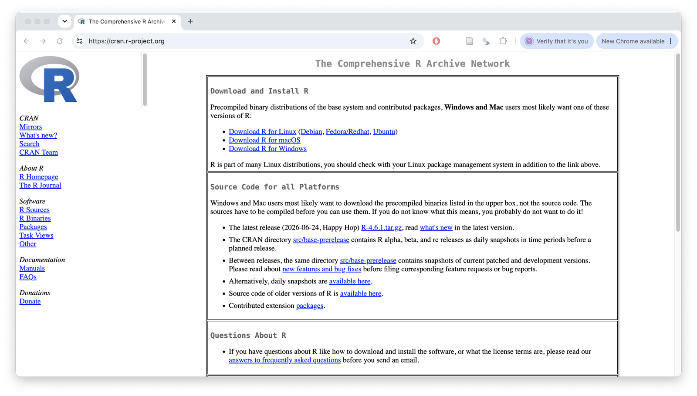

::: panel-tabset
## Windows

1.  On the 'R for Windows' page, click **base** (or **install R for the first time**).

    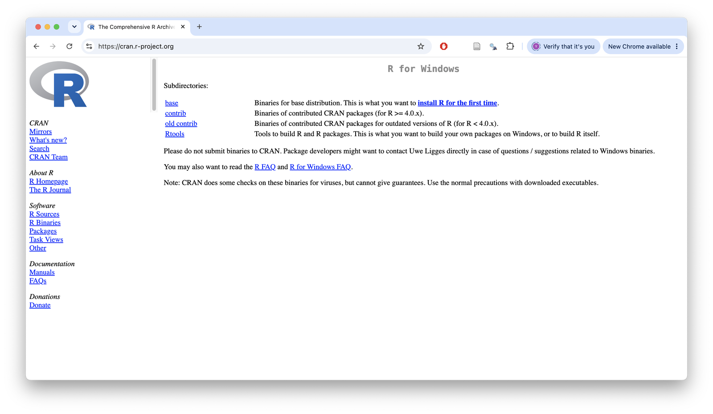

2.  Click the large **Download R-4.x.x for Windows** link at the top of the next page. The numbers will depend on the latest version; always get the latest one.

3.  Open the downloaded file (it's called something like `R-4.x.x-win.exe`) and click through the installer. The default options are all fine, so you can just keep clicking **Next** and then **Finish**.

## macOS

1.  First, check which kind of Mac you have. Click the Apple menu in the top-left corner of the screen, and choose **About This Mac**. If you see **Chip: Apple M1** (or M2, M3, and so on), you have an *Apple silicon* Mac. If you see **Processor: ... Intel**, you have an *Intel* Mac.

2.  On the 'R for macOS' page, under **Latest release**, download the right file for your Mac: the one with **arm64** in its name for Apple silicon, or the one with **x86_64** in its name for Intel.

    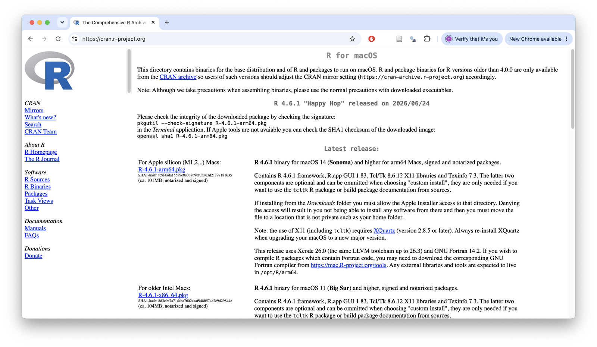

3.  Open the downloaded `.pkg` file and click through the installer, keeping the default options.
:::

You won't open R itself again after this: from now on, RStudio will start it for you.

## Step 2: Install RStudio

Go to <https://docs.posit.co/ide/user/download.html>. The page should detect your computer and show a 'Recommended for you' box, with a button such as **Download for macOS** or **Download for Windows**: click it. (On a Mac, there's only one version, for both Apple silicon and Intel.) If the page offers the wrong version, scroll down to the list of all installers.

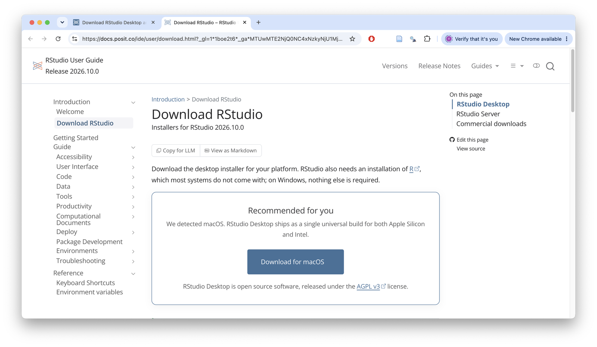

::: panel-tabset
## Windows

Open the downloaded `.exe` file and click through the installer, keeping the default options. RStudio will appear in your Start menu.

## macOS

Open the downloaded `.dmg` file. A window opens with the RStudio icon and a shortcut to your Applications folder: drag the RStudio icon onto the Applications folder.

Then open RStudio **from your Applications folder** (not from the window that opened from the `.dmg`). The first time, macOS will ask whether you're sure you want to open an app downloaded from the internet: click **Open**. You can then eject the RStudio 'disk' in Finder and delete the `.dmg` file.
:::

## Step 3: Open RStudio

Open RStudio. You should see a window divided into three panes. On the left is the **console**, which starts with a message telling you which version of R is running. If you see this, R and RStudio are both installed and talking to each other.

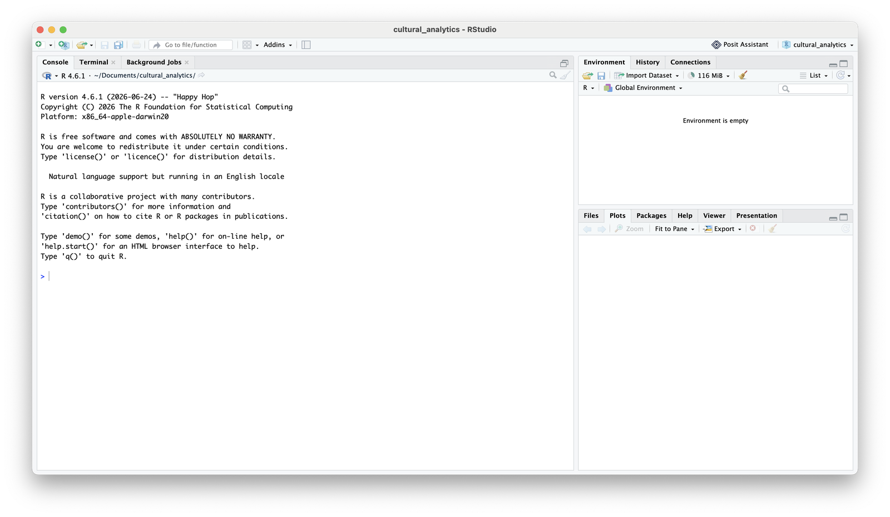

Click in the console, next to the `>` symbol, type `1 + 1`, and press Enter. R should answer with `[1] 2`.

::: callout-tip
If RStudio asks you to choose a version of R, or says it can't find R, then R didn't install properly. Go back to step 1 and run the R installer again, then restart RStudio.
:::

## Step 4: Install the course packages

R comes with a set of basic functions, but most of what we'll do uses *packages*: free add-ons written by other R users. You only need to install each package once on your computer. Copy the following into the console, and press Enter:

``` r
install.packages(c("tidyverse", "rmarkdown", "sf", "rnaturalearth",
                   "rnaturalearthdata", "ggthemes", "patchwork",
                   "palmerpenguins"))
```

This downloads and installs quite a lot of software, so it can take several minutes. Lots of text will scroll past in the console, some of it in red. This is normal: red text in R isn't always an error. Wait until the console shows the `>` symbol again before you do anything else.

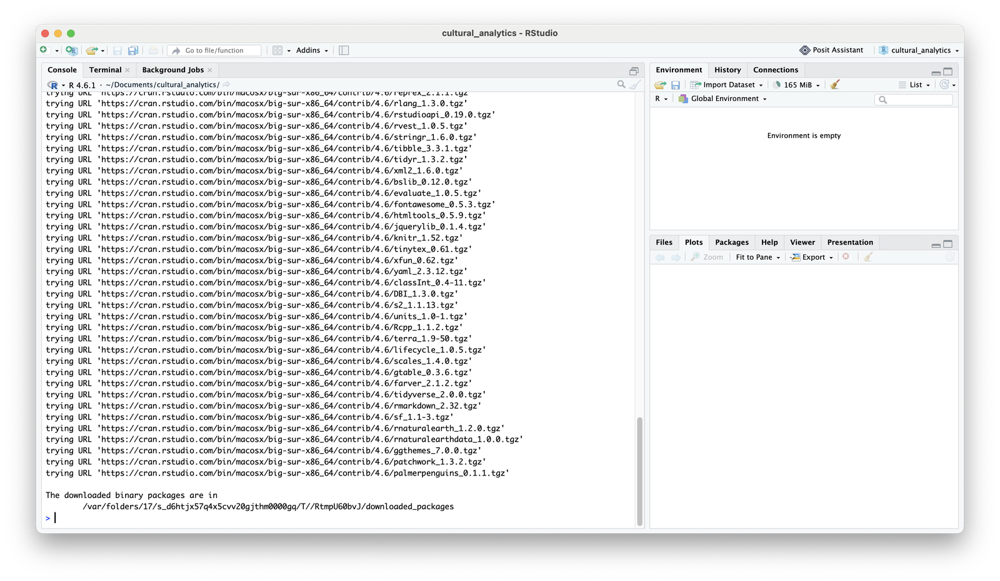

::: callout-warning
## 'Do you want to install from sources?'

At some point R may stop and ask *'Do you want to install from sources the packages which need compilation? (Yes/no/cancel)'*. Type `no` and press Enter. Installing 'from sources' needs extra tools that you don't have, and the version R installs instead works just as well.
:::

To check that it worked, run this in the console:

``` r
library(tidyverse)
```

You should see a short list of packages with tick marks next to them, something like this. If instead you see the error `there is no package called 'tidyverse'`, the installation didn't finish: run the `install.packages()` line again.

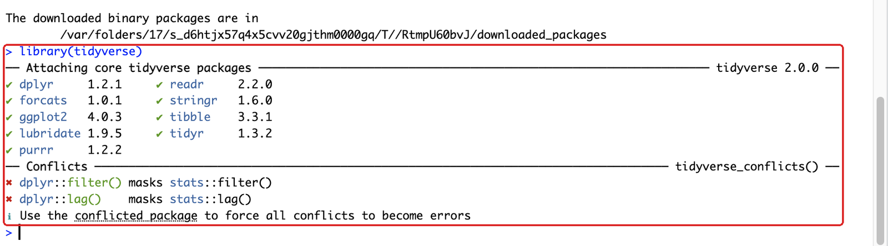

## Step 5: Make a project folder for the course

For this course, you'll keep everything (data, R Markdown files, and the reports you knit) in one folder on your computer. RStudio can manage this folder for you as a **project**. When you work inside a project, R automatically looks for files in that folder, so you can read in a dataset just by giving its file name.

1.  In RStudio, click **File → New Project...**, then **New Directory**, then **New Project**.

    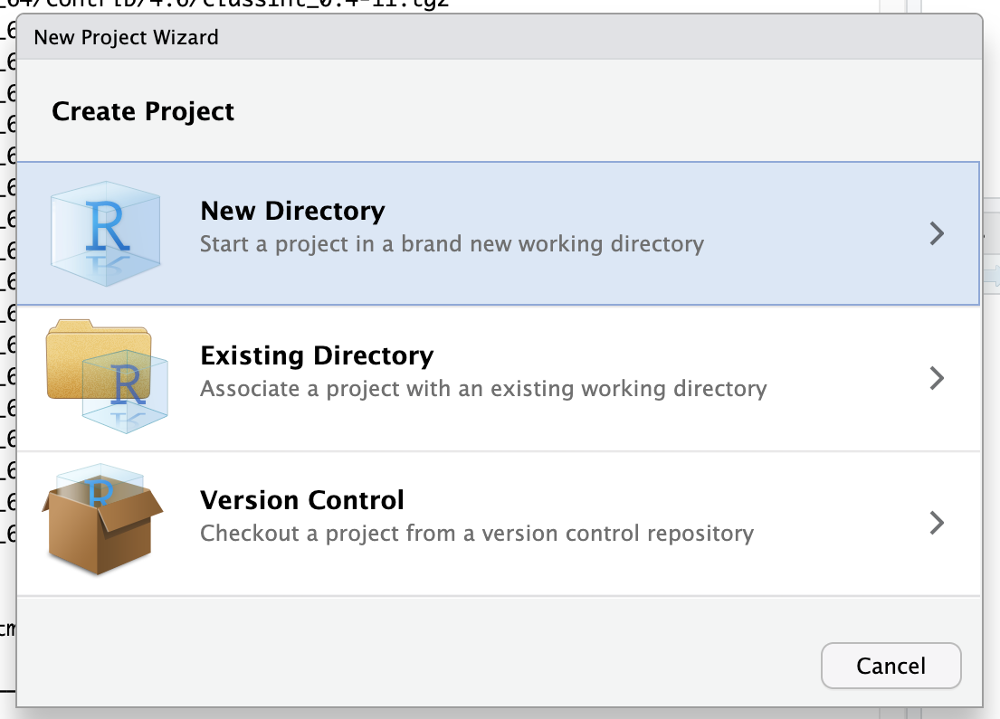{width="500"}

2.  Under **Directory name**, type `cultural_analytics`. Next to **Create project as subdirectory of**, click **Browse...** and choose where to put it, for example your Documents folder. Click **Create Project**.

    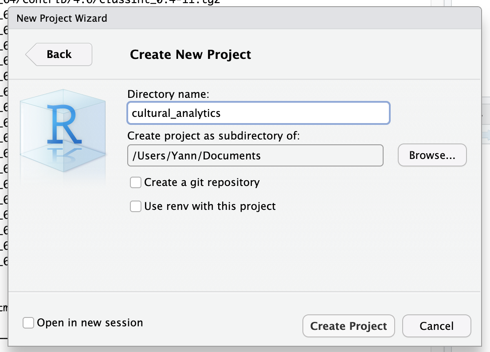{width="500"}

RStudio will restart inside your new project. You can tell, because the project name appears in the top-right corner of the window, and the Files pane (bottom right) shows the contents of your new folder, which for now is just a file called `cultural_analytics.Rproj`.

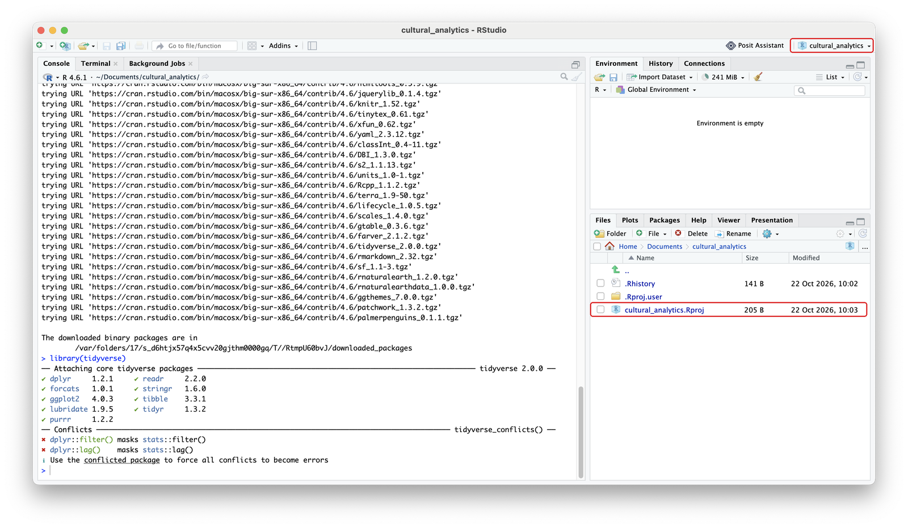

**Whenever you work on this course, open this project first**: either double-click the `cultural_analytics.Rproj` file in the folder, or in RStudio click **File → Open Project...**, or pick it from the menu in the top-right corner. When you download a dataset for an exercise, save it (or move it) into this folder.

::: callout-tip
It's best to make this folder somewhere that *isn't* synced by OneDrive, iCloud Drive, Dropbox or Google Drive. Syncing software sometimes locks files while R is using them, which can cause strange errors. Keep your own backup copy of your work somewhere else instead.
:::

## Step 6: Change one setting

By default, RStudio saves everything you've created in a session, and quietly loads it again the next time you open it. This sounds helpful, but it means your code can end up relying on things you made earlier and then deleted from your file - and then the same code fails when you knit it, or when someone else runs it. It's better to start each session fresh.

Click **Tools → Global Options...**. On the **General** page:

-   untick **Restore .RData into workspace at startup**
-   set **Save workspace to .RData on exit** to **Never**

Then click **OK**.

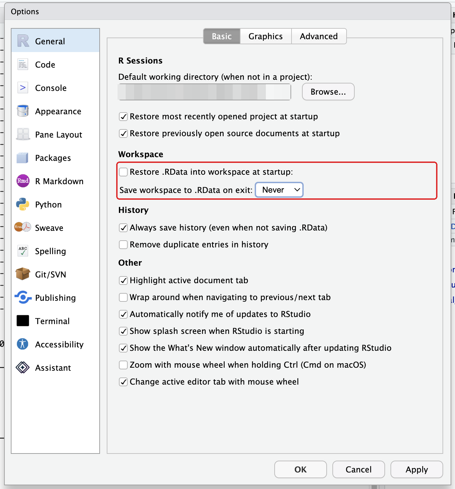{width="500"}

## Check that everything works

Finally, copy this code into the console and press Enter. It loads the packages, and draws a scatter plot and a world map.

``` r
library(tidyverse)
library(sf)
library(rnaturalearth)

ggplot(mpg, aes(x = displ, y = hwy)) + geom_point()
ggplot(ne_countries()) + geom_sf()
```

The charts appear in the **Plots** tab in the bottom-right pane. You'll see the map first: click the left arrow at the top of the Plots tab to go back to the scatter plot. If you can see both, you're ready for the course.

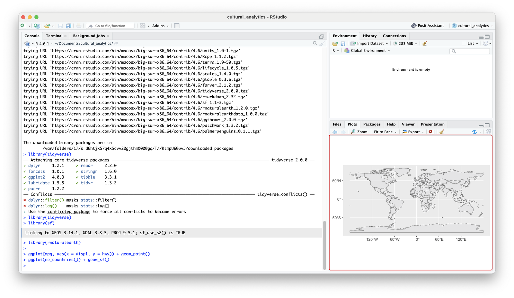

## If something goes wrong

-   **An error that says `there is no package called '...'`.** That package didn't install. Run `install.packages("...")` again, with the package name from the error message, and read the messages in the console to see what went wrong.
-   **A warning that a package 'was built under R version ...'.** You can ignore this. It just means the package was made with a slightly newer version of R than yours. It still works.
-   **A warning that 'Rtools is required to build R packages'** (Windows). You can ignore this. You only need Rtools to install packages 'from sources', which you don't need to do.
-   **You already had R or RStudio installed.** Check the version: the first line of the console message when you open RStudio says which version of R you have. If it's more than about a year old, install the latest version over it, following the steps above, and then install the packages again.
-   **Something else.** Copy the exact error message, or take a screenshot of the whole RStudio window, and bring it to the first class or post it on Brightspace. Searching the web for the exact error message often helps too.

## Before the first class

-   [ ] R is installed
-   [ ] RStudio is installed and opens, and `1 + 1` gives `[1] 2` in the console
-   [ ] the course packages are installed, and `library(tidyverse)` works
-   [ ] you have a `cultural_analytics` project and know how to open it
-   [ ] the test plots draw in the Plots tab
