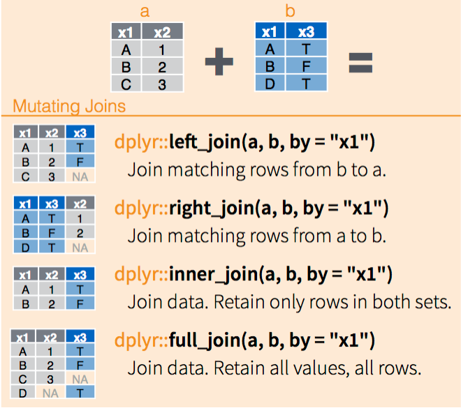
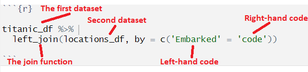

```{webr-r}
#| context: setup

library(dplyr)
library(readr)

url <- "https://raw.githubusercontent.com/yann-ryan/infovis-course/master/titanic_df_full.csv"
download.file(url, "titanic_df.csv")

titanic_df =  read_csv('titanic_df.csv')

locations_df = tribble(
  ~code, ~location_name, ~country,  ~lat, ~lng,
  "Q",   "Queenstown", "Ireland", 51.85, -8.29,
  "S",   "Southampton", "United Kingdom", 50.9, -1.4,
  "C",   "Cherbourg", "France", 49.63, -1.62
)

# the same table, but with Southampton listed twice
locations_twice = tribble(
  ~code, ~location_name,      ~country,
  "Q",   "Queenstown",        "Ireland",
  "S",   "Southampton",       "United Kingdom",
  "S",   "Southampton Docks", "United Kingdom",
  "C",   "Cherbourg",         "France"
)
```

### left_join(), right_join(), inner_join()

Another set of commands we'll use quite often in this course are the `join()` 'family'. Joins are a very powerful but simple way of selecting certain subsets of data, and adding information from multiple tables together.

Remember the titanic dataset had a column 'embarked', which contained either Q, S or C, which told where the passenger got on?

Let's say we wanted to display the full name of the embarking location, plus some other information. We have another dataset, called locations_df, which contains the code and the equivalent full name, plus the country name and coordinates of the location. You can see what this looks like by running the cell below:

```{webr-r}

locations_df

```

We can combine these two tables of information, so that they are merged, or joined together - the result will be that the correct extra information for each place code will be added to the titanic_df data.

This is done using a set of functions called joins.

::: callout-tip
Joining, or using relational data, is a really fundamental concept to many programming languages and data models. Excel has a similar feature which they call *pivot tables*. Even if you never use R or make a visualisation again, understanding the principles behind this is incredibly useful if you ever work with data in your future career.
:::

In R, we can do these joins using the functions `left_join()`, `right_join()` and `inner_join()`. These are variations on the same thing, and they differ by the way that they merge the two datasets together.



Joins need a common **key**, a column which allows the join to match the data tables up. It's important that these are unique (a person's name makes a bad key by itself, for example, because it's likely more than one person will share the same name). Usually, we use codes as the join keys. If the columns containing the join keys have different names (as ours do), specify them using the syntax below:

```{webr-r}

titanic_df |>
  left_join(locations_df, by = c('embarked' = 'code'))

```

The join function is a bit complex, so it's worth looking at what it is doing.



### Check the number of rows

`titanic_df` has 1,309 rows. How many rows does the joined table have? Predict first, then check with `nrow()`:

```{webr-r}
joined = titanic_df |>
  left_join(locations_df, by = c('embarked' = 'code'))

nrow(joined)
```

Still 1,309. A left join keeps every row of the left table, exactly once, as long as each key appears only once in the right table. The two passengers with no port are kept too: they just get `NA` in the new columns. Checking the number of rows before and after a join is the most important habit to get into.

### Left, right and inner joins

What happens if the second table has no row for one of the codes? Here we remove Queenstown from `locations_df`, and then try a `left_join()` and an `inner_join()`:

```{webr-r}
no_queenstown = locations_df |> filter(code != 'Q')

titanic_df |> left_join(no_queenstown, by = c('embarked' = 'code')) |> nrow()
titanic_df |> inner_join(no_queenstown, by = c('embarked' = 'code')) |> nrow()
```

-   `left_join()` keeps every row of the left (first) table. Passengers from Queenstown are still there, with `NA` in the new columns.
-   `inner_join()` keeps only the rows that have a match in both tables. The 123 passengers from Queenstown, and the 2 with no port, are gone: 1,184 rows. This means an inner join is also a way of filtering one table by another.
-   `right_join()` keeps every row of the right (second) table.

### Join keys must be unique

What if the key appears more than once in the table you join in? In the table `locations_twice`, Southampton has been entered twice. Run the join and check the rows:

```{webr-r}
titanic_df |>
  left_join(locations_twice, by = c('embarked' = 'code')) |>
  nrow()
```

Every Southampton passenger matched **two** rows, so they now appear twice: 1,309 + 914 = 2,223 rows. Any count or sum you calculated after this would be wrong, without an error. R does give a warning ("many-to-many relationship"), but only if you read it. This is why names make bad keys: two different people can share one. To check a key for duplicates before you join, count it and keep anything that appears more than once:

```{webr-r}
locations_twice |>
  count(code) |>
  filter(n > 1)
```

## Exercises

-   Join the two tables, then calculate the number of men and women who embarked from each **country**.

```{webr-r}

```

-   What share of the passengers from each country survived? (Remember from Data Analysis 2: `survived` is 1 or 0, so `mean(survived)` is the share who survived.) Why do you think the passengers who boarded in France did so much better? Think back to the average fare at each port.

```{webr-r}

```

## Learning Objectives

Before moving on, take a look and see if you are confident with all of the following learning objectives. If anything is unclear, try to go back over the material, or make a note and ask in our next class!

(the checkboxes are just for your own use, they won't save if you leave or refresh the page)

-   [ ] Understand what a join is, and why it needs a common 'key' column
-   [ ] Use `left_join()` to merge two dataframes together
-   [ ] Join on columns which have different names in each dataframe
-   [ ] Check the number of rows before and after a join
-   [ ] Know the difference between `left_join()`, `right_join()` and `inner_join()`
-   [ ] Check that a join key is unique, using `count()` and `filter()`
