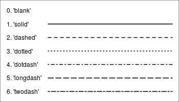
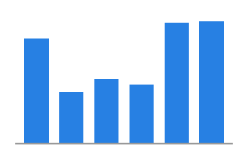
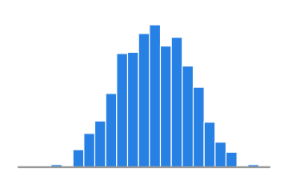
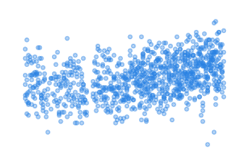
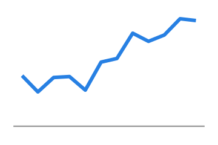
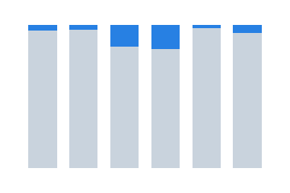
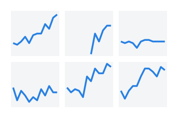
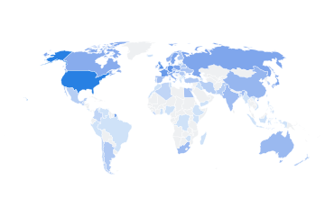

```{webr-r}
#| context: setup
library(readr)
library(dplyr)
library(stringr)

url1 <- "https://raw.githubusercontent.com/yann-ryan/infovis_data/main/nobel/laureates_df.csv"
download.file(url1, "laureates_df.csv")
laureates_df <- read_csv('laureates_df.csv')

url2 <- "https://raw.githubusercontent.com/yann-ryan/infovis_data/main/nobel/prize_df.csv"
download.file(url2, "prize_df.csv")
prize_df <- read_csv('prize_df.csv')

nobel_df <- laureates_df |>
  left_join(prize_df, by = 'prize_id') |>
  mutate(birth_year = as.numeric(str_sub(birth_date, 1, 4)),
         age_at_award = award_year - birth_year)

nobel_summary <- nobel_df |>
  group_by(category) |>
  summarise(n = n(),
            pct_female = mean(gender == 'female', na.rm = TRUE) * 100,
            avg_age = mean(age_at_award, na.rm = TRUE))

```

## What other charts can we make?

To demonstrate the basic range of charts we can create, we'll use the Nobel Prize dataset from the last page: `nobel_df` has one row per laureate, and `nobel_summary` has one row per prize category, with the count of laureates, the percentage who were women, and the average age at the time of the award.

```{webr-r}

nobel_df

```

## Controlling aesthetics

To draw other chart types, we replace the geometry `geom_col` with others. In some cases, we will also change or add aesthetics.

Each chart type is followed by examples of the typical aesthetics which can be used with that geometry.

## Where should this code be placed?

As we learned in the previous section, we can place an aesthetic either within `aes()` or outside it:

-   When we specify an aesthetic *within* `aes()`, we ask for variables from our dataset to be mapped to it. It is best to include the aes() within the `ggplot()` function, though it can also be placed within the `geom_` function.

-   When we specify an aesthetic not within an `aes()`, it is used to map to specific values, such as setting all the points in a chart to blue. When using aesthetics like this, they should always be placed within the `geom_` function.

For each aesthetic, there is an example where the aesthetic is placed within the `aes()` and outside it, to show the difference.

## Geom_point()

`geom_point()` places points on a 2D plane. It requires at least `x` and `y` coordinates within the `aes()`. The result is often called a 'scatterplot' or sometimes a 'bubble chart'.

```{webr-r}

nobel_summary |>
ggplot(aes(x = avg_age, y = pct_female)) +
  geom_point()

```

### Key aesthetics

#### Size

We can optionally set the `size` variable.

Outside the aes()

```{webr-r}

nobel_summary |>
ggplot(aes(x = avg_age, y = pct_female)) +
  geom_point(size = 5)

```

**Try it yourself:** copy and paste the chart below, and set the size variable to 10.

Inside the aes()

```{webr-r}

nobel_summary |>
ggplot(aes(x = avg_age, y = pct_female, size = n)) +
  geom_point()

```

**Try it yourself:** make a new version of the plot. Set the number of laureates (`n`) to the x axis, the percentage of women (`pct_female`) to the y axis, and the average age (`avg_age`) to the size variable.

```{webr-r}

```

#### Colour

and/or the `colour` variable:

```{webr-r}

nobel_summary |>
ggplot(aes(x = avg_age, y = pct_female, size = n)) +
  geom_point(color = 'red')


```

```{webr-r}

nobel_summary |>
ggplot(aes(x = avg_age, y = pct_female, size = n,color = category)) +
  geom_point()


```

**Try it yourself:** create a plot with the points all the same colour: `forestgreen`. You need to choose where the aesthetic should go, out of the two examples above!

```{webr-r}

```

#### Alpha

Alpha sets the transparency, a number between 0 and 1:

```{webr-r}
nobel_summary |>
ggplot(aes(x = avg_age, y = pct_female, size = n,color = category)) +
  geom_point(alpha = .5)
```

#### Shape

Or the shape. There is a set of numeric codes to select specific shapes. Here is the full set:

{width="300"}

```{webr-r}
nobel_summary |>
ggplot(aes(x = avg_age, y = pct_female, size = n)) +
  geom_point(shape = 2)
```

```{webr-r}
nobel_summary |>
ggplot(aes(x = avg_age, y = pct_female, size = n,shape = category)) +
  geom_point()
```

::: {.callout-tip}
## More on shapes

Notice that shapes 21 through 25 are blue with a black outline? Using these allows you to set the outline and the fill of a shape separately. If you set the shape to one of these, you can now use `colour =` to set the outline and `fill =` to set the inside colour, resulting in a 'bubble chart'.

```{webr-r}

nobel_summary |>
ggplot(aes(x = avg_age, y = pct_female, size = n, fill = category), color = 'black') +
  geom_point(shape = 21)

```
:::

#### Use

Scatterplots are often used to show relationships between variables, like the link between average age and gender balance shown here: the categories which tend to honour older laureates also tend to have the lowest share of women.

## Geom_line

geom_line will draw a line between points in numerical order.

```{webr-r}
nobel_df |>
  filter(category == 'Physics') |>
  mutate(decade = floor(award_year / 10) * 10) |>
  count(decade) |>
  ggplot(aes(x = decade, y = n)) +
  geom_line()
```

**Try it yourself:**

Draw a similar plot, for a prize category in the dataset of your choice.

```{webr-r}

```


### Key aesthetics


#### Colour

You can set line colour:

::: callout-tip
You can choose from a huge number of colours in your charts. A lot of colours have specific names, which are all listed [here](https://r-charts.com/colors/). Alternatively, you can choose colours using HEX codes: put \# before the code and add it as normal.
:::

```{webr-r}
nobel_df |>
  filter(category == 'Physics') |>
  mutate(decade = floor(award_year / 10) * 10) |>
  count(decade) |>
  ggplot(aes(x = decade, y = n)) +
  geom_line(color = 'forestgreen')
```

```{webr-r}
nobel_df |>
  mutate(decade = floor(award_year / 10) * 10) |>
  group_by(decade, category) |>
  summarise(n = n(), .groups = 'drop') |>
  ggplot(aes(x = decade, y = n, color = category)) +
  geom_line()
```

::: callout-note
To set the colours for these categories individually we can use a custom colour scale, which we'll cover next week.
:::

**Try it yourself:** choose a subset of the six categories. Chart the total prize money awarded (`amount_adjusted`, summed) per decade, with each category having a different colour.

#### Linetype

Linetype can be set using a set of codes. Here are the main ones:



```{webr-r}
nobel_df |>
  filter(category == 'Physics') |>
  mutate(decade = floor(award_year / 10) * 10) |>
  count(decade) |>
  ggplot(aes(x = decade, y = n)) +
  geom_line(linetype = 'dashed')
```

```{webr-r}
nobel_df |>
  mutate(decade = floor(award_year / 10) * 10) |>
  group_by(decade, category) |>
  summarise(n = n(), .groups = 'drop') |>
  ggplot(aes(x = decade, y = n, linetype = category)) +
  geom_line()
```

#### Use

Line graphs are usually used to show something changing over time. Because a line is drawn connecting each data point to the next one, we assume that one follows another in a logical sequence.

## Multiple geoms

You can stack multiple geoms on top of each other, just add them using another `+`:

```{webr-r}
nobel_df |>
  filter(category == 'Physics') |>
  mutate(decade = floor(award_year / 10) * 10) |>
  count(decade) |>
  ggplot(aes(x = decade, y = n)) +
  geom_line() +
  geom_point()
```

**Try it yourself:**

Draw a chart combining a bar and a line plot, using a prize category of your choice.

```{webr-r}


```

## Other geoms

## Statistical chart types

### geom_histogram

A histogram is a chart which plots the *distribution* of a set of values as a series of bars. Each bar represents a 'bin' or range of values, with the height of the bar indicating how many of the values are within that bin.

We could use it to plot the distribution of the age at which laureates received their prize, for example:

```{webr-r}

nobel_df |>
  ggplot(aes(x = age_at_award)) + geom_histogram()

```

The code for a histogram looks a little different than usual. We only set the `x` variable - the y position will be automatically calculated when it does the statistical transformation.

Second, you'll notice a message underneath the plot: `` `stat_bin()` using `bins = 30`. Pick better value with `binwidth`. `` Ggplot automatically divides the data into 30 equal-sized bins by default, but this is often not the clearest way to represent the distribution. We can choose either another number of bins with the argument `bins =`, or choose how big each range should be with the code `binwidth =`.

```{webr-r}

nobel_df |>
  ggplot(aes(x = age_at_award)) +
  geom_histogram(binwidth = 5)

```

### geom_density

Another way to show distributions of values is using geom_density:

```{webr-r}
nobel_df |>
  ggplot(aes(x = age_at_award)) +
  geom_density( )
```

### geom_boxplot

geom_boxplot shows distributions:

```{webr-r}
nobel_df |>
  filter(!is.na(age_at_award)) |>
  ggplot(aes(x = category, y = age_at_award, group = category)) +
  geom_boxplot()
```

A boxplot visualises the distribution of numbers (in this case, the age at which laureates in each category received their prize). The middle line is the median (the middle value, if you lined all the values up in order). The upper and lower ends of the box are the 25th and 75th percentiles, so the box contains the middle half of the values, and the dots (if any) show outliers.

This particular plot shows that Economic Sciences laureates tend to be the oldest on average and Physics laureates the youngest, while Peace laureates have by far the widest spread of ages (befitting a prize given to activists, politicians, and organisations alike, rather than for a single, slow-to-mature body of scientific work).

geom_boxplot has many attributes which can be changed, determining how the statistics are visualised. You can see these by typing `?geom_boxplot` in the console.

### Special case: geom_text

Geom_text will actually add the text from a column to a visualisation. This is useful if we want to label the chart itself with some values (we'll learn better ways to annotate later in the course).

geom_text() works like any other geometry, except we must supply it with a `label` aesthetic:

```{webr-r}

nobel_summary |>
  ggplot(aes(x = category, y = avg_age)) +
  geom_col() +
  geom_text(aes(y = avg_age + 2, label = round(avg_age)))

```

Why have I used `+ 2` and `round()` here?

### Shapes: geom_polygon, geom_segment, geom_rect

As well as these geoms which create recognisable chart types, it's also useful to know that you can essentially create almost anything by using ggplot to draw shapes either with data or with absolute values. For example, you can make a 'lollipop chart' with a combination of `geom_segment` and `geom_point`, such as here to show the growth in the number of laureates per category between the 1950s and the 2010s:

```{webr-r}
nobel_df |>
  mutate(decade = floor(award_year / 10) * 10) |>
  filter(decade %in% c(1950, 2010)) |>
  count(decade, category) |>
  pivot_wider(names_from = decade, values_from = n, values_fill = 0) |>
  ggplot(aes(x = category, xend = category, y = `1950`, yend = `2010`)) +
  geom_segment() +
  geom_point(size=3) +
  geom_point(aes(y = `2010`), size=3)+
  coord_flip()
```

Note that geom_segment needs `xend` and `yend`, as well as `x` and `y`. These shapes often have different required aesthetics.

## Small multiples with facet_wrap()

Earlier, we drew the number of laureates per decade for all six prize categories on one chart, with a different colour for each line. Here it is again:

```{webr-r}
nobel_df |>
  mutate(decade = floor(award_year / 10) * 10) |>
  group_by(decade, category) |>
  summarise(n = n(), .groups = 'drop') |>
  ggplot(aes(x = decade, y = n, color = category)) +
  geom_line()
```

Six lines is already quite hard to read: they cross over each other, and you have to keep looking back and forth to the legend to work out which is which.

An alternative is to draw **small multiples**: a series of small charts, one for each category, side by side. ggplot2 does this with `facet_wrap()`. Add it to the end of the chart, with a `~` (a tilde) followed by the name of the column you want to split the chart by:

```{webr-r}
nobel_df |>
  mutate(decade = floor(award_year / 10) * 10) |>
  group_by(decade, category) |>
  summarise(n = n(), .groups = 'drop') |>
  ggplot(aes(x = decade, y = n)) +
  geom_line() +
  facet_wrap(~ category)
```

Small multiples work well for two reasons:

-   **The viewer only needs to learn to read one chart.** Once they've understood the first panel, they can read all the others in the same way.
-   **Every panel uses the same scales.** Because the axes are the same, you can compare the panels directly: it's easy to see that Physics, Chemistry and Medicine have grown much more than Literature or Peace, which have stayed at about one laureate a year.

Notice too that every line drops sharply at the end. That isn't a real decline: the 2020s aren't over yet, so the last decade only has a few years of data. It's a good example of why you should always check what a chart is actually showing before you interpret it.

Notice that we no longer need colour or a legend: each panel is labelled with its category instead. That leaves colour free to show something else.

`facet_wrap()` works with any chart type. Here's a histogram of the age at which laureates won their prize, split by category, so that we can compare the distributions:

```{webr-r}
nobel_df |>
  ggplot(aes(x = age_at_award)) +
  geom_histogram(binwidth = 5) +
  facet_wrap(~ category)
```

You can choose the number of columns (or rows) with `ncol =` (or `nrow =`). For example, `facet_wrap(~ category, ncol = 1)` puts all the panels in a single column, one above the other, which makes the distributions easier to compare along the age axis:

```{webr-r}
nobel_df |>
  ggplot(aes(x = age_at_award)) +
  geom_histogram(binwidth = 5) +
  facet_wrap(~ category, ncol = 1)
```

::: callout-warning
## Free scales

By default, every panel has the same axes. You can let each panel have its own y axis with `facet_wrap(~ category, scales = 'free_y')`. This can be useful if some groups are much smaller than others, and you're interested in the *shape* of each line rather than its size. But be careful: with free scales, panels which look similar might represent very different numbers, and the viewer can no longer compare them directly. If you use them, make sure the reader can tell.
:::

**Try it yourself:** make a scatterplot of the age at award (`age_at_award`) against the year of the award (`award_year`), with a separate panel for each `gender`. Are women laureates getting older or younger over time?

```{webr-r}

```

## Choosing a chart: what am I trying to show?

You've now seen most of the basic chart types. But how do you choose between them?

The answer depends on two things. The first is the **type of data** you have: whether your variables are continuous, discrete, categorical, or ordinal (see [Data Visualisation Basics](22_data-visualisation-1.qmd#discrete-vs-continuous-aesthetics)). Some aesthetics and chart types only work with one or the other.

The second, and more important, is **what you are trying to show**: what is the story in the data, or the question you want to answer? Most charts are trying to show one of a small number of things. The cards below show the most common, with an example question from the Nobel data and the chart types (and geoms) you could use:

::: {.grid .chart-chooser}

::: {.g-col-6 .g-col-lg-3 .chart-card}
{fig-alt="Bar chart of the number of laureates in each of six categories"}

[Amounts]{.chart-card-title}

*How many laureates are there in each category?*

Bar chart: `geom_col()`, `geom_bar()`
:::

::: {.g-col-6 .g-col-lg-3 .chart-card}
{fig-alt="Lollipop chart with six categories ordered from highest to lowest value"}

[Ranking]{.chart-card-title}

*Which category has the oldest laureates?*

Ordered bar or lollipop chart: `geom_col()`, `geom_segment()` + `geom_point()`
:::

::: {.g-col-6 .g-col-lg-3 .chart-card}
{fig-alt="Histogram of laureates' ages at the time of their award"}

[Distribution]{.chart-card-title}

*How old are laureates when they win?*

Histogram, density plot, boxplot: `geom_histogram()`, `geom_density()`, `geom_boxplot()`
:::

::: {.g-col-6 .g-col-lg-3 .chart-card}
{fig-alt="Scatterplot of laureates' age at award against the year of the award"}

[Relationship]{.chart-card-title}

*Are laureates getting older over time?*

Scatterplot: `geom_point()`
:::

::: {.g-col-6 .g-col-lg-3 .chart-card}
{fig-alt="Line chart of the number of laureates per decade, rising over time"}

[Change over time]{.chart-card-title}

*How has the number of laureates changed by decade?*

Line chart, bar chart: `geom_line()`, `geom_col()`
:::

::: {.g-col-6 .g-col-lg-3 .chart-card}
{fig-alt="Stacked bar chart showing the small share of women in each prize category"}

[Part-to-whole]{.chart-card-title}

*What share of each category's laureates are women?*

Stacked bar chart: `geom_col(position = 'fill')`
:::

::: {.g-col-6 .g-col-lg-3 .chart-card}
{fig-alt="Six small line charts, one per prize category, on the same scales"}

[Comparison across groups]{.chart-card-title}

*Has each category grown in the same way?*

Small multiples: `facet_wrap()`
:::

::: {.g-col-6 .g-col-lg-3 .chart-card}
{fig-alt="World map shaded by the number of laureates born in each country"}

[Spatial]{.chart-card-title}

*Where were laureates born?*

Map: `geom_sf()` (weeks 5-6)
:::

:::

The *Financial Times* has a very useful poster, the [Visual Vocabulary](https://ft-interactive.github.io/visual-vocabulary/), which does the same thing in much more detail, with dozens of chart types arranged by what they show. It's worth keeping open while you plan your reports.

One chart type here is new: the **stacked bar chart**, used to show proportions. Map a category to the `fill` aesthetic, and add `position = 'fill'` to `geom_col()`. Each bar is then stretched to the same height, so that the y axis shows the proportion (from 0 to 1) rather than the count:

```{webr-r}
nobel_df |>
  count(category, gender) |>
  ggplot(aes(x = category, y = n, fill = gender)) +
  geom_col(position = 'fill')
```

Try removing `position = 'fill'` and running the code again. What's the difference, and which chart better answers the question 'what share of each category's laureates are women'?

::: callout-tip
## Before you make a chart, ask...

1.  What is my question, or the story I want to tell?
2.  Which of the things in the cards above am I trying to show?
3.  What type of data are the variables involved?
4.  Which chart type, and which aesthetics, fit both?

If you can't answer the first question, no chart type will help!
:::

## Check your understanding

**1.** A student wants to show how the number of pages in published novels is spread out: are most novels about the same length, or are there lots of very short and very long ones? Which chart types would be suitable, and which geoms would they use?

::: {.callout-tip collapse="true"}
## Answer

This is a question about a **distribution** of a continuous variable. A histogram (`geom_histogram()`) or density plot (`geom_density()`) would show the shape of the distribution. A boxplot (`geom_boxplot()`) would also work, and would be particularly useful for comparing the distribution between groups, for example novels from different decades.
:::

**2.** A chart shows the number of books published each year from 1800 to 1900, for eight different countries, as eight coloured lines on one chart. The lines overlap and are hard to tell apart. What one line of code could you add to make it clearer, and what else would you change?

::: {.callout-tip collapse="true"}
## Answer

Add `facet_wrap(~ country)` to make small multiples: one small line chart per country. You could then remove `color = country` from the `aes()`, because each panel is already labelled with its country, so the colour and the legend are no longer needed.
:::

## Add-ons

Another way to get the chart type you want is to install additional packages which use the same 'grammar of graphics' to extend ggplot. You can make animated plots using `gganimate`, networks using `ggraph`. Later in the course we will create maps with a geom called `geom_sf`. There are hundreds of these add-ons, which you can browse [here](https://exts.ggplot2.tidyverse.org/gallery/).

## Learning Objectives

Before moving on, take a look and see if you are confident with all of the following learning objectives. If anything is unclear, try to go back over the material, or make a note and ask in our next class!

(the checkboxes are just for your own use, they won't save if you leave or refresh the page)

-   [ ] Draw a scatterplot with `geom_point()`, and control size, colour, alpha, and shape
-   [ ] Draw a line chart with `geom_line()`, and control colour and linetype
-   [ ] Draw a histogram, density plot, and boxplot to show a distribution
-   [ ] Use `geom_text()` to label a chart with values
-   [ ] Combine more than one geom on the same chart
-   [ ] Use `facet_wrap()` to make small multiples, and explain when they are clearer than one chart
-   [ ] Choose a chart type based on what you want to show (amounts, ranking, distribution, relationship, change over time, part-to-whole, comparison, spatial)
-   [ ] Make a stacked bar chart of proportions with `position = 'fill'`
