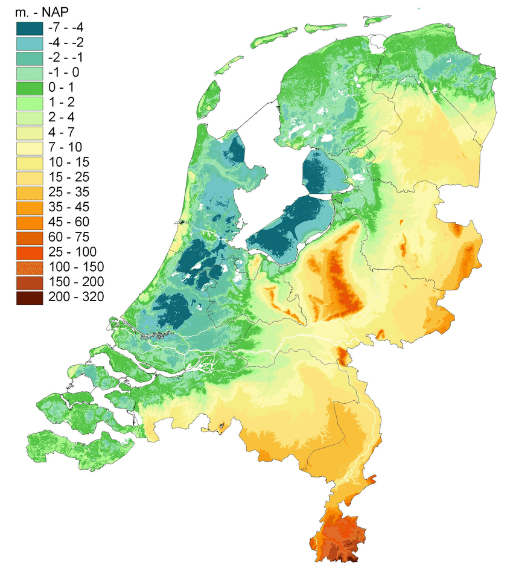
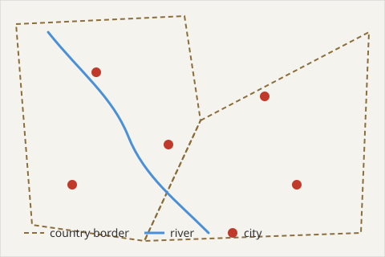
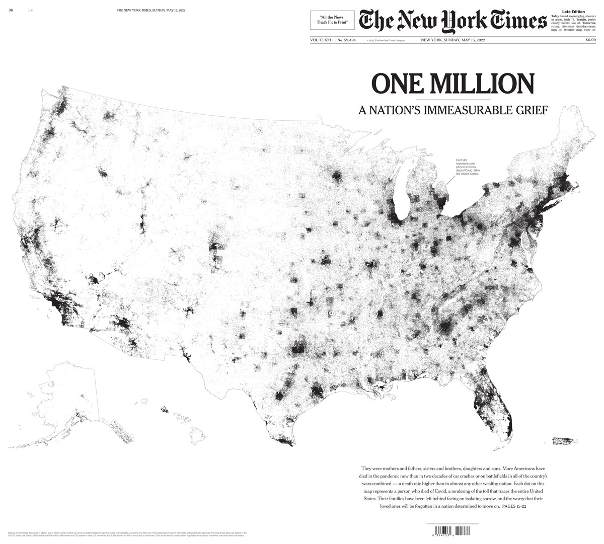
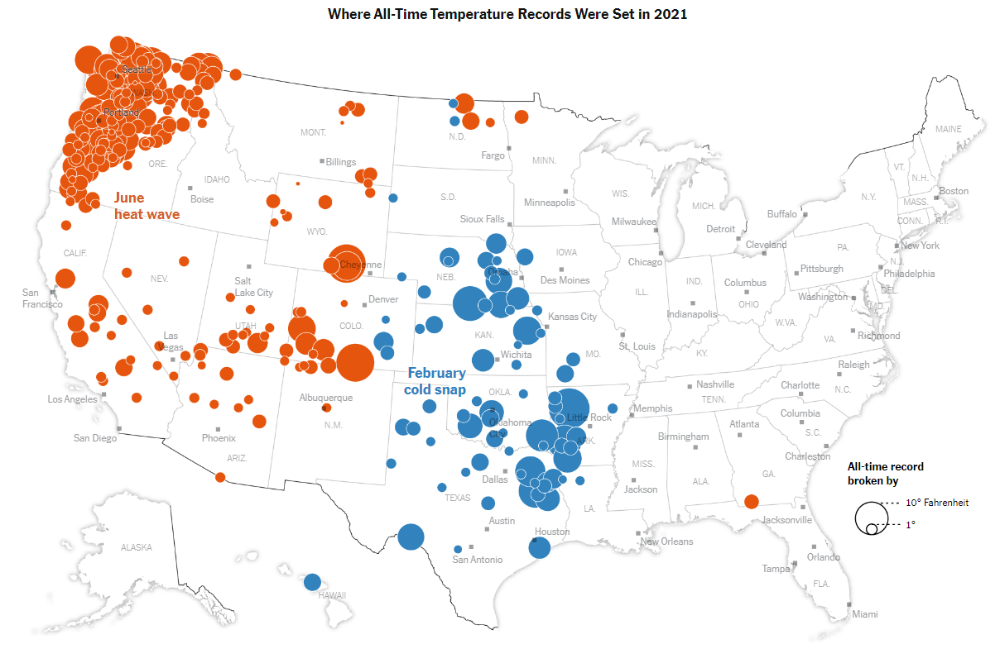
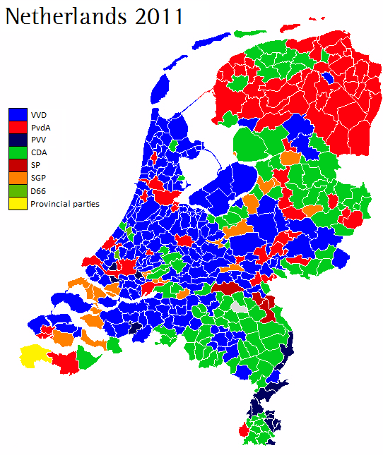
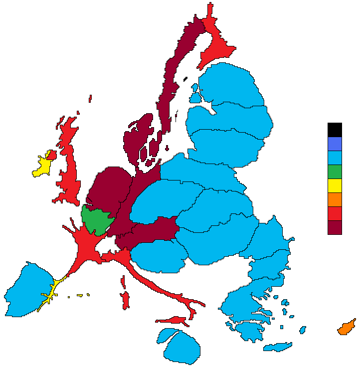

[{fig-align="center"}](https://xkcd.com/1472/)

In this last part of the course, we'll learn how to make maps. More specifically, we'll make maps which visualise data: maps in which geographic elements, such as points and shapes, are drawn according to some cultural, historical or political data. These kinds of maps have become very familiar in digital history, data journalism and infographics.

The good news is that you already know almost everything you need. A map is just another kind of data visualisation, and we'll make them with the same tool we've been using all along: **ggplot2**. The main new thing is a special kind of data, which knows about geography.

Over the next three classes, we'll work through three stages:

1.  **Your first map** (this class): drawing a map with ggplot2, colouring it by some data, zooming in, and choosing a map projection.
2.  **Choropleth maps** (next class): joining your own dataset to a map, and colouring regions by it.
3.  **Points maps** (the class after that): turning coordinates into points on a map.

Throughout, we'll use one running example: the **UNESCO World Heritage List**, a list of around 1,200 places judged to be of 'outstanding universal value' to humanity, from the pyramids of Giza to the canal ring of Amsterdam. As we'll see, *where* these sites are is just as interesting as *what* they are.

## Why make a map?

Maps are useful because some information has inherently spatial aspects - *where* the data is from is as important as *what*. We might want to understand geographic patterns of a phenomenon, for instance how language is used in different regions, or where cultural institutions are concentrated.

A map can also be a useful cognitive shortcut. Because we all have models of maps in our heads already (think about how you know roughly where the provinces of the Netherlands or the major cities of Europe are), we can often grasp a lot of information very quickly. If you know the rough positions of the provinces of the Netherlands, you will probably understand some data about them more quickly as a map than as a table.

Data maps also help us see patterns which are specifically geographic: that something is more common on coasts, in cities, or in particular regions, or that there are differences between the centre and the periphery.

But a map is not always the best choice. If the question you're asking isn't really about geography, a simple bar chart is often clearer. Ask yourself: *does location actually matter here?*

## How computers store maps

There are two common ways of representing the real world as data: **raster** and **vector** maps. On this course we'll work only with vector maps, but it's useful to know the difference.

### Raster maps

A raster map represents the world as a grid of pixels, like a digital photograph. Each pixel is coloured, and the colour means something. A scan of a historical map is a raster map; so is an elevation map, in which each pixel is coloured by the height of the land at that point:

{width="360" fig-alt="An elevation map in which each pixel is shaded according to the height of the land."}

### Vector maps

A vector map instead represents geographic things as **points**, **lines**, and **polygons** (shapes), each stored as a set of coordinates. A city might be a point, a river a line, and a country a polygon. Unlike a raster map, a vector map knows that a certain shape is 'the Netherlands', so we can attach data to it - its population, its number of World Heritage sites, and so on. This is what makes vector data so useful for data visualisation.

{width="472" fig-alt="A vector map drawn with lines for rivers, points for cities, and polygons for country borders."}

## Maps map data to aesthetics, too

Just as with every other chart on this course, making a data map means mapping data to **aesthetics**. The difference is that *position* is now a real place on the earth, rather than an x and y axis. On top of position, data maps mostly use **colour**, **size**, and **shape**. There are two main kinds:

### Points maps

A points map draws a point at a specific location, such as a town, a building, or an address. This first example simply uses position: each Covid death in the US has been drawn as a single tiny point, and through millions of these points we can see where the death toll was highest.

{width="555" fig-alt="A map of the United States made of millions of tiny black dots, one for each Covid death, densest in the big cities."}

::: callout-note
This map also shows one weakness of points maps: often, a map like this simply shows where people live, rather than revealing anything new. Always ask whether your map is just a population map in disguise!

[{width="400"}](https://xkcd.com/1138/)
:::

We can also map further aesthetics to the points. In this example from the New York Times, each point is a weather station where a temperature record was broken. The colour shows whether it was a heat (red) or cold (blue) record, and the size shows by how much the previous record was broken:

{width="748" fig-alt="A map of the United States with red and blue circles of different sizes, showing where heat and cold records were broken."}

### Choropleth maps

The other main kind of data map colours in **regions** - countries, provinces, municipalities - according to some data. This is called a **choropleth map**. Choropleths are useful when your data isn't about a single point, but about an area. Election maps are a classic example, because votes are counted by region. In this map of the 2011 Dutch provincial elections, each municipality is coloured by the party which won the most votes there:

{width="420" fig-alt="A map of Dutch municipalities, each coloured by the party with the most votes. Much of the map is dark blue, the colour of the VVD."}

### The trouble with choropleths

Choropleths are very common, but they can easily mislead. In the election map above, about half of the map is blue. You might think that the VVD received around half of the votes. In fact, they won about one-fifth.

This is because the map gives every square kilometre the same visual weight, but votes are cast by *people*, not land. The VVD did well in rural areas, which are large but sparsely populated. A good rule in data visualisation is that the same amount of 'ink' should represent the same amount of data - and a choropleth often breaks this rule.

There are two common ways to deal with this:

-   **Normalise the data.** Instead of mapping raw counts (the number of World Heritage sites in a country, say), map a rate: sites per million people, or per square kilometre. Otherwise, big countries will tend to look 'more' of everything. Choosing what to divide by is itself an important decision - we'll come back to this next class.
-   **Distort the map.** A *cartogram* resizes regions according to the data. This example resizes the countries of the EU according to how much they contributed to, or received from, the EU budget per person between 2007 and 2013:

{width="490" fig-alt="A cartogram of the European Union in which countries are stretched or shrunk according to their contribution to the EU budget."}

### Every map is a choice

Maps feel objective - they look like a picture of the world as it is. But every map involves choices: which places to include, which borders to draw (and from which year), which projection to use, which data to show, and what to leave out. Borders themselves are often contested. Keep the *Data Feminism* readings in mind: it's always worth asking who made a map, for what purpose, and whose view of the world it represents.

## Learning Objectives

Before moving on, take a look and see if you are confident with all of the following learning objectives. If anything is unclear, try to go back over the material, or make a note and ask in our next class!

(the checkboxes are just for your own use, they won't save if you leave or refresh the page)

-   [ ] Know the difference between raster and vector maps
-   [ ] Know the difference between a points map and a choropleth map, and when to use each
-   [ ] Explain why choropleth maps can mislead, and how normalising the data helps
-   [ ] Recognise that every map involves choices, and ask whose perspective a map represents
