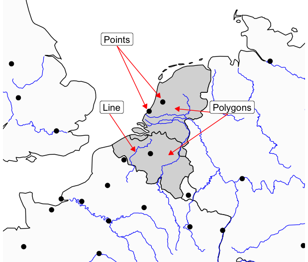

```{webr-r}
#| context: setup

library(dplyr)
library(ggplot2)
library(sf)
library(rnaturalearth)

worldmap <- ne_countries(scale = 'medium', returnclass = 'sf')
```

In this chapter we'll make our first map: a map of the world's countries, drawn with ggplot2. To do this, we need two new packages:

-   **sf**, which lets R work with geographic data.
-   **rnaturalearth**, which downloads ready-made maps from [Natural Earth](https://www.naturalearthdata.com/), a free collection of map data.

```{webr-r}
library(dplyr)
library(ggplot2)
library(sf)
library(rnaturalearth)
```

## Getting a map

The function `ne_countries()` downloads a map of all the world's countries. It needs two arguments:

-   `scale =` sets how detailed the borders are: `'small'` or `'medium'`. (There's also `'large'`, but it needs an extra package and is far more detail than we need.)
-   `returnclass = 'sf'` tells it to give us the map in the format the sf package uses, called **simple features**. We'll always use this.

Save the result as an object, so we can use it later:

```{webr-r}
worldmap <- ne_countries(scale = 'medium', returnclass = 'sf')
```

::: callout-tip
You can also download individual countries, e.g. `ne_countries(country = c('Netherlands', 'Belgium'), scale = 'medium', returnclass = 'sf')`, or a map of coastlines without any borders, with `ne_coastline(scale = 'medium', returnclass = 'sf')`.
:::

## What is a simple features object?

Let's look at the map. It's a big object, so we'll just `select()` a few of its columns:

```{webr-r}
worldmap |>
  select(name, continent, pop_est)
```

It looks very much like the dataframes we've been working with all along. Each row is one country, and there are columns with information about it - its name, continent, population (`pop_est`), and much more. In geographic terms, each row is called a **feature**.

The difference is the extra column at the end: `geometry`. This contains the *shape* of each country, as a long list of coordinates which, joined together, draw its outline. Notice that we didn't ask for the geometry column in `select()`, but it's still there: in an sf object, the geometry 'sticks' to each row, whatever you do to it.

Geometries can be points, lines, or polygons (shapes):

{width="600" fig-alt="Examples of point, line and polygon geometries."}

Above the table, you'll also see a line starting `Geodetic CRS`. This is the map's **coordinate reference system**, which tells R how the coordinates relate to real places on the earth. We'll come back to this in the [chapter on projections](44_projections.qmd).

## Drawing a map with `geom_sf()`

To draw a map, we use ggplot2 exactly as before, with a new geom: `geom_sf()`. Unlike `geom_point()` or `geom_col()`, we don't need to tell it what goes on the x and y axes - it reads the positions from the geometry column.

```{webr-r}
ggplot() +
  geom_sf(data = worldmap)
```

That's it - a map of the world!

### sf objects work with dplyr

Because an sf object behaves like a dataframe, we can use all the dplyr functions we've learned on it. For example, Antarctica takes up a lot of space at the bottom of the map. Let's remove it with `filter()`, and save the result:

```{webr-r}
worldmap <- worldmap |>
  filter(continent != 'Antarctica')

ggplot() +
  geom_sf(data = worldmap)
```

**Try it yourself:** make a map of only the countries of Africa.

```{webr-r}

```

## Colouring the map by data

Now we can turn this into a data visualisation. As with any other chart, we map a column to an aesthetic inside `aes()`. For polygons, the most useful aesthetic is `fill`. Let's fill each country by its continent:

```{webr-r}
ggplot() +
  geom_sf(data = worldmap, aes(fill = continent))
```

Because `continent` is a categorical variable, ggplot uses a categorical colour scale. If we use a numeric column, such as population, we get a continuous scale instead:

```{webr-r}
ggplot() +
  geom_sf(data = worldmap, aes(fill = pop_est))
```

::: callout-note
## Inside or outside `aes()`?

The same rule applies as for every other chart. Put an aesthetic **inside** `aes()` when it should depend on the data. Put it **outside** `aes()` when you want to set it to one fixed value - for example, to make all the borders white and thin:

``` r
geom_sf(data = worldmap, aes(fill = pop_est), colour = 'white', linewidth = 0.1)
```

For polygons, `fill` is the colour of the inside of the shape, and `colour` is the colour of its border.
:::

## Making it look like a map

The grey background, grid lines, and latitude/longitude labels are useful for a chart, but they usually aren't needed on a map. The quickest way to remove them is `theme_void()`. Then we can use everything we've learned about scales and labels to finish the map:

```{webr-r}
ggplot() +
  geom_sf(data = worldmap, aes(fill = pop_est), colour = 'white', linewidth = 0.1) +
  scale_fill_viridis_c(labels = scales::label_number(scale = 1e-6, suffix = 'm', big.mark = ',')) +
  labs(title = 'Population of the world\'s countries',
       fill = 'Population',
       caption = 'Data: Natural Earth') +
  theme_void()
```

::: callout-warning
This map makes a good example, but not a very interesting one: big countries with lots of people stand out, as you'd expect. Next class we'll see how to **normalise** data, so that countries of different sizes can be compared fairly.
:::

**Try it yourself:** the map has a column called `income_grp`, which puts each country into one of five income groups. Make a map filled by income group, with thin grey borders, a title, a better legend title, and `theme_void()`.

```{webr-r}

```

## Zooming in

Often, we want to map only part of the world. There are two ways of doing this, and they do different things.

### Filtering

The first is to `filter()` the data, as we did with Antarctica. Let's try making a map of Europe:

```{webr-r}
europe <- worldmap |>
  filter(continent == 'Europe')

ggplot() +
  geom_sf(data = europe)
```

That's not what we wanted! The problem is that some European countries have territories elsewhere in the world. France, for example, includes French Guiana in South America, so the map has to stretch to fit it in. Russia also stretches all the way to the Pacific.

### Zooming with `coord_sf()`

The second way is to keep all the data, but tell ggplot which area to show, using `coord_sf()`. This is the coordinates layer, which we've skipped over until now. Its `xlim` and `ylim` arguments set the range of **longitude** (east-west) and **latitude** (north-south) to show:

```{webr-r}
ggplot() +
  geom_sf(data = europe) +
  coord_sf(xlim = c(-25, 45), ylim = c(34, 72))
```

Often, the best approach is a combination: filter to the data you need, and zoom with `coord_sf()` to choose the area. Zooming in with `coord_sf()` also means neighbouring countries are drawn at the edges, which helps readers find their way:

```{webr-r}
ggplot() +
  geom_sf(data = worldmap) +
  geom_sf(data = europe, fill = 'steelblue') +
  coord_sf(xlim = c(-25, 45), ylim = c(34, 72))
```

This last map has **two** `geom_sf()` layers: first the whole world in grey, and then Europe on top, in blue. As with every ggplot, layers are drawn in order, so the layer you want on top must come last.

::: callout-tip
## Finding the right limits

To find the longitude and latitude of an area, you can look it up on a map: for example, right-clicking on a place in Google Maps shows its coordinates (latitude first, then longitude). West of Greenwich and south of the equator are negative numbers.
:::

**Try it yourself:** adjust the limits to zoom in on Scandinavia.

```{webr-r}
ggplot() +
  geom_sf(data = worldmap) +
  coord_sf(xlim = c(-25, 45), ylim = c(34, 72))
```

::: callout-note
Zooming doesn't change the data, only the view. If you colour countries by some data and then zoom in, the colour scale is still based on *all* the countries, including the ones you can't see. If this matters, filter the data first.
:::

## Exercise

Make a map of South America, with each country filled by its income group (`income_grp`). Then:

-   Zoom in so that there's no empty space around the continent.
-   Make the borders black.
-   Use three colours of your choice with `scale_fill_manual()`.
-   Add a title, subtitle, and legend title, and use `theme_void()`.

```{webr-r}

```

## Check your understanding

**1.** A student's map has the countries coloured in, but no borders are visible. What would they add to `geom_sf()` to draw the borders in white?

::: {.callout-tip collapse="true"}
## Answer

`colour = 'white'`, outside `aes()`: `geom_sf(data = worldmap, aes(fill = continent), colour = 'white')`. For polygons, `colour` controls the border, and `fill` the inside.
:::

**2.** What's the difference between these two maps?

``` r
worldmap |> filter(continent == 'Asia') |> ggplot() + geom_sf()

worldmap |> ggplot() + geom_sf() + coord_sf(xlim = c(25, 150), ylim = c(-10, 60))
```

::: {.callout-tip collapse="true"}
## Answer

The first only draws the countries whose continent is Asia (and the map stretches to fit all of them in). The second draws *all* the countries, but zooms in on the area from 25° to 150° east and 10° south to 60° north, so neighbouring countries (and parts of Europe and Africa) are visible at the edges.
:::

**3.** In the code `ggplot() + geom_sf(data = worldmap)`, why don't we need to give an `x` and `y` aesthetic?

::: {.callout-tip collapse="true"}
## Answer

Because `geom_sf()` reads the positions from the special `geometry` column of the sf object, which contains the coordinates of each shape.
:::

## Learning Objectives

Before moving on, take a look and see if you are confident with all of the following learning objectives. If anything is unclear, try to go back over the material, or make a note and ask in our next class!

(the checkboxes are just for your own use, they won't save if you leave or refresh the page)

-   [ ] Download a world map with `ne_countries()`
-   [ ] Explain what a simple features (sf) object is, and what the geometry column contains
-   [ ] Use dplyr functions such as `filter()` on an sf object
-   [ ] Draw a map with `geom_sf()`, and fill it by a column of data
-   [ ] Set the border colour and remove unnecessary elements with `theme_void()`
-   [ ] Zoom in with `coord_sf()`, and explain how this differs from filtering
