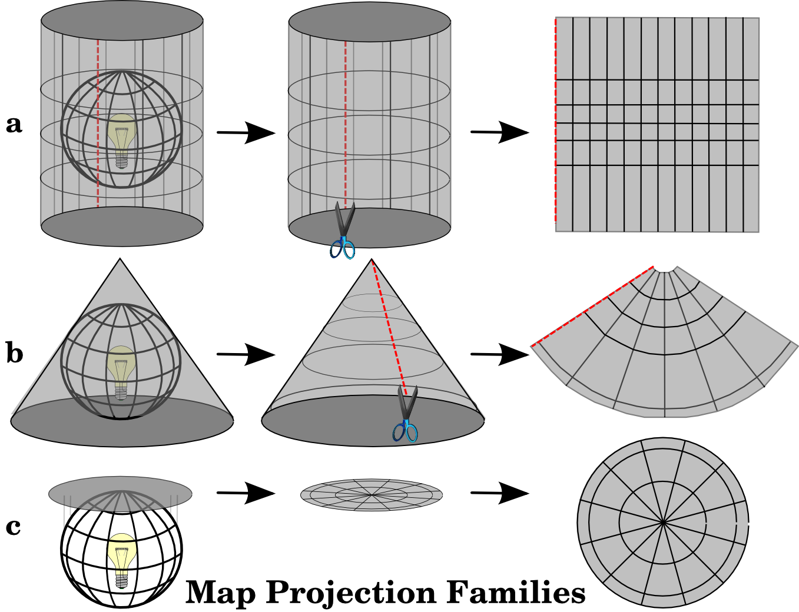
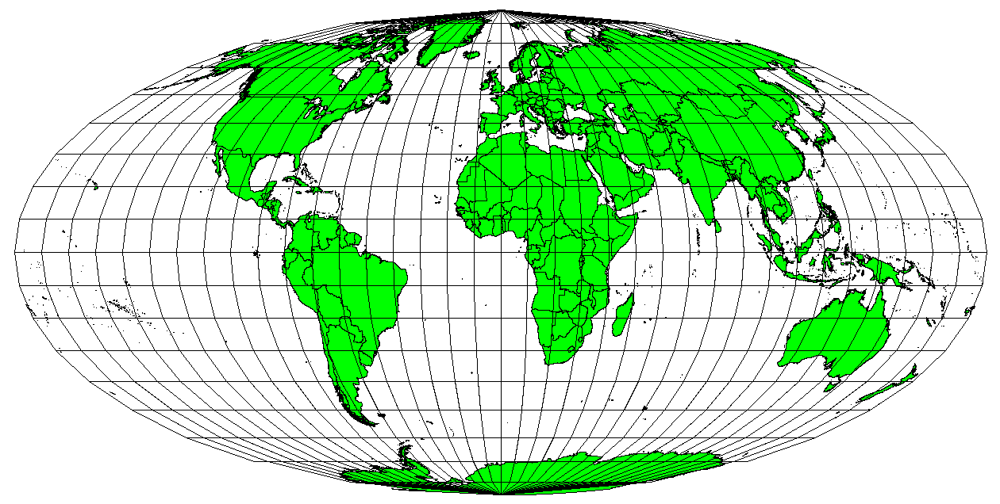
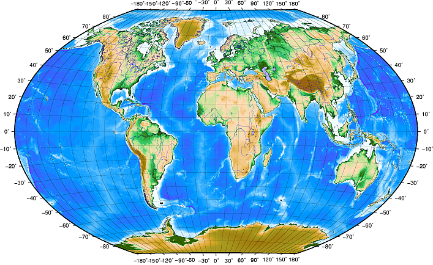
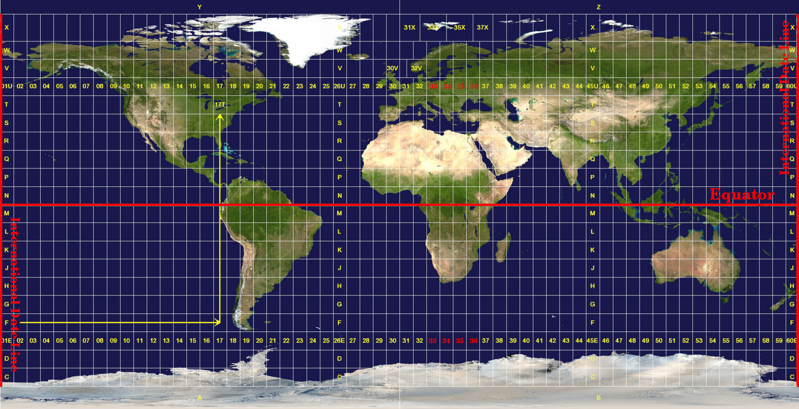

```{webr-r}
#| context: setup

library(dplyr)
library(ggplot2)
library(sf)
library(rnaturalearth)

worldmap <- ne_countries(scale = 'medium', returnclass = 'sf') |>
  filter(continent != 'Antarctica')
```

The earth is (roughly) a sphere, but our maps are flat. A **map projection** is a method for turning the curved surface of the earth into a flat picture. This is impossible to do perfectly - think of trying to flatten the peel of an orange without tearing or stretching it. Every projection distorts something, so choosing a projection means choosing which kind of distortion you're willing to accept.

This chapter loads the same world map as the last one (without Antarctica):

```{webr-r}
library(dplyr)
library(ggplot2)
library(sf)
library(rnaturalearth)

worldmap <- ne_countries(scale = 'medium', returnclass = 'sf') |>
  filter(continent != 'Antarctica')
```

## What gets distorted?

A projection can preserve some properties of the earth's surface, but never all of them at once:

-   **Area:** the relative sizes of places.
-   **Shape** (or angles): the shapes of places, at least locally.
-   **Distance:** the distances between places.

{width="500" fig-alt="Diagram showing a globe projected onto a cylinder, a cone, and a flat plane, each then cut and flattened into a map."}

## Changing the projection with `coord_sf()`

The maps we made in the last chapter used a very simple 'projection': longitude was used directly as the x axis, and latitude as the y axis. This is easy, but it stretches everything away from the equator.

To change the projection, we use the coordinates layer again: `coord_sf()`, with the argument `crs =`. `crs` stands for **coordinate reference system** (more on this below). Each projection has a code, which we pass to `crs` as a text string starting with `+proj=`.

### Mercator

The Mercator projection is the one you probably know best, because it's used by Google Maps and most online maps:

```{webr-r}
ggplot() +
  geom_sf(data = worldmap) +
  coord_sf(crs = '+proj=merc')
```

Mercator preserves **shape**: a small island has the right shape, and a constant compass direction is a straight line, which made it very useful for navigation at sea. But it hugely distorts **area** towards the poles. Greenland looks about the size of Africa, when Africa is actually around fourteen times larger. For a data map, this matters: countries far from the equator - in Europe and North America, for instance - look much bigger, and so more important, than they are.

### Equal-area projections

An **equal-area** projection preserves the relative sizes of places, at the cost of distorting their shapes. For **choropleth maps**, where we colour in regions, this is usually what we want: otherwise, the area of colour a reader sees depends on the projection as well as on the data. The Equal Earth projection is a good modern choice:

```{webr-r}
ggplot() +
  geom_sf(data = worldmap) +
  coord_sf(crs = '+proj=eqearth')
```

Compare the sizes of Greenland and Africa with the Mercator map above.

Another common equal-area projection is Mollweide (`'+proj=moll'`):

{width="400" fig-alt="A world map in the oval-shaped Mollweide projection, with Greenland shown much smaller than Africa."}

### Compromise projections

A **compromise** projection doesn't preserve any one property exactly, but tries to keep all the distortions reasonably small, so the map 'looks right'. These are good for general-purpose world maps. The Robinson projection is a well-known example:

```{webr-r}
ggplot() +
  geom_sf(data = worldmap) +
  coord_sf(crs = '+proj=robin')
```

**Try it yourself:** draw the world map, filled by continent, in the Mollweide projection (`'+proj=moll'`), and the Winkel Tripel projection (`'+proj=wintri'`), which is used by National Geographic. Which do you prefer?

```{webr-r}

```

## Projections for smaller areas

Projections matter most for world maps, but they matter for smaller areas too. For maps of Europe, Eurostat (the EU's statistical office) uses an equal-area projection with the code **3035**. Codes like this are called **EPSG codes**, and you give them to `crs` as a number rather than text.

There's one catch: in a projected map, the coordinates are no longer longitude and latitude, but distances in metres. So if we zoom in with `xlim` and `ylim`, we need to tell `coord_sf()` that our limits are still in longitude and latitude, by setting `default_crs` to 4326 (the code for ordinary longitude and latitude):

```{webr-r}
ggplot() +
  geom_sf(data = worldmap) +
  coord_sf(crs = 3035,
           xlim = c(-15, 50), ylim = c(35, 72),
           default_crs = 4326)
```

Compare this to the map of Europe in the last chapter: Scandinavia is no longer stretched, and the map curves the way the earth does.

::: callout-note
The lines of longitude and latitude are now curved, so a 'box' of longitude and latitude no longer fits the map neatly. ggplot uses the corners of your limits to decide what to show, which means the edges of the area can get cut off. If that happens, just make the limits a little wider.
:::

::: callout-tip
For a map of the Netherlands, the official Dutch projection is EPSG code **28992** ('Amersfoort / RD New'). Most countries have their own standard projection: search for '\[country\] EPSG' to find it.
:::

## Coordinate reference systems

You'll often see the term **coordinate reference system** (CRS) in connection with maps. A CRS is the full set of rules which links the numbers in the geometry column to real places on the earth. There are two types:

-   A **geographic** CRS uses longitude and latitude, in degrees. The most common is called **WGS 84**, with the EPSG code **4326**. This is what GPS uses, and it's the CRS of the Natural Earth maps.

{width="400" fig-alt="A world map with labelled lines of longitude and latitude."}

-   A **projected** CRS uses a flat, projected map, with positions measured in metres from some starting point. EPSG 3035 and 28992 are both projected CRSs.

{width="400" fig-alt="A world map divided into a grid of numbered and lettered UTM zones."}

You can check the CRS of any sf object with `st_crs()`:

```{webr-r}
st_crs(worldmap)
```

### Why does this matter?

Most of the time, ggplot takes care of the CRS for you. When you add several `geom_sf()` layers to one map, ggplot converts them all to the same CRS: the one set in `coord_sf()`, or, if you haven't set one, the CRS of the first layer.

Where it does matter is when you **make your own** sf object, for example from a set of coordinates. Then you'll need to tell R which CRS your coordinates use. We'll do this in the [chapter on points maps](48_points-map.qmd).

::: callout-note
You might also come across the sf function `st_transform()`, which permanently converts an sf object to a different CRS, e.g. `worldmap |> st_transform(crs = '+proj=eqearth')`. For drawing maps with ggplot, `coord_sf(crs = ...)` does the same job.
:::

## Check your understanding

**1.** You're making a choropleth map of the world, showing the number of museums per person in each country. Which kind of projection should you choose, and why?

::: {.callout-tip collapse="true"}
## Answer

An **equal-area** projection, such as Equal Earth or Mollweide. In a choropleth, readers judge the data partly by how much area is coloured. A projection which enlarges some regions, like Mercator (which makes countries near the poles look much bigger), would give those countries more visual weight than the data justifies.
:::

**2.** Why does Greenland look as big as Africa on many online maps?

::: {.callout-tip collapse="true"}
## Answer

Most online maps use the Mercator projection, which preserves shapes but increasingly exaggerates areas towards the poles.
:::

## Learning Objectives

Before moving on, take a look and see if you are confident with all of the following learning objectives. If anything is unclear, try to go back over the material, or make a note and ask in our next class!

(the checkboxes are just for your own use, they won't save if you leave or refresh the page)

-   [ ] Explain what a map projection is, and why every projection distorts something
-   [ ] Change the projection of a map with `coord_sf(crs = ...)`
-   [ ] Choose an equal-area projection for a choropleth map, and explain why
-   [ ] Explain what a coordinate reference system (CRS) is, and the difference between a geographic and a projected CRS
