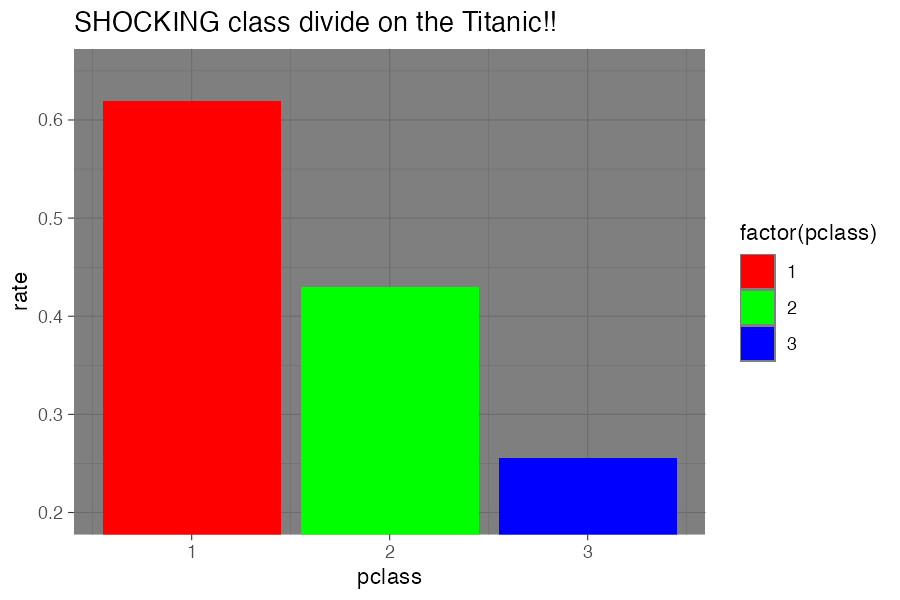
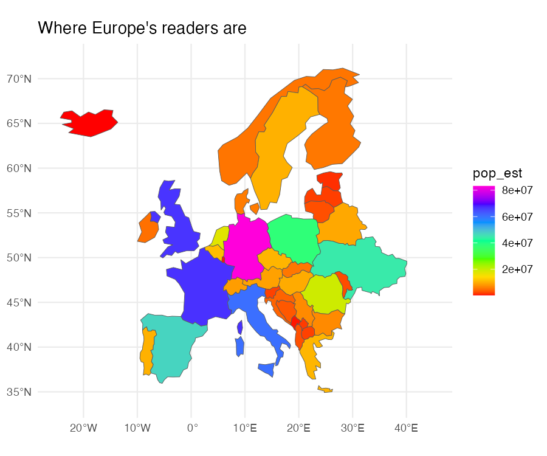

The exam is worth 40% of your final grade. This chapter explains what it looks like, what you need to know, and how to prepare - and it ends with a complete practice exam, with model answers.

## About the exam

-   **When and where:** Tuesday 5 January 2027, 13:00-15:00, Universitair Sportcentrum, Hall 2. The resit is on Tuesday 26 January 2027, 15:00-17:00, Lipsius 1.27. Always check MyTimetable for changes.
-   **Length:** two hours.
-   **No R.** You won't have access to R or RStudio during the exam, and you won't need it. You'll be asked to *read* and *reason about* code, not to run it.
-   **Function reference sheet.** You'll be given a copy of the [reference sheet](#function-reference-sheet) below. You don't need to memorise function names or arguments - what matters is that you understand what they do and when to use them.

The exam has four parts. Each one relates to a different set of skills from the course:

| Part | What you'll do | Weight | Covers |
|----|----|----|----|
| A | **Read the code.** Given a small table and some dplyr code, work out what the output will be, choose the code which produces a given result, or find the bug. | 30% | Weeks 1-2: data analysis |
| B | **Code and charts.** Work out what chart some ggplot code produces, or what you'd change to get a particular effect. | 20% | Weeks 3-4: data visualisation |
| C | **Critique a visualisation.** You're shown a chart or map: identify its problems and explain how you would fix them. | 25% | Weeks 3-6: design principles, colour, accessibility, mapping |
| D | **Plan an analysis.** You're given a description of a dataset you haven't seen before and a research question. Explain how you would use the data to answer it, and what you'd need to watch out for. | 25% | The whole course, including the readings |

: Exam structure {tbl-colwidths="\[8,52,10,30\]" .striped}

Parts A and B have one correct answer. Parts C and D are open questions: there are many good answers, and you'll be rewarded for clear reasoning which uses the ideas and vocabulary from the course.

## How to prepare

1.  **Do the home exercises.** Only two are graded, but they are all written to prepare you for this exam and for the reports. Reading code is much easier once you've written lots of it.
2.  **Use the 'Check your understanding' boxes** at the end of chapters. They are written in the same style as Part A and B questions. Where there's a code cell, *predict the answer first*, and then run the code to check.
3.  **Go through the Learning Objectives** at the end of each chapter. If you can't tick one off, go back over that chapter.
4.  **Practise critiquing.** Whenever you see a chart in the news or on social media, ask yourself what it does well and what you'd change. The chapters on [Gestalt principles](27_gestalt.qmd), [colour](31_colour.qmd), and [accessibility](38_accessibility.qmd) give you the vocabulary.
5.  **Re-read the two compulsory readings** from *Data Feminism*. Part D will often give you a chance to use them.
6.  **Do the practice exam** below, under time pressure, before looking at the answers.

## What you should be able to do

### Data analysis (weeks 1-2)

-   [ ] Explain what a dataframe is, and what rows, columns and data types are
-   [ ] Predict the output of `select()`, `slice()`, `arrange()`, `filter()`, `mutate()`, `count()`, `group_by()` and `summarise()`
-   [ ] Follow a chain of functions joined with the pipe (`|>`), step by step
-   [ ] Explain what a join does, what a key is, and why a `left_join()` can produce `NA` values
-   [ ] Explain the difference between 'wide' and 'long' (tidy) data
-   [ ] Spot common mistakes, such as `=` instead of `==`, or forgetting quotation marks

### Data visualisation (weeks 3-4)

-   [ ] Explain how ggplot2 maps columns of data to *aesthetics* (x, y, colour, fill, size...) using `aes()`
-   [ ] Explain the difference between setting an aesthetic inside and outside `aes()`
-   [ ] Choose an appropriate chart type (geom) for a given question and type of data
-   [ ] Explain what scales do, and when to use a sequential, diverging, or qualitative colour scale
-   [ ] Use Gestalt principles to explain why a chart works, or doesn't
-   [ ] Explain the role of titles, labels and annotations in telling a story with data

### Ethics, FAIR data and accessibility (week 5)

-   [ ] Explain the FAIR principles and evaluate a dataset against them
-   [ ] Identify accessibility problems in a visualisation (e.g. colour-blindness, contrast, missing alt text) and suggest fixes
-   [ ] Use ideas from the *Data Feminism* readings to discuss how a dataset or visualisation was made, and whose perspective it represents

### Digital mapping (weeks 5-6)

-   [ ] Explain what a simple features (sf) object is, and how it differs from a regular dataframe
-   [ ] Explain the steps of joining a dataset to a map, and spot problems with a join
-   [ ] Explain how to turn a dataset of coordinates into points on a map
-   [ ] Explain what a map projection is, and how the choice of projection can distort a map
-   [ ] Explain when to use a choropleth and when to use a points map
-   [ ] Explain why choropleth maps usually need *normalised* data (e.g. per person) rather than raw counts

## Function reference sheet

This is the reference sheet you'll be given in the exam.

| Function | What it does |
|----|----|
| `select(df, col1, col2)` | Keep only the named columns. `select(df, -col1)` removes a column. |
| `slice(df, 1:5)` | Keep rows by position. `slice_max(df, col, n = 5)` / `slice_min()` keep the rows with the highest/lowest values. |
| `arrange(df, col)` | Sort rows by a column, smallest first. `arrange(df, desc(col))` sorts largest first. |
| `filter(df, condition)` | Keep rows where the condition is `TRUE`. Comparisons: `==`, `!=`, `>`, `<`, `>=`, `<=`, `%in%`. Combine with `&` (and), `|` (or); negate with `!`. |
| `str_detect(col, "text")` | `TRUE` if the text is found in the column (often used inside `filter()`). |
| `mutate(df, new_col = ...)` | Add a new column, or change an existing one. |
| `if_else(condition, yes, no)` | Return one value if a condition is `TRUE`, another if `FALSE`. `case_when()` handles several conditions. |
| `rename(df, new_name = old_name)` | Rename a column. |
| `count(df, col)` | Count the number of rows for each value of a column. |
| `group_by(df, col)` | Group rows, so that the next function is applied to each group separately. |
| `summarise(df, new_col = ...)` | Reduce each group to one row, e.g. with `n()`, `sum()`, `mean()`, `max()`, `min()`. |
| `left_join(x, y, by = "key")` | Add the columns of `y` to `x`, matching rows by a key. Keeps all rows of `x`; rows with no match get `NA`. Also `inner_join()`, `full_join()`. |
| `pivot_longer()` / `pivot_wider()` | Reshape data from wide to long format, or from long to wide. |
| `ggplot(df, aes(x = , y = , colour = , fill = , size = ))` | Start a chart, mapping columns to aesthetics. |
| `geom_point()`, `geom_line()`, `geom_col()`, `geom_bar()`, `geom_histogram()`, `geom_text()` | Draw the data as points, lines, bars, a histogram, or text. |
| `scale_x_continuous()`, `scale_x_date()`, `scale_fill_brewer()`, `scale_colour_viridis_d()`, ... | Control how data values are translated into positions or colours. |
| `facet_wrap(~ col)` | Split a chart into small multiples, one per value of a column. |
| `labs(title = , x = , y = , caption = )` | Set titles and labels. |
| `annotate()` | Add a single piece of text or a shape to a chart. |
| `theme_minimal()`, `theme()` | Change the overall look of the chart. |
| `geom_sf()` | Draw an sf object (a map): polygons, lines or points. Positions come from the geometry column. |
| `coord_sf(xlim = , ylim = , crs = )` | Zoom in on a map, and/or change its projection. |
| `st_read()` | Read a map file (e.g. a GeoJSON file or shapefile) into an sf object. |
| `st_as_sf(df, coords = c('longitude', 'latitude'), crs = 4326)` | Turn a dataframe with coordinates into an sf object of points. |
| `separate_rows(df, col, sep = ', ')` | Split a column containing several values into separate rows. |

: Function reference sheet {tbl-colwidths="\[40,60\]" .striped}

## Practice exam

Try this under exam conditions: two hours, no R, just the reference sheet above. Then compare your answers with the model answers (click to expand them).

### Part A: Read the code (30%)

All the questions in Part A use these two small dataframes. `books` contains six works of seventeenth- and eighteenth-century English literature:

| title | author | year | format | pages |
|----|----|----|----|----|
| Leviathan | Hobbes | 1651 | folio | 396 |
| Paradise Lost | Milton | 1667 | quarto | 342 |
| Pilgrim's Progress | Bunyan | 1678 | octavo | 232 |
| Robinson Crusoe | Defoe | 1719 | octavo | 364 |
| Gulliver's Travels | Swift | 1726 | octavo | 300 |
| Pamela | Richardson | 1740 | duodecimo | 250 |

: books {.striped}

`authors` contains the birth years of some of the authors:

| author | born |
|----|----|
| Hobbes | 1588 |
| Milton | 1608 |
| Defoe | 1660 |
| Swift | 1667 |
| Richardson | 1689 |

: authors {.striped}

**A1.** What is the output of this code? Write out the resulting table.

``` r
books |>
  filter(year > 1700, format == "octavo") |>
  select(title, pages)
```

::: {.callout-tip collapse="true"}
## Answer

| title              | pages |
|--------------------|-------|
| Robinson Crusoe    | 364   |
| Gulliver's Travels | 300   |

Only two rows have a year after 1700 *and* the format octavo (*Pamela* is after 1700 but is a duodecimo; *Pilgrim's Progress* is an octavo but before 1700). `select()` then keeps only two columns.
:::

**A2.** How many rows will the result of this code have, and what will be in the first row?

``` r
books |>
  group_by(format) |>
  summarise(n = n(), mean_pages = mean(pages)) |>
  arrange(desc(n))
```

::: {.callout-tip collapse="true"}
## Answer

Four rows, one for each format. The first row is octavo, with `n` = 3 and `mean_pages` = 298.7 (the average of 232, 364 and 300). `summarise()` reduces each group to a single row, and `arrange(desc(n))` puts the most common format first.
:::

**A3.** A student wants to count how many of the books were published in each century. Which of these will work?

a)  `books |> count(year)`
b)  `books |> mutate(century = if_else(year < 1700, "17th", "18th")) |> count(century)`
c)  `books |> filter(year < 1700) |> count(year)`
d)  `books |> group_by(year < 1700)`

::: {.callout-tip collapse="true"}
## Answer

**b**. It first makes a new column, `century`, and then counts the values in it (3 and 3). (a) counts each individual year, giving six rows with a count of 1. (c) only looks at the 17th century, and again counts individual years. (d) groups the data, but doesn't count anything.
:::

**A4.** What does this code produce for *Pilgrim's Progress*, and why?

``` r
books |>
  left_join(authors, by = "author") |>
  mutate(age = year - born) |>
  select(author, age)
```

::: {.callout-tip collapse="true"}
## Answer

`NA`. Bunyan isn't in the `authors` table, so the `left_join()` keeps the row (because `books` is on the left) but has no value to put in the `born` column, so it puts `NA`. Any calculation with `NA` also gives `NA`. The other rows give the author's age when the book was published (e.g. 63 for Hobbes).
:::

**A5.** What does this return?

``` r
books |>
  arrange(desc(pages)) |>
  slice(1:2)
```

::: {.callout-tip collapse="true"}
## Answer

The two longest books: *Leviathan* (396 pages) and *Robinson Crusoe* (364 pages), with all their columns. `arrange(desc(pages))` sorts the longest first, and `slice(1:2)` keeps the first two rows. `slice_max(books, pages, n = 2)` would do the same thing in one step.
:::

**A6.** This code gives an error. What's wrong, and how would you fix it?

``` r
books |>
  filter(format = "quarto")
```

::: {.callout-tip collapse="true"}
## Answer

A single `=` is used to set a value (e.g. an argument to a function), not to compare. To test whether two things are equal, you need `==`: `filter(format == "quarto")`.
:::

### Part B: Code and charts (20%)

**B1.** Which of these produces a scatterplot of year against number of pages, with the points coloured by format? For each of the others, explain what goes wrong.

a)  `ggplot(books, aes(x = year, y = pages, colour = format)) + geom_point()`
b)  `ggplot(books, aes(x = year, y = pages)) + geom_point(colour = format)`
c)  `ggplot(books, aes(x = year, y = pages, fill = format)) + geom_point()`
d)  `ggplot(books, aes(x = format, y = pages)) + geom_col()`

::: {.callout-tip collapse="true"}
## Answer

**a**. In (b), `colour = format` is outside `aes()`, so R doesn't look for a column called `format` in the data - it gives an error. In (c), the points are drawn with `fill` mapped to format, but the default points are solid dots that have no fill, only a colour, so they all appear black. (d) is a bar chart of the total number of pages for each format, not a scatterplot.
:::

**B2.** A student writes the following code, expecting blue points. Instead the points are a pinkish-red, and there's a legend with the single entry 'blue'. Why, and how would you fix it?

``` r
ggplot(books, aes(x = year, y = pages)) +
  geom_point(aes(colour = "blue"))
```

::: {.callout-tip collapse="true"}
## Answer

Inside `aes()`, ggplot treats `"blue"` as a *data value* (as if there was a column where every row said "blue"), not as a colour. It gives that value the first colour in its default palette, and adds a legend for it. To set a fixed colour, put it outside `aes()`: `geom_point(colour = "blue")`.
:::

**B3.** You've made a line chart of the number of books published per year, with one line per format. The lines overlap so much that it's hard to read. Name **two** different changes you could make to the code to improve it, and explain what each does.

::: {.callout-tip collapse="true"}
## Answer

Good answers include:

-   `facet_wrap(~ format)` to give each format its own small panel (small multiples), so the lines no longer overlap.
-   Highlight one format and make the others grey, to focus on the story you want to tell.
-   Label the lines directly (e.g. with `geom_text()` or `annotate()`) instead of using a legend.
-   Summarise by decade instead of year (using `mutate()` and `group_by()`), to make the lines smoother.
:::

### Part C: Critique a visualisation (25%)

**C1.** This chart shows the proportion of passengers who survived the sinking of the Titanic, by ticket class. Identify at least **four** problems with it, and explain how you would fix each.

{fig-alt="A bar chart with a dark grey background, titled 'SHOCKING class divide on the Titanic!!'. Three bars in bright red, green and blue show values of about 0.62, 0.43 and 0.25 for classes 1, 2 and 3. The y-axis begins at 0.2 rather than zero, and the axes are labelled 'pclass' and 'rate'. A legend titled 'factor(pclass)' repeats the three classes." width="80%"}

::: {.callout-tip collapse="true"}
## Answer

-   **The y-axis doesn't start at zero.** Bar charts encode values by the *length* of the bar, so a truncated axis exaggerates the differences: the first-class bar looks about six times as long as the third-class bar, when the real difference is about 2.5 times. Start the axis at zero.
-   **The colours carry no information and are hard to read.** Red, green and blue are just repeating the x-axis, and red/green is a problem for colour-blind readers. Use a single colour, or a sequential palette if you want to emphasise the ordering of the classes.
-   **The legend is redundant**, and its title ('factor(pclass)') is a leftover from the code. Remove it.
-   **The axis labels are column names**, not explanations. Use e.g. 'Ticket class' (with labels 'First', 'Second', 'Third') and 'Share of passengers who survived', ideally as a percentage.
-   **The title is sensationalist**, and doesn't tell the reader what they're looking at. A good title states the finding plainly, e.g. 'First-class passengers were more than twice as likely to survive as those in third class'.
-   **The dark background** reduces contrast. Use a light theme such as `theme_minimal()`.
-   **No source** is given. Add a caption.
:::

**C2.** This map was made for a report arguing that Germany, France, and the UK are Europe's most 'bookish' countries. The fill colour shows each country's total population. Identify the problems with the map, and with the way it's being used.

{fig-alt="A choropleth map of Europe titled 'Where Europe's readers are'. Countries are filled with a rainbow colour scale running from red through yellow, green and blue to pink. The legend is titled 'pop_est' and runs from 0 to 8e+07 in scientific notation. Germany is pink, France and the UK blue, and most smaller countries orange or red." width="80%"}

::: {.callout-tip collapse="true"}
## Answer

-   **The data doesn't match the claim.** The map shows *total population*, not reading. Big countries will always look 'more' of everything on a map of raw counts. To say anything about reading, you would need data about reading (e.g. library loans, book sales), and you'd need to **normalise** it - e.g. loans *per person* - so that countries of different sizes can be compared.
-   **The rainbow colour scale** has no natural order (is pink more than blue?), creates false boundaries between colours, and is not colour-blind friendly. For ordered numeric data, use a sequential palette (e.g. light to dark of one hue, or viridis).
-   **The legend is unreadable**: its title is a column name (`pop_est`) and the numbers are in scientific notation (8e+07). Give it a proper title ('Population (millions)') and readable labels.
-   **The title makes a claim which the map can't support.**
-   **No source** is given, and there's no information about the year of the data.
-   **The projection:** this map uses plain longitude and latitude, which stretches countries further from the equator (compare the size of Scandinavia and Spain). A projection designed for Europe would be better.
:::

### Part D: Plan an analysis (25%)

**D1.** You're given a (simplified) dataset of voyages made by ships of the Dutch East India Company (VOC) from the Netherlands to Asia between 1595 and 1795. Each row is one voyage, with these columns:

-   `ship_name`: the name of the ship
-   `departure_date`: the date the ship left the Netherlands
-   `departure_port`: the Dutch port it left from
-   `arrival_date`: the date it arrived in Asia (empty if it never arrived)
-   `arrival_port`: the port it arrived at in Asia
-   `crew_departure`: the number of people on board when it left
-   `crew_arrival`: the number of people on board when it arrived

Your research question is: **How did the deadliness of the voyage to Asia change over the seventeenth and eighteenth centuries?**

Explain, step by step, how you would use this data to answer the question. Mention the functions you would use, and the chart you would make (and why). Then discuss at least **two** problems or limitations with the data, or ethical issues, that you would need to consider in your report.

::: {.callout-tip collapse="true"}
## Answer

A strong answer would include something like the following. You don't need to write perfect code: a clear explanation in words, naming the relevant functions, is enough.

**Steps:**

1.  `filter()` to keep only voyages which arrived, and where both crew columns have values (and explain that you've done this - see the problems below).
2.  `mutate()` to calculate the number of deaths (`crew_departure - crew_arrival`) and, more importantly, the *proportion* who died (`deaths / crew_departure`). The proportion is better than the raw number, because ships became bigger over time, so a raw count would mostly show the size of the ships.
3.  `mutate()` to extract the year from `departure_date`, and then make a decade column (e.g. `floor(year / 10) * 10`).
4.  `group_by(decade)` and `summarise()` to calculate the average proportion of deaths per decade, and the number of voyages, `n()`.
5.  Make a **line chart** (`geom_line()`) with decade on the x-axis and the average mortality on the y-axis, because the question is about change over time. Add clear labels, a title that states the finding, a source, and perhaps annotations for important events.

**Problems and limitations** (any two, well explained):

-   **Missing data:** ships which were wrecked or captured never arrived, so they have no arrival crew number. If you filter them out, you leave out the *most* deadly voyages, and underestimate mortality. You could count these separately, or make a second chart of the share of ships that never arrived.
-   **The numbers don't only reflect deaths:** people could also leave or join the ship at stops along the way (e.g. at the Cape), so a lower number on arrival isn't only deaths.
-   **Sources and FAIR:** you'd need to find out where the numbers come from (VOC records), how they were transcribed, and how complete they are for different periods - the early decades may be less well recorded.
-   **Ethics and perspective:** this data was produced by a colonial trading company, and records people as numbers of 'crew'. It says nothing about who they were, and nothing about the people in Asia affected by the VOC. Following *Data Feminism*, you could reflect on whose perspective the data represents, and on how to present deaths respectfully (e.g. avoiding sensationalist titles).
:::
