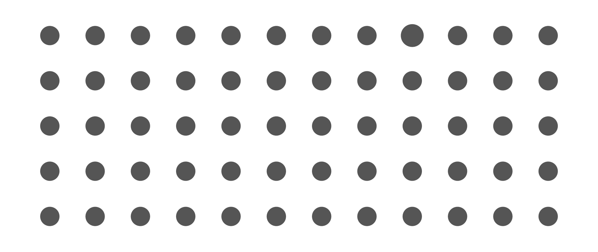
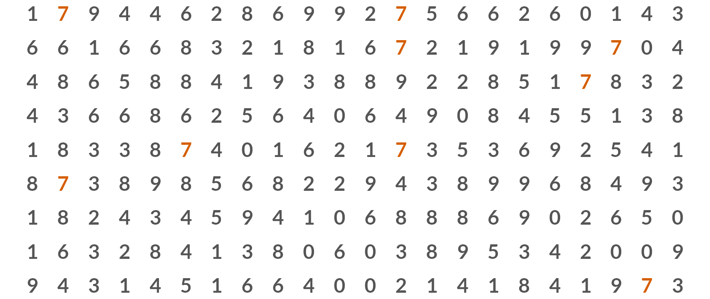
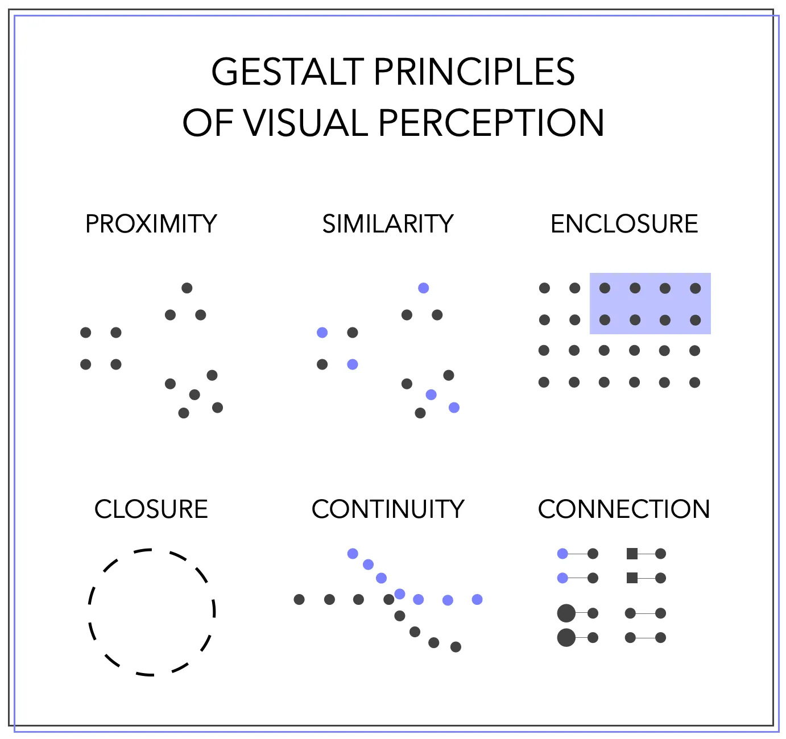
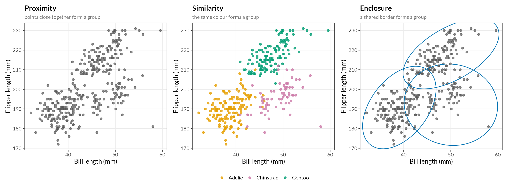
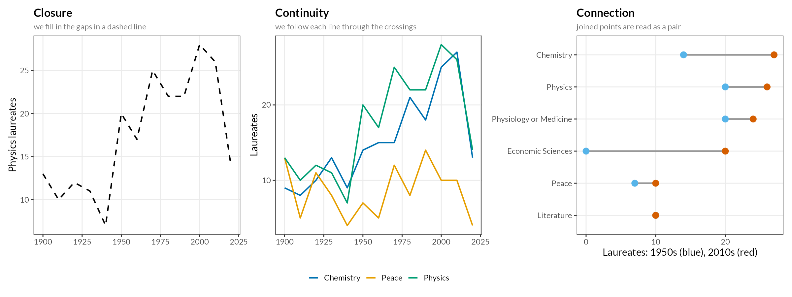
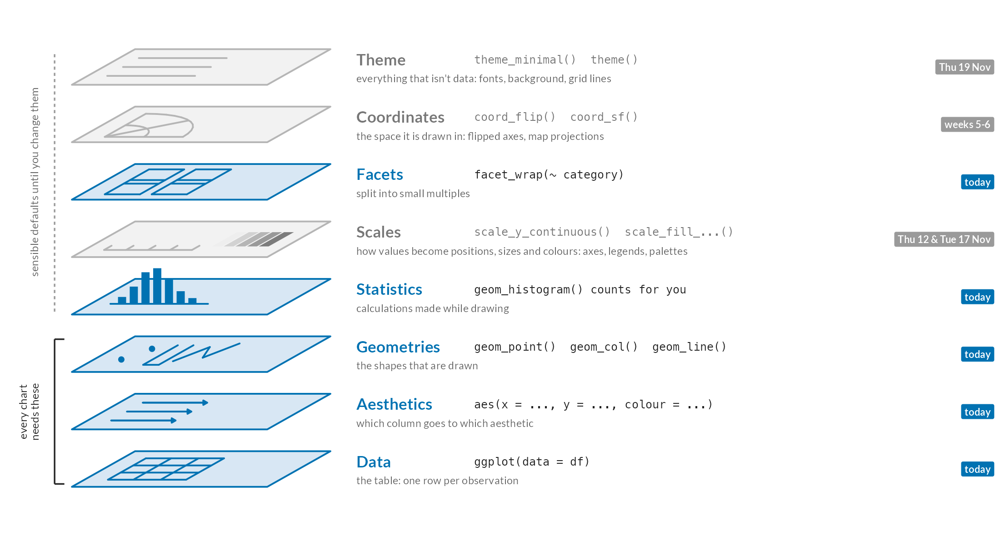
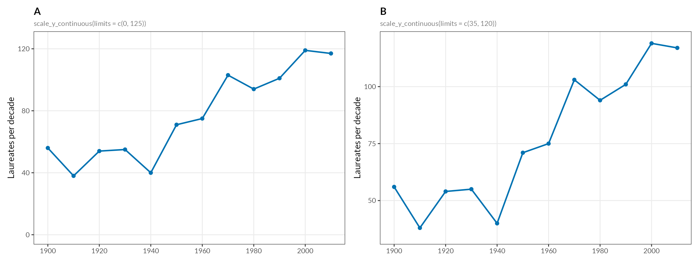

## Today

```{webr-r}
#| context: setup

library(dplyr)
library(readr)
library(stringr)
library(tidyr)
library(ggplot2)
options(width = 80, pillar.print_min = 5, pillar.print_max = 5)
theme_set(theme_grey(base_size = 16))

url1 <- "https://raw.githubusercontent.com/yann-ryan/infovis_data/main/nobel/laureates_df.csv"
download.file(url1, "laureates_df.csv")
laureates_df <- read_csv("laureates_df.csv", show_col_types = FALSE)

url2 <- "https://raw.githubusercontent.com/yann-ryan/infovis_data/main/nobel/prize_df.csv"
download.file(url2, "prize_df.csv")
prize_df <- read_csv("prize_df.csv", show_col_types = FALSE)

nobel_df <- laureates_df |>
  left_join(prize_df, by = 'prize_id')

nobel_summary <- nobel_df |>
  count(category)

nobel_by_year <- nobel_df |>
  count(award_year)
```

1.  Why do charts work? Pre-attentive attributes and Gestalt principles
2.  Critique: data, aesthetics and perception
3.  Scales: limits, breaks, labels, and ordering bars
4.  Data challenge 3, in two versions
5.  Report 1: pitch your dataset and question

::: notes
Open the deck a minute before class: the setup downloads the Nobel data and loads ggplot2, which is slow in the browser. Have the four A3 critique sheets ready: the critique didn't happen on Tuesday, so groups are formed today and rounds 1 and 2 are done together. The answers to each Try it yourself are in these notes. Rough timing for a two-hour seminar: perception 15 min, critique 35, scales 30, data challenge 5, pitches 25, your turn with what's left.
:::

## Warm-up

Find the dot that's different



::: notes
Give them a few seconds, and ask them to put a hand up when they've found it. Most will need to scan: one dot in the top row is slightly bigger. Then next slide.
:::

## Again



::: predict
Instant. A strong difference in colour "pops out" before you start looking
:::

::: notes
Second time, every hand goes up at once. These are pre-attentive attributes: colour, size, shape, orientation and position are processed automatically, in a fraction of a second, before we pay attention. But how strong the difference is matters: a small difference in size had to be searched for; a strong difference in colour didn't. Lesson for charts: if you want the reader to notice one thing, make it clearly different in colour or size, rather than relying on a label they have to read. And if everything is brightly coloured, nothing pops out.
:::

# Why do charts work? {.section-break}

Gestalt principles

## We see wholes, not parts

Gestalt psychology (from about 1900): our minds group what we see into patterns, without being asked

{height="460"}

::: notes
From the Gestalt Principles chapter, which they were asked to read. "Gestalt" is German for shape or form. The six principles we use for charts: proximity, similarity, enclosure, closure, continuity, connection. Most of ggplot's defaults already use them; the point of knowing them is to have words for why a chart works, or doesn't. Those words are what the critique and the exam ask for.
:::

## Grouping



::: notes
The same 342 penguins three times. Left: with no colour, we still see clusters, purely because the points are close together (proximity). Middle: colour makes the three species obvious, and shows that the two clusters in the bottom left are really two species overlapping (similarity). Right: an outline around each group (enclosure); we'll learn to draw these in the annotations chapter. Ask: in the middle chart, which principle wins when proximity and similarity disagree? Points of different colours sit close together where Adelie and Chinstrap overlap, and we still separate them by colour.
:::

## Lines



::: notes
Left: a dashed line is a series of separate dashes, but we read it as one line (closure). Middle: where the Physics and Chemistry lines cross, we still follow each one through, rather than seeing them bounce off each other (continuity). This is also why a line chart implies order: we assume each point leads to the next. Right: a dumbbell chart; the grey line ties the two dots together, so we compare the 1950s with the 2010s in each category (connection). Economics starts at 0 because the prize only began in 1969, and Literature's two dots sit on top of each other (10 in both decades). Ask: which of these would mislead if the x axis were categories with no order, like countries?
:::

## Proximity decides the comparison

```{webr-r}
nobel_df |>
  filter(category %in% c('Physics', 'Chemistry', 'Peace', 'Literature')) |>
  count(category, gender) |>
  ggplot(aes(x = category, y = n, fill = gender)) +
  geom_col(position = 'dodge')
```

::: predict
**Try:** swap `x = category` and `fill = gender`. Which comparison is easier now, and which is harder?
:::

::: notes
position = 'dodge' (from Tuesday) puts bars side by side. With category on x, the bars that sit next to each other are women and men in the same prize: easy to compare within a prize. Swapped, all the women's bars are together and all the men's: easy to compare prizes for one gender, harder to see the gap. Same data, same geom: the grouping by proximity decides what the reader compares. The rule: put the things you most want compared next to each other. Physics: 5 women, 222 men; Peace: 19 and 92; Literature: 18 and 103; Chemistry: 8 and 189.
:::

# Critique {.section-break}

Data, aesthetics and perception

## The critique gallery

Four historical visualisations, printed on A3. Form **four groups**: each group gets one sheet, and keeps it for the rest of the course

::: {style="font-size: 0.85em;"}
1.  Florence Nightingale, *Diagram of the causes of mortality in the army in the East*, 1858
2.  Charles Joseph Minard, *Napoleon's Russian campaign of 1812*, 1869
3.  W.E.B. Du Bois and students at Atlanta University, *Assessed value of household and kitchen furniture owned by Georgia Negroes*, 1900
4.  John Snow, *Deaths from cholera in Soho, London, 1854*, published 1855
:::

::: small
Laptops closed. Spend a few minutes just looking, close up: read the small print and the source line. We'll come back to the same sheet on 24 and 26 Nov
:::

::: notes
The critique was planned for Tuesday but didn't happen, so today does rounds 1 and 2 of the critique gallery page together. Number the groups 1-4 and hand out the sheets. Ask them to look in silence for two or three minutes before talking.
:::

## Critique: what is it, and how is it read?

**25 minutes**, then two minutes per group. Not every question fits every sheet: if one doesn't, say why

::: {.columns style="font-size: 0.72em;"}
::: {.column width="50%"}
**The data and the chart** (Tuesday)

1.  What is one *observation*: a person, a month, a place? What are the *variables*, and what type is each: categorical, ordinal, discrete, continuous?
2.  Which *aesthetic* is each variable mapped to (position, length, area, colour, ...)?
3.  What kind of chart is it, and what is it trying to show: amounts, change over time, part-to-whole, a relationship, something spatial?
4.  Could you read off an actual value if you wanted to?
5.  What is the main message, in one sentence?
:::

::: {.column width="50%"}
**Perception and design** (today)

6.  Where does your eye go first? Is that the most important thing?
7.  Is it obvious what to look at, and in what order? How long did it take you to work out how to read it?
8.  Which Gestalt principles does it use? Do they help, or get in the way?
9.  Does it group together things that shouldn't be grouped, or split up things that belong together?
10. What would you remove, and what would you add, to make it easier to read?
:::
:::

::: notes
Rounds 1 and 2 of the critique gallery page. If time is short, ask groups to do 1, 2, 5, 6 and 8 first. Things to listen for. Nightingale: one wedge per month, variables month, cause of death and number of deaths; deaths are mapped to the area of each wedge (the radius is scaled so that the area is right), but area is hard to compare; the eye goes to the big blue wedges (preventable disease), which is exactly her argument; the two spirals are joined by a dashed line (connection, closure). Minard: six variables on one sheet (the army's size as the width of the band, its position, direction by colour, temperature, dates, and the places); the eye follows the band from left to right and back (continuity); the temperature chart below is tied to the return journey by thin vertical lines (connection); a lot to take in at once. Du Bois: one observation per year, value mapped to the length of each spiral band, which makes the later, bigger values hard to compare with the early ones; colour separates the years (similarity); striking, but you can't read off values without the labels. Snow: one mark per death, at the house where it happened, so position carries the argument; the bars cluster around the Broad Street pump (proximity), and the quiet street plan lets them pop out (pre-attentive). Pick one person per group to sum up.
:::

# Scales {.section-break}

How data becomes position, colour and size

## Scales: the next layer

{height="460"}

::: small
A **scale** decides how values in the data become positions, colours and sizes. ggplot always adds one; you only write it when you want to change it
:::

::: notes
Back to Tuesday's layers diagram: we did data, aesthetics, geometries, a bit of statistics and facets. Scales are the next layer up. Every aesthetic in aes() has a scale: x and y have position scales, fill has a colour scale, and so on. The scale is shown to the reader as an axis or a legend. Today: position scales. Tuesday: date scales and colour.
:::

## Same data, two charts

Nobel Prize laureates per decade, 1900s to 2010s. The only difference is the limits of the y axis



::: predict
**Discuss:** in which chart has the number of laureates grown more? Which chart would you use, and why?
:::

::: notes
From the Chart scales chapter. Ask for a show of hands: who thinks B shows more growth? Then point out that the numbers are identical: 56 laureates in the 1900s, 38 in the 1910s and 40 in the 1940s (the two world wars; no prizes 1940-42), 117 in the 2010s. In B the y axis starts at 35, so the dips look dramatic and the growth looks steep; in A, from 0, it's a steady doubling. Neither chart is faked. Bar charts must start at 0, because we read the length of the bar; for a line chart it depends on the point you want to make: B is fine if the dips are the story. The rule is to choose the limits deliberately, and be able to say why. Next: how to set them ourselves. The same question comes up in data challenge 3 (alternative), Part 4.
:::

## Limits

```{webr-r}
nobel_by_year |>
  ggplot(aes(x = award_year, y = n)) +
  geom_line() +
  scale_x_continuous(limits = c(1980, 2000))
```

::: small
`scale_x_continuous()` for the x axis · `scale_y_continuous()` for the y axis · `limits = c(start, end)`
:::

. . .

::: predict
Read the warning: "Removed 100 rows". Values outside the limits are **removed** before anything is drawn, not just hidden
:::

::: notes
nobel_by_year has 121 rows (one per year with a prize); 21 of them fall between 1980 and 2000, so 100 are removed. For a line chart that doesn't matter. But for anything that calculates (a histogram, a boxplot, a mean), the calculation only sees what's left. Data challenge 3 has a step about exactly this: zooming in on a boxplot with limits changes the median line. If you want to zoom without throwing data away, coord_cartesian(xlim = ...) does that; not in the book, mention only if asked.
:::

## Limits {.try-it}

Set the limits of the y axis to 0 and 20

```{webr-r}
nobel_by_year |>
  ggplot(aes(x = award_year, y = n)) +
  geom_line() +
  scale_x_continuous(limits = c(1980, 2000)) +
  ___
```

::: notes
scale_y_continuous(limits = c(0, 20)). The first Try it yourself in the Position scales chapter. In these years there were 6 to 13 laureates a year, so this leaves room above. Note there's a separate scale per axis, each added with +.
:::

## Breaks

```{webr-r}
nobel_by_year |>
  ggplot(aes(x = award_year, y = n)) +
  geom_line() +
  scale_x_continuous(limits = c(1980, 2000),
                     breaks = c(1980, 1990, 2000))
```

::: small
`breaks` decides where the ticks, labels and grid lines go
:::

::: notes
The chapter's first breaks example. The fainter grid lines in between are the minor breaks: a few slides on.
:::

## `seq()`

```{webr-r}
nobel_by_year |>
  ggplot(aes(x = award_year, y = n)) +
  geom_line() +
  scale_x_continuous(limits = c(1980, 2000),
                     breaks = seq(from = 1980, to = 2000, by = 2))
```

::: small
`seq(from, to, by)` makes a sequence of numbers, so you don't have to type every break
:::

::: notes
The tip box in the chapter. Run seq(from = 1980, to = 2000, by = 2) on its own first, so they see it's just a vector of numbers: 1980, 1982, ... 2000.
:::

## Breaks {.try-it}

Set the breaks for the y axis to every 2, instead of every 5

```{webr-r}
nobel_by_year |>
  ggplot(aes(x = award_year, y = n)) +
  geom_line() +
  scale_x_continuous(limits = c(1980, 2000),
                     breaks = c(1980, 1990, 2000)) +
  ___
```

::: notes
+ scale_y_continuous(breaks = seq(from = 0, to = 20, by = 2)). The second Try it yourself in the Position scales chapter. ggplot's default y breaks here are 5 and 10. Breaks outside the range of the axis are simply not drawn, so they'll see 2 to 14, not 0 to 20.
:::

## Minor breaks and labels

```{webr-r}
nobel_by_year |>
  ggplot(aes(x = award_year, y = n)) +
  geom_line() +
  scale_x_continuous(limits = c(1980, 2000),
                     breaks = c(1980, 1990, 2000),
                     minor_breaks = 1980:2000,
                     labels = c('Year 1', 'Year 2', 'Year 3'))
```

::: small
`minor_breaks`: the fainter grid lines in between · `labels`: the text at each break, one per break, in the same order · `1980:2000` is every whole number from 1980 to 2000
:::

::: notes
The chapter's last two examples, combined (the chapter adds labels to the minor breaks example). If the number of labels doesn't match the number of breaks, ggplot gives an error ("breaks and labels have different lengths").
:::

## Minor breaks and labels {.try-it}

Copy the chart above, but change the minor breaks to every 5 years, and the labels for the major breaks to `'First Year'`, `'Second Year'`, and so on

```{webr-r}
nobel_by_year |>
  ggplot(aes(x = award_year, y = n)) +
  geom_line() +
  scale_x_continuous(limits = c(1980, 2000),
                     breaks = c(1980, 1990, 2000),
                     minor_breaks = ___,
                     labels = ___)
```

::: notes
minor_breaks = seq(from = 1980, to = 2000, by = 5), labels = c('First Year', 'Second Year', 'Third Year'). The third Try it yourself in the chapter. With minor breaks every 5 years, the minor lines fall at 1985 and 1995 (the others coincide with the major breaks).
:::

## Bars in order

```{webr-r}
nobel_summary |>
  ggplot(aes(x = category, y = n)) +
  geom_col()
```

::: small
A text column on x gets a **discrete** scale: alphabetical by default, which is almost never the order you want
:::

::: notes
Physiology or Medicine 229, Physics 227, Chemistry 197, Literature 121, Peace 111, Economic Sciences 96. The long labels overlap too.
:::

## `reorder()`

```{webr-r}
nobel_summary |>
  ggplot(aes(x = reorder(category, desc(n)), y = n)) +
  geom_col()
```

::: small
`reorder(category, desc(n))` puts the categories in order of `n`, highest first · it goes in `aes()`, not in a scale
:::

::: notes
As in the chapter: reorder() changes the order of the data, not the scale. Without desc(), the order is lowest first.
:::

## `coord_flip()`

```{webr-r}
nobel_summary |>
  ggplot(aes(x = reorder(category, n), y = n)) +
  geom_col() +
  coord_flip()
```

::: small
`coord_flip()` swaps the x and y axes · the `desc()` is gone, so that the highest value is at the **top**
:::

::: notes
Long labels like "Physiology or Medicine" are much easier to read horizontally. In data challenge 3 they'll use this with authors or artists.
:::

# Data challenge 3 {.section-break}

Two versions: choose one

## Data challenge 3

::: columns
::: {.column width="50%"}
**Shakespeare and Company, in charts** (chapter 36)

Back to the lending library of data challenge 2: who borrowed, the library over time, the most active readers, and whether women read women writers, now as charts

Uses the csv files from data challenge 2
:::

::: {.column width="50%"}
**How has music changed over time?** (chapter 37)

About 30,000 songs from 471 Spotify playlists, with Spotify's audio features: danceability, energy, valence

Reads straight from the web: nothing to download
:::
:::

::: predict
Same skills, both with numbers in brackets to check your work. Parts 1 and 2 first; the *Harder* steps are a stretch
:::

::: notes
Both use everything from this week and Tuesday: count(), geom_col / line / point / histogram / boxplot, inside and outside aes(), facet_wrap(), position = 'fill', limits and breaks, reorder() and coord_flip(). Either is good practice for Report 1. The Spotify one has a nice critical question about how the data was made (playlists collected in 2019, so few old songs, and most of those are rock). Not graded; answers discussed next week.
:::

# Report 1: pitch {.section-break}

Your dataset and your question

## Report 1: data visualisation

A short **visual essay**, written in R Markdown, that uses a dataset to explore a question you're interested in

::: {style="font-size: 0.85em;"}
-   Around **1,200-1,500 words**, with **three or four visualisations** made with ggplot2
-   Explain your **question**, where your **data** comes from and how it was made, what you **did** to it, and what your **charts show**
-   Reflect on the **limitations** of the data, and of your own choices
-   A **humanities** dataset, with documentation of where it came from: see the Data sources page in the book for suggestions and example visual essays
-   **20%** of the final grade · due **Monday 23 November** · the .Rmd and the knitted .html, as a .zip on Brightspace
:::

::: notes
All from the Assessment section on the book's front page and the Data sources page. Points worth stressing: the documentation matters, because a third of a good report is about how the data was made and what that means; three or four well-chosen charts beat ten quick ones; every chart needs a sentence or two saying what the reader should see. Today and next week give them the rest: scales, colour, titles, themes and annotations (Thu 19 Nov: bring a draft chart). Report 2 (maps, 25%) can reuse the same dataset.
:::

## Pitch your report

In one or two sentences:

> I want to find out **[question]**, using **[dataset]**, which was made by **[who]**, and has one row per **[what]**.

::: {style="font-size: 0.85em;"}
-   Is the question one a chart can answer? Which kind: amounts, change over time, a distribution, a relationship, part-to-whole?
-   Have you loaded it into R yet? How many rows, and which columns will you need?
-   What's one thing that might go wrong (missing values, the wrong unit of observation, a join that needs a key)?
:::

::: notes
Go round the room, about a minute each, and ask one of the three questions back to each person. Note down datasets and anyone without one yet; follow up by email. Common problems to listen for: a question too broad for 1,500 words ("music over time"), a dataset with no clear row ("a website"), data that can't be downloaded. Suggestions for anyone stuck: the Data sources page in the book, TidyTuesday, the two data challenge 3 datasets, or the Nobel data. Report 1: 1,200-1,500 words, three or four ggplot2 charts, R Markdown, due Mon 23 Nov.
:::

## Your turn {.your-turn}

In the course book:

-   **Chapters 32-35**: More Data Visualisation, Gestalt Principles, Chart scales, Position scales. Try every Try it yourself
-   **Data challenge 3**: chapter 36 or 37, whichever you prefer

::: predict
**Stuck?** Each axis has its own scale, added with `+` · `limits` and `breaks` need a vector: `c()` or `seq()` · one label per break · a warning about removed rows means values fell outside your limits · `reorder()` goes inside `aes()`
:::

## Before Tuesday

**Report 1**: start working on your dataset. Get it into R, and make one rough chart

**Read** Date scales and Colour and size scales (chapters 38-39)

**Home exercise 6** (chapter 41): ungraded practice. Limits, breaks and fixed colours with the movie data

**Tuesday 17 Nov:** Data Visualisation 2, part 2. Date and colour scales
