## Today

```{webr-r}
#| context: setup

library(dplyr)
library(readr)
library(stringr)
library(tidyr)
library(ggplot2)
options(width = 80, pillar.print_min = 5, pillar.print_max = 5)
theme_set(theme_grey(base_size = 16))

url <- "https://raw.githubusercontent.com/yann-ryan/infovis-course/master/titanic_df_full.csv"
download.file(url, "titanic_df.csv")
titanic_df <- read_csv("titanic_df.csv", show_col_types = FALSE)

url1 <- "https://raw.githubusercontent.com/yann-ryan/infovis_data/main/nobel/laureates_df.csv"
download.file(url1, "laureates_df.csv")
laureates_df <- read_csv("laureates_df.csv", show_col_types = FALSE)

url2 <- "https://raw.githubusercontent.com/yann-ryan/infovis_data/main/nobel/prize_df.csv"
download.file(url2, "prize_df.csv")
prize_df <- read_csv("prize_df.csv", show_col_types = FALSE)

nobel_df <- laureates_df |>
  left_join(prize_df, by = 'prize_id') |>
  mutate(birth_year = as.numeric(str_sub(birth_date, 1, 4)),
         age_at_award = award_year - birth_year)

nobel_summary <- nobel_df |>
  group_by(category) |>
  summarise(n = n(),
            pct_female = mean(gender == 'female', na.rm = TRUE) * 100,
            avg_age = mean(age_at_award, na.rm = TRUE))
```

1.  Why visualise? Mapping data to aesthetics
2.  The grammar of graphics: your first chart with ggplot2
3.  More chart types: points, lines, distributions, small multiples
4.  Choosing a chart
5.  Report 1
6.  Your turn

::: predict
**Due today:** Home exercise 4, the second checkpoint. Upload the .Rmd and knitted .html as a .zip on Brightspace.
:::

::: notes
Open the deck a minute before class: the setup downloads the Titanic and Nobel Prize data and loads dplyr and ggplot2 (ggplot2 takes a little longer than usual to load in the browser). Laptops out, course book open at Data Visualisation Basics. The answers to each Try it yourself are in these notes. Quick show of hands on the checkpoint.
:::

## Last week, as a table

```{webr-r}
titanic_df |>
  group_by(pclass, sex) |>
  summarise(survival = mean(survived))
```

::: predict
**Try:** which group had the best chance of surviving? How long did it take you to see that the gap between women and men is smallest in third class?
:::

::: notes
Women 0.97 / 0.89 / 0.49, men 0.34 / 0.15 / 0.15 by class. Six numbers is about the limit of what we can compare by reading. The next slide shows the same six numbers as a chart.
:::

## The same numbers, as a chart

```{webr-r}
titanic_df |>
  group_by(pclass, sex) |>
  summarise(survival = mean(survived)) |>
  ggplot(aes(x = pclass, y = survival, fill = sex)) +
  geom_col(position = 'dodge')
```

::: small
By the end of today you'll be able to read every line of this code
:::

::: notes
Nothing new was calculated: the same six values, now as the height of bars. The comparisons we struggled with become something we see without trying. position = 'dodge' puts the bars side by side; it isn't in the book yet, so just mention it. That is the whole idea of data visualisation: aiding cognition by mapping data to things our eyes judge quickly.
:::

# Mapping data to aesthetics {.section-break}

Geometries and aesthetics

## Geometries and aesthetics

::: columns
::: {.column width="45%"}
**Geometries**: the shapes that are drawn. Points, lines, bars

**Aesthetics**: the features of those shapes. Position, size, colour, shape, linetype, transparency

A chart **maps** columns of data to aesthetics: bigger value → bigger circle, higher bar, hotter colour
:::

::: {.column width="55%"}
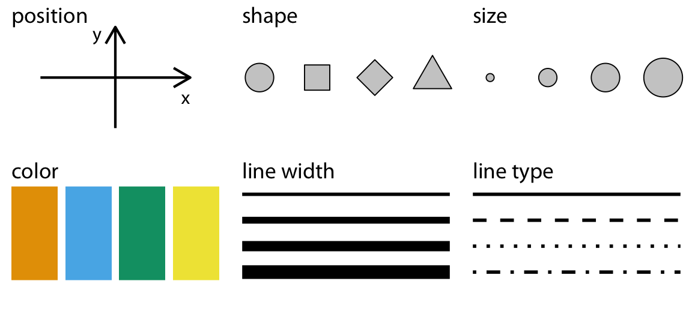
:::
:::

::: notes
From the Data Visualisation Basics chapter, which they were asked to read beforehand. We read size as amount, hotter colours as larger values, opacity as strength. Next week, the Gestalt chapter explains why these work.
:::

## Mapping: a column becomes an aesthetic

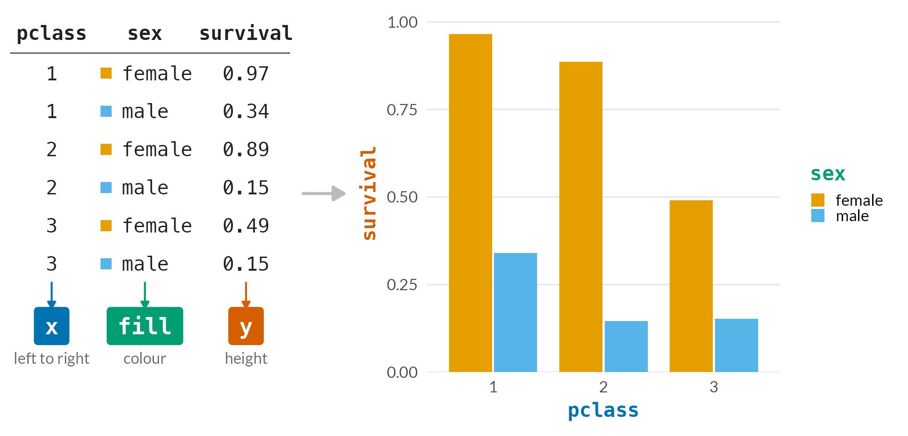{.r-stretch}

::: small
`aes(x = pclass, y = survival, fill = sex)` · each **column** → one **aesthetic** · each **row** → one bar
:::

::: notes
The opening chart, taken apart. Six rows in the table, six bars in the chart. pclass decides where a bar sits left to right, survival decides how tall it is, sex decides its colour. The orange square next to "female" in the table is the same orange as the bars: ggplot chooses that colour for each value and writes the key in the legend. aes() is just this list of assignments; we'll write it ourselves in a few minutes.
:::

## Same data, three mappings

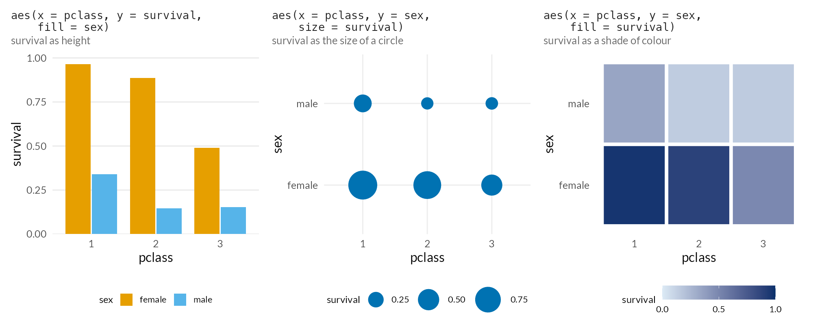

::: predict
**Try:** in which chart is it easiest to see that survival for women in 3rd class (0.49) is about half that for women in 2nd class (0.89)? Why?
:::

::: notes
All three use exactly the same six numbers; only the mapping changes. Most people say the bars: we judge position and length along a common baseline much more precisely than area or shade (Cleveland and McGill's 1984 ranking of visual encodings). The circles look closer than they are, and the shades of blue are only good for spotting the broad pattern. So the most important value in a chart should usually go on x or y; colour and size are for the secondary variable. That's also why the heatmap works better with many cells, when bars would be too crowded.
:::

## What kind of data is it?

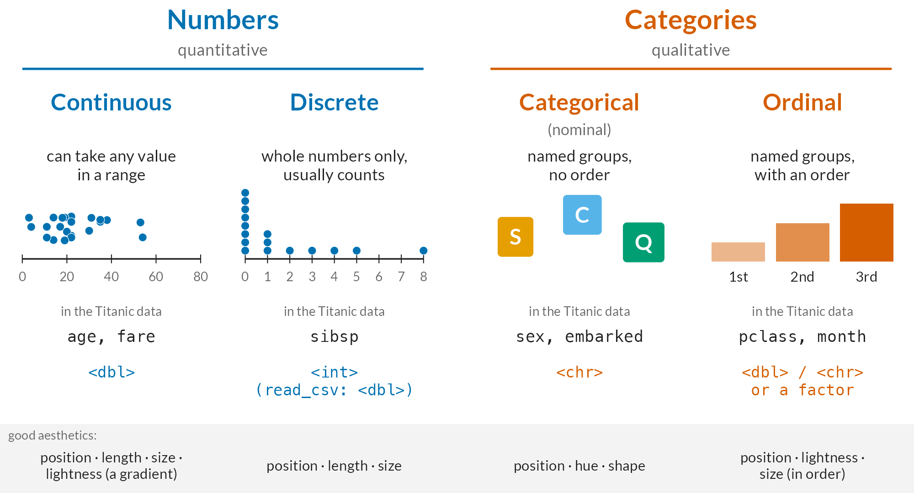{width="100%"}

::: notes
The type of a column decides which aesthetics make sense. Numbers have a size, so they suit position, length, size and a gradient of lightness. Categories have no size, so they suit distinct hues and shapes: shape can only show categories. Ordinal sits in between: the groups have an order, so a light-to-dark scale works, but the gaps between them aren't measured. Ask: which type is pclass? It's stored as a number <dbl>, but it's really ordinal: there's no second-and-a-half class. sibsp (siblings and spouses on board) is discrete: most passengers had none, one dot per ~120 passengers. If we mapped pclass to colour, ggplot would treat it as continuous and give us a gradient; the "Categorical or continuous?" slide later shows that happening with fare.
:::

# ggplot2 {.section-break}

The grammar of graphics

## Layers

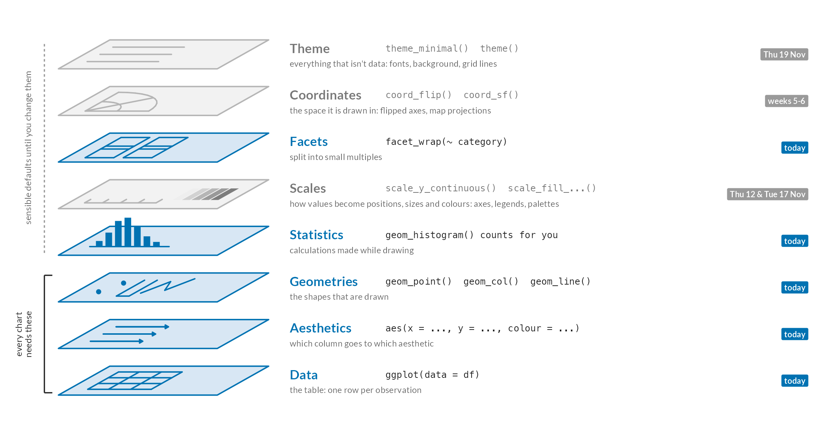{height="530"}

::: small
Every chart needs **data**, **aesthetics** in `aes()` and a **geometry** `geom_...()`, joined with `+`. Every other layer has a default you can change, with another `+`
:::

::: notes
The 'gg' is the grammar of graphics: a chart is a stack of independent layers. The bottom three you always write yourself. The rest are always there too, but ggplot fills them in for you: when we map a column to fill, a scale decides which colours and draws the legend; the coordinates are ordinary x and y; the theme is the grey background. Today: data, aesthetics, geoms, a bit of statistics (the histogram counts for you) and facets. Scales on Thursday and next Tuesday, themes on 19 Nov, coordinates when we get to maps. Because each layer is independent, changing a bar chart into a line chart is one word, and changing the colours never touches the geometry.
:::

## Step 1: summarise

What we want to show: the number of women and men on board

```{webr-r}
df <- titanic_df |>
  group_by(sex) |>
  summarise(n = n())

df
```

::: notes
female 466, male 843. The workflow from now on: clean and filter, summarise, then visualise. Most of the work is the dplyr part from the last two weeks.
:::

## Step 2: `ggplot()` + data + `aes()`

```{webr-r}
ggplot(data = df, aes(x = sex, y = n))
```

. . .

::: predict
An empty chart: ggplot knows *where* things go, but not *what* to draw
:::

::: notes
The axes are already labelled and scaled, from the aes() mapping. No geometry yet.
:::

## Step 3: add a geometry

```{webr-r}
ggplot(data = df, aes(x = sex, y = n)) +
  geom_col()
```

::: small
`+` adds a layer (not `|>`!) · one layer per line makes it easier to read
:::

::: notes
geom_col() draws a bar whose height is the y value. A very common mistake: using |> instead of + between layers. ggplot gives a helpful error ("Did you use %>% or |> instead of +?"); worth showing if anyone hits it.
:::

## Outside `aes()`: a fixed value

```{webr-r}
ggplot(data = df, aes(x = sex, y = n)) +
  geom_col(fill = 'red')
```

::: small
`fill` is the inside of the bar · `colour` is the outline · `linewidth`, `linetype`, `alpha`
:::

## Outside `aes()` {.try-it}

Give the bars a black outline with a linewidth of 2

```{webr-r}
ggplot(data = df, aes(x = sex, y = n)) +
  geom_col(___)
```

::: notes
geom_col(colour = 'black', linewidth = 2). Both spellings, colour and color, work. Same as the first Try it yourself in the ggplot2 chapter.
:::

## Inside `aes()`: a column from the data

```{webr-r}
df2 <- titanic_df |>
  group_by(sex, embarked) |>
  summarise(n = n())

ggplot(data = df2, aes(x = sex, y = n, fill = embarked)) +
  geom_col()
```

::: notes
Inside aes(), fill takes its values from the embarked column, and ggplot chooses the colours and adds a legend. Women: S 291, C 113, Q 60, NA 2. The rule to remember: a fixed value goes outside aes(); a column goes inside.
:::

## Spot the mistake

What will this draw? Predict, then run it

```{webr-r}
ggplot(data = df, aes(x = sex, y = n, fill = 'red')) +
  geom_col()
```

. . .

::: predict
Salmon-pink bars and a legend that says "red". Inside `aes()`, ggplot treats `'red'` as a piece of **data**, a category with one value, and gives it the first default colour. A fixed value belongs **outside** `aes()`
:::

::: notes
Probably the single most common ggplot mistake. If a legend appears that you didn't ask for, check what you put inside aes().
:::

## Inside `aes()` {.try-it}

Make the same chart as `df2`, but map the `linetype` to `embarked` as well

```{webr-r}
ggplot(data = df2, aes(___)) +
  geom_col(colour = 'black')
```

::: notes
aes(x = sex, y = n, fill = embarked, linetype = embarked). The outline needs a colour or you won't see the linetype, so colour = 'black' is given. Point out that the two mappings share one legend.
:::

## Categorical or continuous?

```{webr-r}
df3 <- titanic_df |>
  group_by(embarked) |>
  summarise(avg_paid = mean(fare, na.rm = TRUE), n = n())

ggplot(data = df3, aes(x = embarked, y = n, fill = avg_paid)) +
  geom_col()
```

::: small
Text column → separate, distinct colours · number column → one continuous gradient, dark to light
:::

::: notes
Cherbourg passengers paid 62 on average, Southampton 27, Queenstown 12: the bar for C is lightest. The two passengers with no port paid 80, which is why NA is the lightest bar. Same aesthetic, different scale, depending on the type of data.
:::

# More chart types {.section-break}

The Nobel Prize, 1901-2024

## The Nobel Prize data

```{webr-r}
nobel_df |>
  select(given_name, family_name, category, award_year, gender, age_at_award)
```

::: small
`nobel_df`: one row per laureate (981), joined from the laureates and prizes tables, with `age_at_award` calculated from the birth date
:::

::: notes
Physics 227 laureates, 2.2% women; Peace 17.1% and Literature 14.9%; Economics 3.1%. 66 women in total out of 981. Worth a sentence on the data: it records who the committees recognised, not who did the work. Swap geom_col for something else and the same grammar gives a new chart.
:::

## `geom_point()`: relationships

Are Nobel laureates getting older?

```{webr-r}
nobel_df |>
  ggplot(aes(x = award_year, y = age_at_award)) +
  geom_point()
```

::: small
One point per laureate: 961 of them (the 20 organisations have no age, hence the warning)
:::

::: notes
Ask what they see before saying anything. The cloud drifts upwards: the median age at the award was 55 in 1901-1924 and 68 since 2000 (correlation 0.35). A relationship is a pattern across many points, not a line through a handful. Two things to point out: the youngest laureate, bottom right (Malala Yousafzai, 17, Peace 2014), and the overlap: points sit on top of each other, so try geom_point(alpha = 0.3), outside aes() because it's a fixed value.
:::

## `geom_point()` {.try-it}

Does every prize follow the trend? Keep only `'Physics'`, and map `colour` to `gender`. Then try `'Peace'`

```{webr-r}
nobel_df |>
  filter(___) |>
  ggplot(aes(___)) +
  geom_point()
```

::: notes
filter(category == 'Physics') and aes(x = award_year, y = age_at_award, colour = gender). Physics goes up steeply: median 48 before 1975, 65 since; from Lawrence Bragg at 25 (1915) to Arthur Ashkin at 96 (2018). Five women in total, which colour makes easy to find. Peace goes the other way (correlation -0.32): Joseph Rotblat 87 in 1995, Malala 17 in 2014. So the overall trend hides different stories per prize; facet_wrap(~ category) later today shows all six at once.
:::

## `geom_line()`: change over time

```{webr-r}
nobel_df |>
  filter(category == 'Physics') |>
  mutate(decade = floor(award_year / 10) * 10) |>
  count(decade) |>
  ggplot(aes(x = decade, y = n)) +
  geom_line() +
  geom_point()
```

::: small
Two geoms on one chart: just add another `+`
:::

::: notes
floor(award_year / 10) * 10 turns 1957 into 1950. Physics laureates per decade rise from 13 in the 1900s to 28 in the 2000s (only 7 in the 1940s: no prizes 1940-42). A line implies that one point follows the next, so use it for things in sequence, usually time.
:::

## `geom_line()` {.try-it}

Draw the same chart for a different prize category. Then make the line a colour of your choice

```{webr-r}
nobel_df |>
  filter(___) |>
  mutate(decade = floor(award_year / 10) * 10) |>
  count(decade) |>
  ggplot(aes(x = decade, y = n)) +
  geom_line(___)
```

::: notes
For example filter(category == 'Literature') and geom_line(colour = 'darkred'). Literature stays at about one laureate a year (roughly ten a decade), unlike the sciences, which are often shared. The names must be spelled exactly as in the data: 'Physiology or Medicine', 'Economic Sciences'.
:::

## Distributions

How old are laureates when they win?

```{webr-r}
nobel_df |>
  ggplot(aes(x = age_at_award)) +
  geom_histogram(binwidth = 5)
```

::: small
Only `x`: the height of each bar is counted for you · `binwidth = 5` makes bars of five years · also `geom_density()` and `geom_boxplot()`
:::

::: notes
Median age 60, range 17 (Malala Yousafzai, Peace 2014) to 97 (John Goodenough, Chemistry 2019). The warning about removed rows is the 20 organisations and others with no birth date. Try binwidth = 1 and 20 to show how the choice changes the picture.
:::

## Small multiples: `facet_wrap()`

Six lines on one chart, or six small charts?

```{webr-r}
nobel_df |>
  mutate(decade = floor(award_year / 10) * 10) |>
  count(decade, category) |>
  ggplot(aes(x = decade, y = n)) +
  geom_line() +
  facet_wrap(~ category)
```

::: notes
First show it with colour = category in aes() and without the facet, then switch. Every panel shares the same scales, so you can compare them directly: the sciences grow, Literature and Peace stay flat. Ask: why does every line drop at the end? The 2020s only have five years in the data. Always check what a chart actually shows before interpreting it.
:::

## Part-to-whole: `position = 'fill'`

What share of each category's laureates are women?

```{webr-r}
nobel_df |>
  count(category, gender) |>
  ggplot(aes(x = category, y = n, fill = gender)) +
  geom_col(position = 'fill')
```

::: predict
**Try:** remove `position = 'fill'` and run it again. Which version answers the question better?
:::

::: notes
With 'fill', each bar is stretched to 1, so the y axis is a proportion: Peace 17%, Physics 2%. Without it, the bars show counts, and the small categories (Economics) are hard to read. The question decides which is right. The category labels overlap; fixing that is for next week (scales and themes).
:::

# Choosing a chart {.section-break}

What am I trying to show?

## Start from the question

::: {.columns style="font-size: 0.6em;"}
::: {.column width="25%"}
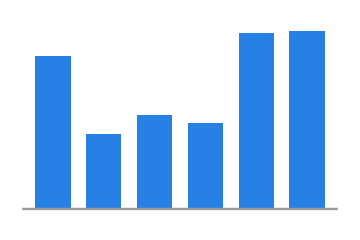
**Amounts**: `geom_col()`

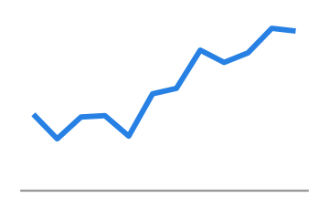
**Change over time**: `geom_line()`
:::

::: {.column width="25%"}

**Ranking**: ordered bars, lollipops

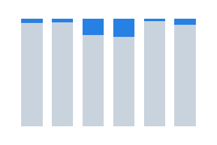
**Part-to-whole**: `position = 'fill'`
:::

::: {.column width="25%"}
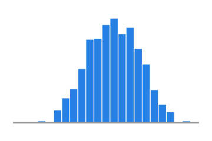
**Distribution**: `geom_histogram()`, `geom_boxplot()`

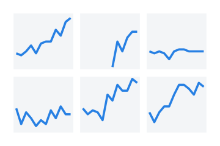
**Comparison**: `facet_wrap()`
:::

::: {.column width="25%"}
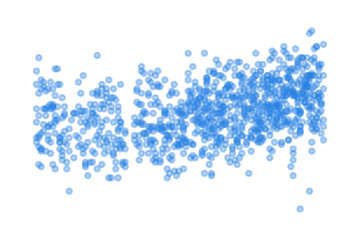
**Relationship**: `geom_point()`

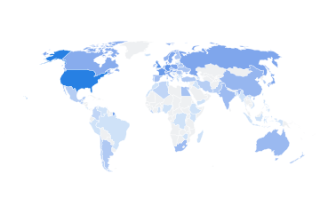
**Spatial**: maps, weeks 5-6
:::
:::

::: notes
The chart-chooser cards from the More chart types chapter. The FT Visual Vocabulary (linked in the book) does the same thing in much more detail. Worth keeping open while planning Report 1.
:::

## Which chart? {.try-it}

Discuss with your neighbour: which chart type, and which geom?

1.  How long are published novels? Are most about the same length, or are there lots of very short and very long ones?
2.  Books published each year, 1800-1900, in eight countries. As eight coloured lines, they overlap and are hard to tell apart
3.  Did women readers at Shakespeare and Company borrow a larger *share* of books by women than men did?

::: notes
1: a distribution, so a histogram or density plot; a boxplot to compare decades. 2: add facet_wrap(~ country), and then remove colour = country, as each panel is labelled. 3: part-to-whole: count(reader_gender, author_gender) and geom_col(position = 'fill'), with reader gender on x and author gender as fill (29% against 15%, from data challenge 2). The first two are the Check your understanding questions at the end of the chapter.
:::

## Before you make a chart, ask...

1.  What is my question, or the story I want to tell?
2.  Which of these am I trying to show: amounts, ranking, distribution, relationship, change, part-to-whole, comparison, place?
3.  What type of data are the variables?
4.  Which chart type, and which aesthetics, fit both?

::: predict
If you can't answer the first question, no chart type will help
:::

# Report 1 {.section-break}

A short visual essay

## Report 1: data visualisation

-   A **question** you're interested in, answered with a **dataset** of your choice
-   Around **1,200-1,500 words**, with **three or four visualisations** made with ggplot2, written in R Markdown
-   Explain your question, where the data comes from and how it was made, what you did to it, and what your charts show
-   Reflect on the limitations of the data, and of your choices
-   **20%** of the final grade · due **Monday 23 November** · the .Rmd and knitted .html as a .zip on Brightspace

::: notes
The data page in the book (Useful information) has suggested datasets and examples of visual essays to look at for inspiration. Anything from the course so far is fine as a starting point, including the Shakespeare and Company data. The next two weeks teach the rest of what they need: scales, colour, titles, themes and annotations.
:::

## The next two weeks

| | | |
|---|---|---|
| **Thu 12 Nov** | Gestalt principles, scales | **Pitch** your dataset and question to the class: one or two sentences |
| **Tue 17 Nov** | Date and colour scales | |
| **Thu 19 Nov** | Titles, themes, annotations | Bring a **draft chart** from your report |
| **Mon 23 Nov** | | **Report 1 due** |

::: notes
For Thursday they don't need a finished plan, just a dataset and a question they find interesting. Encourage them to load the dataset in RStudio before Thursday, to check they can actually read it in.
:::

## Your turn {.your-turn}

In the course book:

-   **Chapters 27-29**: Data Visualisation Basics, Using ggplot2, More chart types. Try every Try it yourself
-   **Chapter 30, Practice exercises**: these check your code automatically. The last two are a challenge

::: predict
**Stuck?** Layers are joined with `+`, not `|>` · a column goes inside `aes()`, a fixed value outside · a legend you didn't ask for? Check what's inside `aes()` · column names without quotes, colours in quotes · ask your neighbour, then put your hand up
:::

## Before Thursday

**Home exercise 5** (chapter 31): ungraded practice, no need to submit

-   The Bellevue Almshouse data again: bar charts, histograms and line charts of admissions in 1840s New York
-   The final challenge: far too many professions for one bar chart. What would you do?

**Read** the short Gestalt Principles chapter beforehand (no code, 10-15 minutes)

**Choose** a dataset and a question for Report 1, to pitch on Thursday

**Thursday 12 Nov:** Data Visualisation 2. Gestalt principles, scales, and position scales
