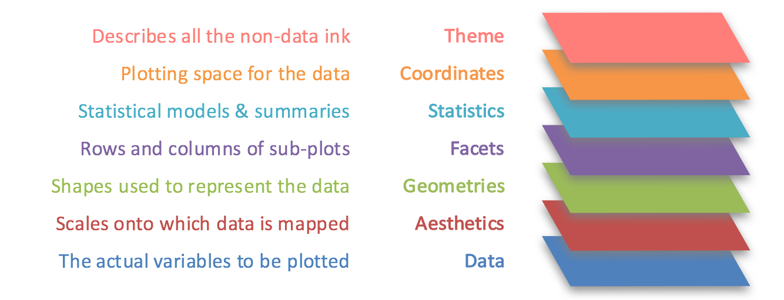

## Today

```{webr-r}
#| context: setup

library(dplyr)
library(readr)
library(stringr)
library(tidyr)
library(ggplot2)
options(width = 80, pillar.print_min = 5, pillar.print_max = 5)
theme_set(theme_grey(base_size = 16))

url1 <- "https://raw.githubusercontent.com/yann-ryan/infovis_data/main/nobel/laureates_df.csv"
download.file(url1, "laureates_df.csv")
laureates_df <- read_csv("laureates_df.csv", show_col_types = FALSE)

url2 <- "https://raw.githubusercontent.com/yann-ryan/infovis_data/main/nobel/prize_df.csv"
download.file(url2, "prize_df.csv")
prize_df <- read_csv("prize_df.csv", show_col_types = FALSE)

nobel_df <- laureates_df |>
  left_join(prize_df, by = 'prize_id') |>
  mutate(birth_year = as.numeric(str_sub(birth_date, 1, 4)),
         age_at_award = award_year - birth_year)

nobel_summary <- nobel_df |>
  group_by(category) |>
  summarise(n = n(),
            pct_female = mean(gender == 'female', na.rm = TRUE) * 100,
            avg_age = mean(age_at_award, na.rm = TRUE))

nobel_by_year <- tibble(award_year = 1901:2024) |>
  left_join(nobel_df |> count(award_year), by = 'award_year') |>
  mutate(n = replace_na(n, 0))
```

1.  A chart that stands on its own
2.  Titles and labels
3.  Themes
4.  Annotations and highlights
5.  Remaking the critique charts
6.  Report 1: finishing your charts

::: notes
Open the deck a minute before class: the setup downloads the Nobel data and loads ggplot2, which is slow in the browser. The answers to each Try it yourself are in these notes. Rough timing for two hours: intro 5 min, titles and labels 20, themes 20, annotations 25, remaking the critique charts 10 to introduce, then your turn. Report 1 is due on Monday, so leave time for questions; anyone who brought a draft chart can use today's techniques on it directly.
:::

## A chart that stands on its own

```{webr-r}
nobel_summary |>
  ggplot(aes(x = avg_age, y = pct_female, size = n, colour = category)) +
  geom_point()
```

::: predict
**Discuss:** someone sees this chart on its own, shared without the report around it. What don't they know?
:::

::: notes
One point per prize: average age at the award on x, the percentage of laureates who are women on y, the number of laureates as size. A reader doesn't know: what the data is (Nobel laureates), the time period (1901-2024), what avg_age and pct_female mean, where the data comes from, and what they're meant to notice (Peace and Literature have far more women than the sciences). Charts get separated from their context: screenshots, slides, people skipping straight to the figures. Today's three tools fill these gaps: labels say what things are, annotations say what to look at, themes control how it looks.
:::

# Titles and labels {.section-break}

## `labs()`

```{webr-r}
nobel_summary |>
  ggplot(aes(x = avg_age, y = pct_female, size = n, colour = category)) +
  geom_point() +
  labs(title = "Age and gender at the Nobel Prize",
       subtitle = "Each point is one prize category, 1901-2024",
       caption = "Data: the Nobel Prize API")
```

::: small
**title**: the headline · **subtitle**: what the reader is looking at · **caption**: the source, and any caveats
:::

::: notes
From the Titles chapter. labs() is one layer, with each label as an argument, separated by commas: one per line makes it easier to read. A caption with the source is expected in every chart in Report 1. Not every context wants a title: academic articles usually put the title in the figure caption under the chart instead. Reports, blogs and journalism usually have it in the chart.
:::

## A title that says something

::: columns
::: {.column width="50%"}
**Describes the chart**

"Age and gender at the Nobel Prize"
:::

::: {.column width="50%"}
**Says what it shows**

"Peace and Literature have the most women laureates"
:::
:::

::: predict
**Discuss:** which is better? When would you use each?
:::

::: notes
The second is a headline title: it tells the reader the finding, so they know what to look for. Journalism uses it almost always. The risk: it has to be true, and supported by the chart, and it can push one reading of the data. A good compromise for Report 1: a title that says the finding, and a subtitle that says what's being measured. Peace is 17.1% women, Literature 14.9%; the sciences between 2.2% (Physics) and 5.7% (Medicine).
:::

## Labelling the aesthetics

```{webr-r}
nobel_summary |>
  ggplot(aes(x = avg_age, y = pct_female, size = n, colour = category)) +
  geom_point() +
  labs(x = "Average age at the award",
       y = NULL,
       size = "Number of\nlaureates",
       colour = "Prize")
```

::: small
Every aesthetic in `aes()` can be relabelled in `labs()`, by name · `NULL` removes a label · `\n` starts a new line
:::

::: notes
By default, ggplot uses the column names, which are written for code, not for readers: avg_age, pct_female. The legend titles come from the same place, so size and colour are labelled the same way as x and y. Removing a label is useful when it's obvious (years on an x axis) or when the title already says it.
:::

## Labels {.try-it}

Label the y axis "% of laureates who were women", and remove the x axis label. Then give the chart a caption with the source

```{webr-r}
nobel_summary |>
  ggplot(aes(x = avg_age, y = pct_female, size = n, colour = category)) +
  geom_point() +
  labs(___)
```

::: notes
labs(y = "% of laureates who were women", x = NULL, caption = "Data: the Nobel Prize API"). Removing the x label here is a bad idea, since "average age at the award" isn't obvious from the numbers: ask them whether it was. Leaving the ___ in gives "unexpected input".
:::

## Text from the data: `geom_text()`

```{webr-r}
nobel_summary |>
  ggplot(aes(x = avg_age, y = pct_female, size = n)) +
  geom_point() +
  geom_text(aes(label = category), size = 5, vjust = -1.2)
```

::: small
`geom_text()` is a geom like the others: `x` and `y` from the data, plus a `label` · `vjust` moves the text up or down
:::

::: notes
Labelling the points directly means the reader doesn't have to look back and forth to a legend, so the colour can go. vjust = -1.2 puts the text above the point. Some labels go off the edge or overlap: one fix is a wider scale (scale_x_continuous(limits = ...)), the question at the end of that section of the chapter.
:::

## Only some labels

```{webr-r}
labels_df <- nobel_summary |>
  filter(category %in% c("Peace", "Literature")) |>
  mutate(label = paste0(category, " (", round(pct_female), "% women)"))

nobel_summary |>
  ggplot(aes(x = avg_age, y = pct_female, size = n)) +
  geom_point() +
  geom_text(data = labels_df, aes(label = label), size = 5, vjust = -1.2)
```

::: small
A second dataset, with only the rows to label, given to `geom_text()` with `data =` · `paste0()` joins text and numbers into a label
:::

::: notes
With six categories, labelling all of them is fine; with a hundred, label only the ones you'll talk about. The chapter uses paste() with sep = ''; paste0() is the same thing without spaces. str_c() from stringr (used in the remake exercises) does the same. Point out that the label layer uses different data from the points: the same idea as the city names in Minard and the pumps in Snow.
:::

## Labels from the data {.try-it}

Label Physics and Chemistry instead, with the category and the average age, rounded: "Physics, 58"

```{webr-r}
labels_df <- nobel_summary |>
  filter(___) |>
  mutate(label = paste0(___))

nobel_summary |>
  ggplot(aes(x = avg_age, y = pct_female, size = n)) +
  geom_point() +
  geom_text(data = labels_df, aes(label = label), size = 5, vjust = -1.2)
```

::: notes
filter(category %in% c("Physics", "Chemistry")), mutate(label = paste0(category, ", ", round(avg_age))). Physics: 57.5, so "Physics, 58"; Chemistry: 58.8, so "Chemistry, 59". A common mistake: paste0(category, ", ", avg_age) without round(), which gives 15 decimals.
:::

# Themes {.section-break}

Everything that isn't the data

## The theme layer

::: columns
::: {.column width="45%"}
{height="520"}
:::

::: {.column style="width: 55%; font-size: 0.8em;"}
The **theme** controls the "non-data ink": backgrounds, grid lines, fonts, the position of the legend

It changes how the chart looks, never what it shows

Two ways to use it:

-   a **preset** theme, which changes everything at once
-   **`theme()`**, which changes one element at a time
:::
:::

::: notes
The layers diagram from week 3; the theme sits at the top. Changing the theme can't change the data, the scales or the geoms, which is why it's safe to experiment with. But it does change what's easy to read: grid lines help reading values, a background can make light colours disappear.
:::

## Preset themes

```{webr-r}
nobel_summary |>
  ggplot(aes(x = category, y = n)) +
  geom_col() +
  coord_flip() +
  theme_minimal()
```

::: predict
**Try:** `theme_classic()`, `theme_bw()`, `theme_light()`, `theme_void()`. What changes each time? Which would you use for a bar chart, and which for a map?
:::

::: notes
The full list is linked in the chapter. theme_minimal(): no background, light grid. theme_classic(): axis lines, no grid, like a textbook. theme_void(): nothing at all, which is useful for maps and for the Snow and Du Bois remakes, where the axes mean nothing to the reader. For a bar chart, grid lines in the direction of the values help; theme_minimal() or theme_light(). The ggthemes package has more (theme_economist() is on the chapter's opening chart), but it needs installing.
:::

## Changing one element: `theme()`

```{webr-r}
nobel_summary |>
  ggplot(aes(x = category, y = n)) +
  geom_col() +
  theme(axis.title.x = element_text(size = 22, face = "bold"))
```

::: {style="font-size: 0.75em;"}
| Part of the chart | Element function | Change |
|----|----|----|
| text: titles, axis labels, legend text | `element_text()` | `size`, `face`, `colour`, `angle`, `hjust` |
| lines: grid, axis lines, ticks | `element_line()` | `colour`, `linewidth`, `linetype` |
| rectangles: backgrounds, borders | `element_rect()` | `fill`, `colour` |
| anything | `element_blank()` | removes it |
:::

::: notes
The pattern is theme(element = element_type(changes)). The element names are listed in the chapter's big diagram (images/35_themes/03.png): worth saving. axis.title is the axis label ("n"); axis.text is the numbers or category names along the axis. People confuse the two. Elements have families: axis.title changes both axes, axis.title.x only one; text changes every piece of text in the chart.
:::

## Long category names

```{webr-r}
nobel_summary |>
  ggplot(aes(x = category, y = n)) +
  geom_col() +
  theme(axis.text.x = element_text(angle = 45, hjust = 1, vjust = 1))
```

::: small
`angle` rotates the text · `hjust = 1` and `vjust = 1` line up the *end* of the text with the bar
:::

::: notes
From the chapter. Try it without hjust and vjust: the labels rotate around their middle and float above the axis. Compare with coord_flip() from last week, which is often easier to read than slanted text: horizontal bars with horizontal names. Slanted text is fine for short labels like years.
:::

## The legend

```{webr-r}
nobel_summary |>
  ggplot(aes(x = avg_age, y = pct_female, size = n, colour = category)) +
  geom_point() +
  theme_minimal() +
  theme(legend.position = "bottom")
```

::: small
`legend.position`: `"right"`, `"left"`, `"top"`, `"bottom"`, or `"none"` to remove all legends · to remove just one, use `guides(colour = "none")`
:::

::: notes
legend.position = "none" was in the Gestalt chapter. Put the preset theme before theme(): a preset replaces every element, so a theme() before it is overwritten. guides(colour = "none") comes up in the Minard remake, where only one of the two legends goes. With two legends at the bottom they sit side by side and can get crowded.
:::

## Themes {.try-it}

Change the panel background to `lightblue`, make the title size 24 and bold, and make the grid lines dashed

```{webr-r}
nobel_summary |>
  ggplot(aes(x = category, y = n)) +
  geom_col() +
  coord_flip() +
  labs(title = "Nobel laureates by prize, 1901-2024") +
  theme(panel.background = ___,
        plot.title = ___,
        panel.grid = ___)
```

::: notes
The exercise from the Themes chapter. panel.background = element_rect(fill = "lightblue"), plot.title = element_text(size = 24, face = "bold"), panel.grid = element_line(linetype = "dashed"). The panel is the area behind the data; the plot is the whole chart, including titles (plot.background). Ask: is the chart better? (Probably not: the blue background makes the bars harder to see. Themes can make a chart worse as easily as better.)
:::

# Annotations and highlights {.section-break}

Telling the reader where to look

## `annotate()`: a label

```{webr-r}
nobel_summary |>
  ggplot(aes(x = avg_age, y = pct_female, size = n)) +
  geom_point() +
  annotate(geom = "text", x = 59, y = 16.5, label = "Peace", size = 6)
```

::: small
`annotate()` adds a geom with positions you give it, not from the data · `x` and `y` are in the units of the axes
:::

::: notes
The difference from geom_text(): geom_text() draws one label for every row of the data; annotate() draws exactly one thing, where you say. Use annotate() for a single label, line or box; geom_text() for labels that come from the data. Peace is at avg_age 60.8, pct_female 17.1. The text is placed just below and to the left, in empty space, ready for an arrow. (The chapter puts it at x = 56, y = 19, which stretches the axes; either works.)
:::

## An arrow

```{webr-r}
nobel_summary |>
  ggplot(aes(x = avg_age, y = pct_female, size = n)) +
  geom_point() +
  annotate(geom = "text", x = 59, y = 16.5, label = "Peace", size = 6) +
  annotate(geom = "curve", x = 59.4, y = 16.6, xend = 60.6, yend = 17.05,
           arrow = arrow(type = "closed", length = unit(2, "mm")))
```

::: small
`"curve"` (or `"segment"` for a straight line) runs from `x`, `y` to `xend`, `yend` · `arrow()` adds the head · its `length` needs `unit()`
:::

::: notes
To find where the arrow should end, look the values up in the data: nobel_summary |> filter(category == "Peace"). Ending exactly on the point puts the head inside it; stop just short. curvature = -0.3 bends it the other way. The arrow() syntax is the awkward part: length = unit(2, "mm"), not length = 2.
:::

## Annotations {.try-it}

Add a label and an arrow pointing to Physics. Find its position in the data first

```{webr-r}
nobel_summary |> filter(category == "Physics")
```

```{webr-r}
nobel_summary |>
  ggplot(aes(x = avg_age, y = pct_female, size = n)) +
  geom_point() +
  annotate(___) +
  annotate(___)
```

::: notes
Physics: avg_age 57.5, pct_female 2.2. For example: annotate(geom = "text", x = 56, y = 6, label = "Physics", size = 6) + annotate(geom = "curve", x = 56, y = 5.3, xend = 57.3, yend = 2.5, arrow = arrow(type = "closed", length = unit(2, "mm"))). Any empty spot works; the text should not cover other points.
:::

## Lines and areas

```{webr-r}
nobel_by_year |>
  ggplot(aes(x = award_year, y = n)) +
  geom_line() +
  annotate(geom = "rect", xmin = 1939, xmax = 1946, ymin = 0, ymax = Inf,
           alpha = 0.3, fill = "grey50") +
  annotate(geom = "segment", x = 1969, xend = 1969, y = 0, yend = Inf,
           linetype = "dashed") +
  annotate(geom = "text", x = 1970, y = 2.5, label = "Economics prize\nfrom 1969",
           hjust = 0, size = 5)
```

::: small
`"rect"` takes `xmin`, `xmax`, `ymin`, `ymax` · `Inf` means "to the edge of the chart" · `geom_vline(xintercept = 1969)` also draws a vertical line
:::

::: notes
No prizes at all were awarded in 1940, 1941 and 1942, during the Second World War: the line drops to 0. The rect makes the reader see the dip as one event. The Economic Sciences prize was first awarded in 1969, which is part of why there are more laureates per year afterwards (the other reason: prizes shared between more people). The same technique is in the Snow remake: a line on the day the pump handle was removed.
:::

## Highlighting with colour

```{webr-r}
highlight_df <- nobel_summary |>
  filter(category %in% c("Peace", "Literature"))

nobel_summary |>
  ggplot(aes(x = avg_age, y = pct_female, size = n)) +
  geom_point(colour = "grey70") +
  geom_point(data = highlight_df, colour = "firebrick")
```

::: small
Draw everything in grey, then draw the rows you want to highlight again, on top, in colour
:::

::: notes
Pre-attentive processing, from the Gestalt warm-up: one colour among greys is seen before anything else. Colour is outside aes() in both layers, because it's one fixed colour, not a mapping, so there's no legend: the title or a label should say what the red points are. The same trick as the Broad Street deaths in the Snow remake, done there with a TRUE/FALSE column and scale_colour_manual().
:::

## Highlights {.try-it}

Highlight the four science prizes (Chemistry, Economic Sciences, Physics, Physiology or Medicine) instead, and add a label that says what they are

```{webr-r}
highlight_df <- nobel_summary |>
  filter(___)

nobel_summary |>
  ggplot(aes(x = avg_age, y = pct_female, size = n)) +
  geom_point(colour = "grey70") +
  geom_point(data = highlight_df, colour = "firebrick")
```

::: notes
filter(category %in% c("Chemistry", "Economic Sciences", "Physics", "Physiology or Medicine")), or filter(!category %in% c("Peace", "Literature")). Then for example annotate(geom = "text", x = 62, y = 8, label = "The four science prizes", colour = "firebrick", size = 6). Ask where to put the label so it's clearly about the red points: next to them, in the same colour (Gestalt: proximity and similarity).
:::

# Remaking the critique charts {.section-break}

Your sheet, in R

## Remaking the critique charts

Each group remakes its own critique chart, in R-Studio

::: {style="font-size: 0.8em;"}
| Group | Chart | Chapter |
|----|----|----|
| 1 | Nightingale: causes of mortality | 50 |
| 2 | Minard: Napoleon's campaign | 46 |
| 3 | Du Bois: household furniture | 48, or 49 (harder: from raw data, synthetic) |
| 4 | Snow: cholera in Soho | 47 |
:::

::: predict
Most steps say what to do, but not which function: look back at the chapters first, then open the **Hint**. Steps marked **New** use something we haven't covered, and their hint gives the code. Numbers in brackets check your work
:::

::: notes
The data in each one needs some wrangling first (pivot_longer() in all four, joins in Du Bois and Snow), then the chart, then scales, then titles, labels and annotations from today. Chapter 49 uses an invented county-level dataset made for teaching: say clearly that it's synthetic; only its state totals are real. Groups that finish can try another chart. Answer keys are in _answers/ (not published).
:::

## Every remake has a scale decision

::: {style="font-size: 0.85em;"}
-   **Minard:** should the width of the line be proportional to the number of soldiers? Then the retreat almost disappears
-   **Nightingale:** should the radius or the *area* of a wedge show the death rate?
-   **Du Bois:** a ring can't go round more than once, and his spiral does. What does that do to the later years?
-   **Snow:** which pump was "nearest", and how many deaths does the map show?
:::

::: predict
Bring what you find to Tuesday: the last critique round, on accessibility and ethics, uses the same sheets
:::

::: notes
These are the discussion questions in each chapter; they connect to Tuesday's scales (scale_size_area(), limits removing values). Minard: default linewidth range makes 340,000 vs 4,000 look like 6 to 1, not 85 to 1. Nightingale: a linear radius makes January 1855 look about 4.5 times March, for a rate about 2.1 times as high; scale_y_sqrt() fixes it. Du Bois: limits below the largest value remove the three biggest years. Snow: 359 of 578 deaths are nearest to Broad Street in a straight line; the table has 616 deaths.
:::

# Report 1 {.section-break}

Due Monday 23 November

## Finishing your charts

For each chart in Report 1, check:

::: {style="font-size: 0.8em;"}
-   **Title:** does it say what the chart shows? Is there a subtitle saying what's measured?
-   **Caption:** does it give the source of the data?
-   **Labels:** are the axes and legends in words a reader understands, with units? Are any labels unnecessary?
-   **Annotation:** is there one thing the reader should see? Point to it
-   **Theme:** is the text big enough? Does the background help, or get in the way?
:::

::: predict
Take one draft chart from your report, and apply one thing from each section of today
:::

::: notes
Report 1: 1,200-1,500 words, three or four ggplot2 charts, R Markdown, the .Rmd and knitted .html as a .zip on Brightspace, Monday 23 November, 20% of the grade. Most common weaknesses in draft charts: column names as axis labels (pct_female), no source, alphabetical bars, and a default legend title. If they brought a draft chart, this is the time to work on it.
:::

## Your turn {.your-turn}

In the course book:

-   **Chapters 43-45**: Titles and Labels, Chart Themes, Annotations and Highlights. Try every Try it yourself
-   **Chapters 46-50**: remake your group's critique chart
-   **Chapter 51**: practice exercises, checked in the browser
-   Or: work on Report 1, and ask

::: predict
**Stuck?** Labels for any aesthetic go in `labs()` · one `theme()` element = one `element_` function · `annotate()` for one thing in a fixed place, `geom_text()` for labels from the data · a preset theme goes *before* `theme()`
:::

## Before Tuesday

**Report 1**: due **Monday 23 November**, on Brightspace

**Read** chapters 52-54: Ethics and data visualisation, Reproducibility and FAIR data, Data Visualisation and Accessibility

**Home exercise 7** (chapter 56): make a Nobel chart more accessible

**Tuesday 24 Nov:** Ethics, FAIR data and accessibility. The third critique round
