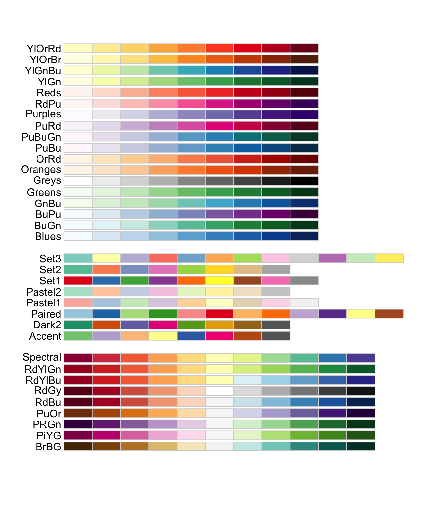

## Today

```{webr-r}
#| context: setup

library(dplyr)
library(readr)
library(stringr)
library(tidyr)
library(ggplot2)
options(width = 80, pillar.print_min = 5, pillar.print_max = 5)
theme_set(theme_grey(base_size = 16))

url0 <- "https://raw.githubusercontent.com/yann-ryan/cultural_analytics_book/main/bellevue_almshouse_modified.csv"
download.file(url0, "bellevue_almshouse_modified.csv")
bellevue_dataset <- read_csv("bellevue_almshouse_modified.csv", show_col_types = FALSE)

df <- bellevue_dataset |>
  group_by(date_in) |>
  summarise(n = n())

url1 <- "https://raw.githubusercontent.com/yann-ryan/infovis_data/main/nobel/laureates_df.csv"
download.file(url1, "laureates_df.csv")
laureates_df <- read_csv("laureates_df.csv", show_col_types = FALSE)

url2 <- "https://raw.githubusercontent.com/yann-ryan/infovis_data/main/nobel/prize_df.csv"
download.file(url2, "prize_df.csv")
prize_df <- read_csv("prize_df.csv", show_col_types = FALSE)

nobel_df <- laureates_df |>
  left_join(prize_df, by = 'prize_id') |>
  mutate(birth_year = as.numeric(str_sub(birth_date, 1, 4)),
         age_at_award = award_year - birth_year)

nobel_summary <- nobel_df |>
  group_by(category) |>
  summarise(n = n(),
            pct_female = mean(gender == 'female', na.rm = TRUE) * 100,
            avg_age = mean(age_at_award, na.rm = TRUE))

nobel_by_year <- nobel_df |>
  count(award_year)
```

1.  Recap: what a scale does
2.  Date scales: breaks and labels for dates
3.  Colour scales: continuous and discrete, and choosing a palette
4.  Size scales and legends
5.  Report 1: scales in your charts

::: notes
Open the deck a minute before class: the setup downloads two datasets (Bellevue Almshouse and Nobel) and loads ggplot2, which is slow in the browser. The answers to each Try it yourself are in these notes. Rough timing for two hours: recap 10 min, date scales 25, colour 40, size and legends 15, Report 1 10, your turn with what's left. Report 1 is due on Monday, so expect questions about it throughout.
:::

## Scales: a recap

A **scale** tells ggplot how to map a variable to an aesthetic: how each value in the data becomes a position, a colour or a size. ggplot adds a default scale for every aesthetic in `aes()`, and shows it to the reader as an axis or a legend

Last Thursday: **position scales**, for `x` and `y`

::: {.columns style="font-size: 0.8em;"}
::: {.column width="50%"}
**Continuous** (numbers)

Maps each value to a **distance** along the axis, in proportion: the same difference in the data is always the same distance on the chart

`scale_x_continuous()`, `scale_y_continuous()`
:::

::: {.column width="50%"}
**Discrete** (categories)

Maps each category to its own **slot** on the axis, evenly spaced. The gaps between slots mean nothing; the order is alphabetical unless you change it

`scale_x_discrete()`, `scale_y_discrete()`
:::
:::

::: notes
The layers diagram from week 3: scales sit above data, aesthetics and geometries. For a continuous scale, 100 laureates is twice as far from 0 as 50, which is why bar charts must start at 0. For a discrete scale, Chemistry and Physics are just next to each other in the alphabet; that's why we used reorder() inside aes() to put bars in order. The data type decides which scale ggplot picks, just as it will for colour today. scale_x_discrete() wasn't in the chapter: mention it exists, we didn't need it.
:::

## Changing a scale

```{webr-r}
nobel_by_year |>
  ggplot(aes(x = award_year, y = n)) +
  geom_line() +
  scale_x_continuous(limits = c(1980, 2000),
                     breaks = seq(from = 1980, to = 2000, by = 5)) +
  scale_y_continuous(limits = c(0, 20))
```

::: small
Add the scale as a layer with `+`, and change it with options **inside** the scale: `limits` for where the axis starts and ends, `breaks` for where the ticks and labels go. One scale per aesthetic
:::

::: predict
Today: the same idea for **dates**, **colour** and **size**. Different scale functions, many of the same options
:::

::: notes
Nobel laureates per year, from last Thursday's slides. Remind them: values outside the limits are removed ("Removed 100 rows"), not just hidden. In these years there were 6 to 13 laureates a year. Every scale today works the same way: scale_x_date() takes date_breaks instead of breaks; scale_fill_continuous() takes limits and breaks, which change the legend instead of the axis.
:::

# Date scales {.section-break}

Breaks and labels for dates

## The Bellevue Almshouse

```{webr-r}
bellevue_dataset |>
  select(date_in, first_name, last_name, age, disease)
```

::: small
9,584 admissions to the almshouse in New York, 1846-1847 · `<date>` under `date_in`: R has recognised the column as a **Date**
:::

::: notes
We used this dataset in week 2 (regex). read_csv() turns a column into a Date automatically if every value looks like 2026-11-17 (year-month-day). The dates run from 1 January 1846 to 31 December 1847, with 653 different days. The disease column records why each person was admitted, not always a disease: sickness, recent emigrant, destitution.
:::

## Why does a date need its own scale?

```{webr-r}
as.numeric(df$date_in) |> head()
```

. . .

::: predict
A Date is stored as the **number of days since 1 January 1970**. 1 January 1846 is day -45,290. The date scale turns those numbers back into readable dates on the axis
:::

. . .

::: small
And if the date were just text? Try `aes(x = as.character(date_in), y = n)` with `geom_point()`: 653 separate labels, in alphabetical order, with no gaps for the missing days
:::

::: notes
The learning objective: why dates need their own scale rather than a plain numeric one. Because a Date is a number underneath, ggplot can put it on a continuous axis, keep the distances between days right, and leave gaps where there were no admissions. A plain number scale would label the axis -45,000, -44,800. Text would give a discrete axis, one label per value, unreadable. If there's time, run the as.character version live: the axis is a black smear of labels.
:::

## A line chart of admissions

```{webr-r}
df |>
  ggplot() +
  geom_line(aes(x = date_in, y = n))
```

::: predict
**Discuss:** what happened in the spring of 1847?
:::

::: notes
Most months have 200 to 400 admissions. April 1847 has 953 and May 1,236; the busiest single day is 24 May 1847, with 113. This is the height of the emigration from Ireland during the Famine. "Recent emigrant" is the most common reason given in April and May 1847 (382 and 753 people), but it only appears as a reason from January 1847: before that the clerks didn't use it. So part of what the chart shows is a change in how the records were kept. Worth saying for Report 1: a spike can be in the world, or in the record. The default x axis shows a label every six months or so; next we choose our own.
:::

## `scale_x_date()`

```{webr-r}
df |>
  ggplot() +
  geom_line(aes(x = date_in, y = n)) +
  scale_x_date(date_breaks = "2 months")
```

::: small
`date_breaks` takes a number and a unit: `"1 week"`, `"2 months"`, `"1 year"` · compare `breaks = seq(...)` in `scale_x_continuous()`
:::

::: notes
The same idea as last Thursday's breaks, but with date units, so no need to work out how many days are in two months. The labels are now crowded; the labels slide fixes that.
:::

## Minor breaks

```{webr-r}
df |>
  ggplot() +
  geom_line(aes(x = date_in, y = n)) +
  scale_x_date(date_breaks = "2 months",
               date_minor_breaks = "1 week")
```

::: small
`date_minor_breaks`: the fainter grid lines in between, in any date unit
:::

::: notes
From the chapter. A week is a bit busy over two years; a month would be more readable.
:::

## Breaks {.try-it}

Put a major break every 6 months, and a minor break every month

```{webr-r}
df |>
  ggplot() +
  geom_line(aes(x = date_in, y = n)) +
  scale_x_date(date_breaks = ___,
               date_minor_breaks = ___)
```

::: notes
date_breaks = "6 months", date_minor_breaks = "1 month". Both are text, in quotes. "6 month" (singular) also works; "six months" doesn't. Leaving the ___ in gives "unexpected input", a parse error.
:::

## Date labels

::: columns
::: {.column width="55%"}
```{webr-r}
df |>
  ggplot() +
  geom_line(aes(x = date_in, y = n)) +
  scale_x_date(date_breaks = "2 months",
               date_labels = "%b %y")
```
:::

::: {.column style="width: 45%; font-size: 0.7em;"}
| Code | Gives        |
|------|--------------|
| `%d` | 17           |
| `%m` | 11           |
| `%b` | Nov          |
| `%B` | November     |
| `%y` | 26           |
| `%Y` | 2026         |

Anything else in the text is kept as it is: `"%d/%m"` gives 17/11
:::
:::

::: notes
The chapter links to the full list in the ggplot2 book. The codes come from R's format() function, so they work outside ggplot too: format(as.Date("2026-11-17"), "%B %Y"). The month names depend on the computer's language settings; in the browser they're English. %y for 1846 gives "46": fine here, confusing over a long period.
:::

## Labels {.try-it}

Label every 6 months, in the form "January 1846"

```{webr-r}
df |>
  ggplot() +
  geom_line(aes(x = date_in, y = n)) +
  scale_x_date(date_breaks = ___,
               date_labels = ___)
```

::: notes
date_breaks = "6 months", date_labels = "%B %Y". ggplot chooses where the breaks start: in ggplot2 4.0 they fall on May and November, not January and July (date_breaks counts from a rounded starting point, not from the first date). If someone gets "Jan 46", they used %b and %y.
:::

# Colour scales {.section-break}

Continuous and discrete

## Continuous or discrete?

```{webr-r}
nobel_summary |>
  ggplot(aes(x = category, y = n, fill = pct_female)) +
  geom_col()
```

::: predict
**Try:** change `fill = pct_female` to `fill = category`. What happens to the colours, and to the legend?
:::

::: notes
nobel_summary has one row per prize: the number of laureates, the percentage who are women, and the average age at the award. pct_female is a number, so ggplot picks a continuous scale (scale_fill_continuous): dark blue for low, light blue for high, and a colour bar for a legend. category is text, so it picks a discrete scale (scale_fill_discrete): six colours spaced around the colour wheel, with a key of boxes. The data type decides the scale, as with x and y. Percentages: Physics 2.2, Economics 3.1, Chemistry 4.1, Medicine 5.7, Literature 14.9, Peace 17.1. Colour by category repeats the x axis here: the chapter's note says this is common, and becomes useful once you facet or remove the axis labels.
:::

## `colour` or `fill`?

::: {style="font-size: 0.85em;"}
-   Points and lines are coloured with **`colour`**; bars, areas and boxes are filled with **`fill`** (their `colour` is the outline)
-   The scale's name has to match the aesthetic: `scale_fill_...` for `fill`, `scale_colour_...` for `colour`
-   Everything on the following slides works for both: swap the word
:::

::: predict
If the names don't match, nothing happens: no error, no change. `scale_colour_viridis_c()` on this bar chart leaves the bars blue
:::

::: notes
The most common reason a colour scale "doesn't work". ggplot also accepts color for colour.
:::

## Three kinds of palette

::: columns
::: {.column width="45%"}
{height="560"}
:::

::: {.column style="width: 55%; font-size: 0.75em;"}
**Sequential** (top): light to dark. For numbers, low to high

**Qualitative** (middle): distinct colours, no order. For categories

**Diverging** (bottom): two colours meeting at a midpoint. For numbers with a meaningful middle: zero, an average, a 50/50 split

::: predict
**Discuss:** which kind would you use for: the percentage of women laureates? The prize category? The difference between each prize's share of women and the overall share?
:::
:::
:::

::: notes
These are the ColorBrewer palettes, designed by the cartographer Cynthia Brewer for maps. The codes (Greens, RdPu, Set2, ...) are what we pass to the scales. Answers: percentage of women, sequential; category, qualitative; difference from the overall share, diverging, with 0 as the midpoint. A qualitative palette on numbers suggests there are separate groups; a sequential one on categories suggests an order that isn't there. The same thinking comes back next week in accessibility: colour should never be the only way to tell things apart.
:::

## Built-in: viridis

```{webr-r}
nobel_summary |>
  ggplot(aes(x = category, y = n, fill = pct_female)) +
  geom_col() +
  scale_fill_viridis_c()
```

::: small
`_c` for continuous data · designed to stay readable for people with colour vision deficiencies, and in black and white
:::

::: notes
Viridis is sequential: its lightness rises steadily from dark purple to yellow, so it still works printed in greyscale. There's a discrete version, scale_fill_viridis_d(), on a later slide.
:::

## From a palette: `scale_fill_distiller()`

```{webr-r}
nobel_summary |>
  ggplot(aes(x = category, y = n, fill = pct_female)) +
  geom_col() +
  scale_fill_distiller(palette = "RdPu")
```

::: small
`distiller` spreads continuous values along one of the ColorBrewer palettes
:::

::: notes
Point out that the highest values (Peace, Literature) are the lightest. distiller reverses the palette by default; direction = 1 puts it the other way round, so the darkest bars are the highest. Not in the chapter, worth mentioning: dark for "more" usually reads more naturally.
:::

## Palettes {.try-it}

Change the palette of this chart to "Greens"

```{webr-r}
nobel_summary |>
  ggplot(aes(x = category, y = n, fill = pct_female)) +
  geom_col() +
  scale_fill_distiller(palette = "RdPu")
```

::: notes
scale_fill_distiller(palette = "Greens"). The Try it yourself from the Colour chapter. The name is case-sensitive: "greens" gives the warning Unknown palette: "greens", and ggplot uses a default palette instead.
:::

## Your own gradient

```{webr-r}
nobel_summary |>
  ggplot(aes(x = category, y = n, fill = pct_female)) +
  geom_col() +
  scale_fill_gradient(low = 'firebrick', high = 'gold')
```

::: small
`scale_fill_gradient(low, high)`: a sequential scale between two colours · R knows over 600 colour names (r-charts.com/colors), or use a hex code like `'#2780e3'`
:::

::: notes
From the chapter. Two colours that differ in lightness as well as hue are easier to read than two equally bright ones.
:::

## A diverging gradient

```{webr-r}
nobel_summary |>
  ggplot(aes(x = category, y = n, fill = pct_female)) +
  geom_col() +
  scale_fill_gradient2(low = 'firebrick', mid = 'white', high = 'gold',
                       midpoint = 10)
```

::: predict
**Try:** 66 of the 981 laureates are women: 6.7%. Set `midpoint = 6.7`. What does the chart say now?
:::

::: notes
With midpoint = 10, as in the chapter, the white point is an arbitrary number. With 6.7, the overall share, red means "fewer women than the Nobel average" and gold means more. Physics, Economics, Chemistry and Medicine are red; Literature and Peace gold. Medicine (5.7%) is close to white. The midpoint should mean something you can put in a sentence.
:::

## Discrete scales

::: columns
::: {.column width="50%"}
```{webr-r}
nobel_summary |>
  ggplot(aes(x = category, y = n,
             fill = category)) +
  geom_col() +
  scale_fill_viridis_d()
```
:::

::: {.column width="50%"}
```{webr-r}
nobel_summary |>
  ggplot(aes(x = category, y = n,
             fill = category)) +
  geom_col() +
  scale_fill_brewer(palette = 'Set2')
```
:::
:::

::: small
`scale_fill_viridis_d()`: `_d` for discrete · `scale_fill_brewer()`: a ColorBrewer palette for categories (the discrete partner of `distiller`)
:::

::: notes
Each cell has its own plot. viridis_d gives six colours in order of lightness, which suggests the categories have an order; for categories, a qualitative palette like Set2 is usually the better choice. Set2 has eight colours; with more categories than that, ggplot warns and leaves the extra ones grey. With more than seven or eight categories, colour stops working anyway: group the small ones into "Other", or use facets.
:::

## Manual colours

```{webr-r}
nobel_summary |>
  ggplot(aes(x = category, y = n, fill = category)) +
  geom_col() +
  scale_fill_manual(values = c('firebrick', 'forestgreen', 'orange',
                               'steelblue', 'goldenrod', 'orchid'))
```

::: small
One colour per category, in the order the categories appear in the legend (alphabetical, unless you change it)
:::

::: notes
Useful when colours mean something: a party's colours, the colours used in a source, or keeping the same colour for the same category across every chart in a report. You can also name them: values = c(Physics = 'steelblue', ...), so the order doesn't matter.
:::

## Manual colours {.try-it}

Make Peace and Literature one colour, and the four science prizes (including Economics) another

```{webr-r}
nobel_summary |>
  ggplot(aes(x = category, y = n, fill = category)) +
  geom_col() +
  scale_fill_manual(values = ___)
```

::: notes
In alphabetical order the categories are Chemistry, Economic Sciences, Literature, Peace, Physics, Physiology or Medicine, so: values = c('grey60', 'grey60', 'firebrick', 'firebrick', 'grey60', 'grey60'). Any two colours work. This is also a preview of Thursday: grey for most things, one colour for what you want the reader to look at (the pre-attentive pop-out from the warm-up last week). Ask: the legend now has two identical colours four times; what would be better? Mapping fill to a new column made with mutate() and if_else() (arts or science), which gives a legend with two entries.
:::

## When a colour scale breaks

```{webr-r}
nobel_summary |>
  ggplot(aes(x = category, y = n, fill = pct_female)) +
  geom_col() +
  scale_fill_brewer(palette = 'Set2')
```

::: {style="font-size: 0.75em;"}
| You see | It means |
|----|----|
| Continuous value supplied to a discrete scale | a number, with `brewer`, `manual` or `viridis_d` |
| Discrete value supplied to a continuous scale | text, with `distiller`, `gradient` or `viridis_c` |
| Insufficient values in manual scale. 6 needed but only 2 provided | one colour per category |
| No error, no change | `scale_colour_` on `fill`, or the other way round |
:::

::: notes
Run it to see the first error, then ask how to fix it: either map fill to category, or use scale_fill_distiller(). Same rule as the data type slide: the scale has to match what's mapped. If pct_female were a number stored as text (as year was in week 2's tidying chapter), you'd get the second error and need as.numeric().
:::

# Size and legends {.section-break}

## Size

```{webr-r}
nobel_summary |>
  ggplot(aes(x = avg_age, y = pct_female, size = n)) +
  geom_point() +
  scale_size_area(max_size = 10)
```

::: small
Size is mapped to the **area** of the point · `scale_size_area()` makes 0 an area of 0, and `max_size` sets the biggest point
:::

::: notes
Each point is a prize: average age at the award on x, the share of women on y, the number of laureates as size. Economics is oldest (66.9 on average); Peace has the most women (17.1%). The sizes are hard to compare exactly (229 vs 197 looks the same): area is one of the weakest aesthetics, which the Nightingale group will recognise. The default scale_size() doesn't start at 0, so small values look bigger than they are relative to large ones.
:::

## Legend limits

```{webr-r}
nobel_summary |>
  ggplot(aes(x = category, y = n, fill = pct_female)) +
  geom_col() +
  scale_fill_continuous(limits = c(0, 20))
```

::: predict
**Predict, then try:** what happens with `limits = c(0, 10)`?
:::

::: notes
c(0, 20) puts the colour bar from 0 to 20, so the colours mean the same in every chart that uses it: useful for comparing two charts. With c(0, 10), Literature (14.9) and Peace (17.1) are outside the limits and turn grey: the NA colour. Same as with position limits last week: values outside are removed, not squeezed in. There's no "Removed rows" warning here, because the bars are still drawn.
:::

## `guides()`

```{webr-r}
nobel_summary |>
  ggplot(aes(x = category, y = n, fill = pct_female)) +
  geom_col() +
  scale_fill_continuous(breaks = seq(0, 20, by = 5)) +
  guides(fill = guide_colourbar(reverse = TRUE,
                                barheight = unit(8, "cm")))
```

::: small
`breaks` in a colour scale sets the numbers on the legend · `guides()` changes how the legend is drawn: `reverse`, `barheight`, `barwidth`, `direction = "horizontal"`
:::

::: notes
Combines three of the chapter's examples. reverse = TRUE puts the highest value at the top, which is the more natural reading. Moving the legend (to the bottom, or inside the chart) is done with theme(): Thursday.
:::

# Report 1 {.section-break}

Due Monday 23 November

## Scales in your report

For each chart in Report 1, check:

::: {style="font-size: 0.85em;"}
-   **Limits:** do bars start at 0? If a line chart doesn't, can you say why?
-   **Order:** are bars in a meaningful order (`reorder()`), not alphabetical?
-   **Dates:** if your data has dates, are the breaks and labels readable?
-   **Colour:** does it show a variable? Does the kind of palette (sequential, diverging, qualitative) match the data?
-   **Legend:** can a reader work out what each colour or size means?
:::

::: predict
Colour only if it tells the reader something. Every chart needs a sentence saying what to see
:::

::: notes
Report 1: 1,200-1,500 words, three or four ggplot2 charts, R Markdown, the .Rmd and knitted .html as a .zip on Brightspace, Monday 23 November, 20% of the grade. Thursday covers titles, themes and annotations, which will finish the charts off: ask them to bring one draft chart from the report on Thursday, ready to improve. Ask whether anyone still hasn't got their data into R, and talk to them during your turn.
:::

## Your turn {.your-turn}

In the course book:

-   **Chapters 38-39**: Date scales, and Colour and size scales. Try every Try it yourself
-   **Chapter 40**: practice exercises, checked in the browser
-   Or: work on Report 1, and ask

::: predict
**Stuck?** `scale_fill_` for `fill`, `scale_colour_` for `colour` · `_c` and `distiller` for numbers, `_d`, `brewer` and `manual` for categories · date breaks are text: `"6 months"` · one manual colour per category
:::

## Before Thursday

**Home exercise 6** (chapter 41): ungraded practice. Limits, breaks, palettes and gradients, with the movie, Nobel and Titanic data

**Report 1**: bring one draft chart from your report

**Read** chapters 42-45: Data Visualisation 3, Titles and Labels, Chart Themes, Annotations and Highlights

**Thursday 19 Nov:** Data Visualisation 3. Titles, themes and annotations
