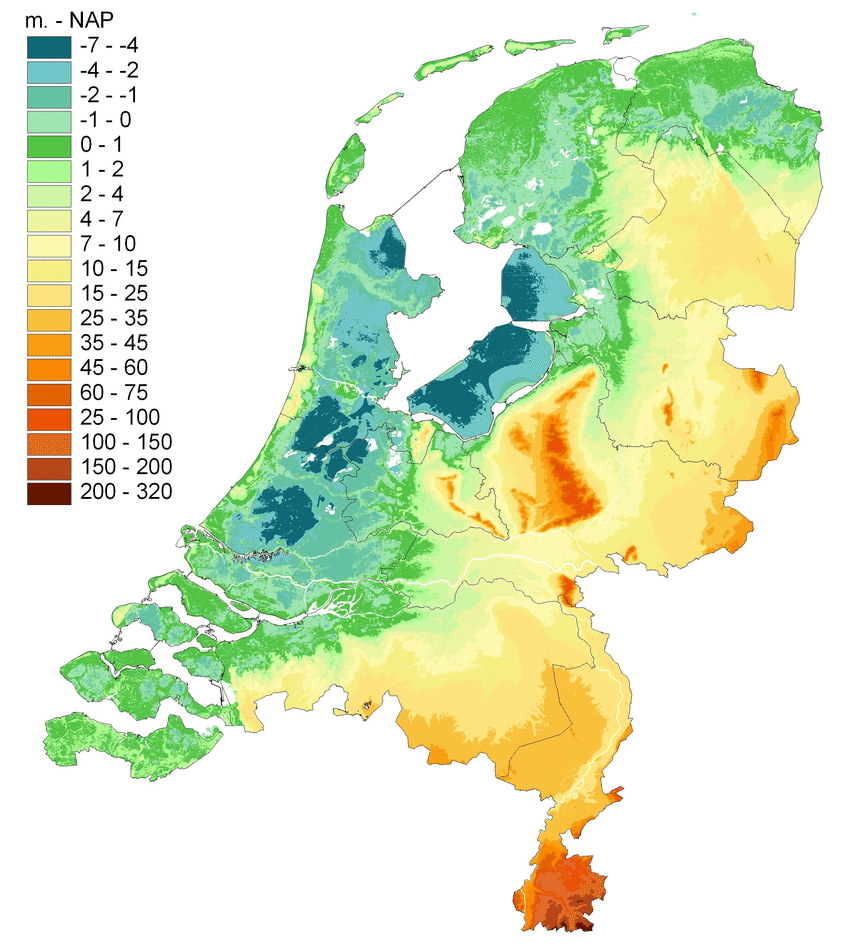
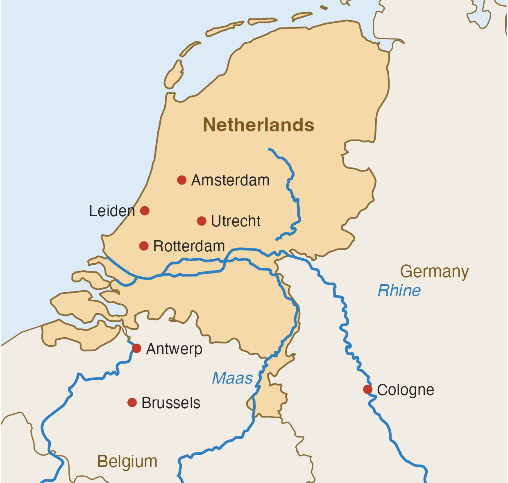
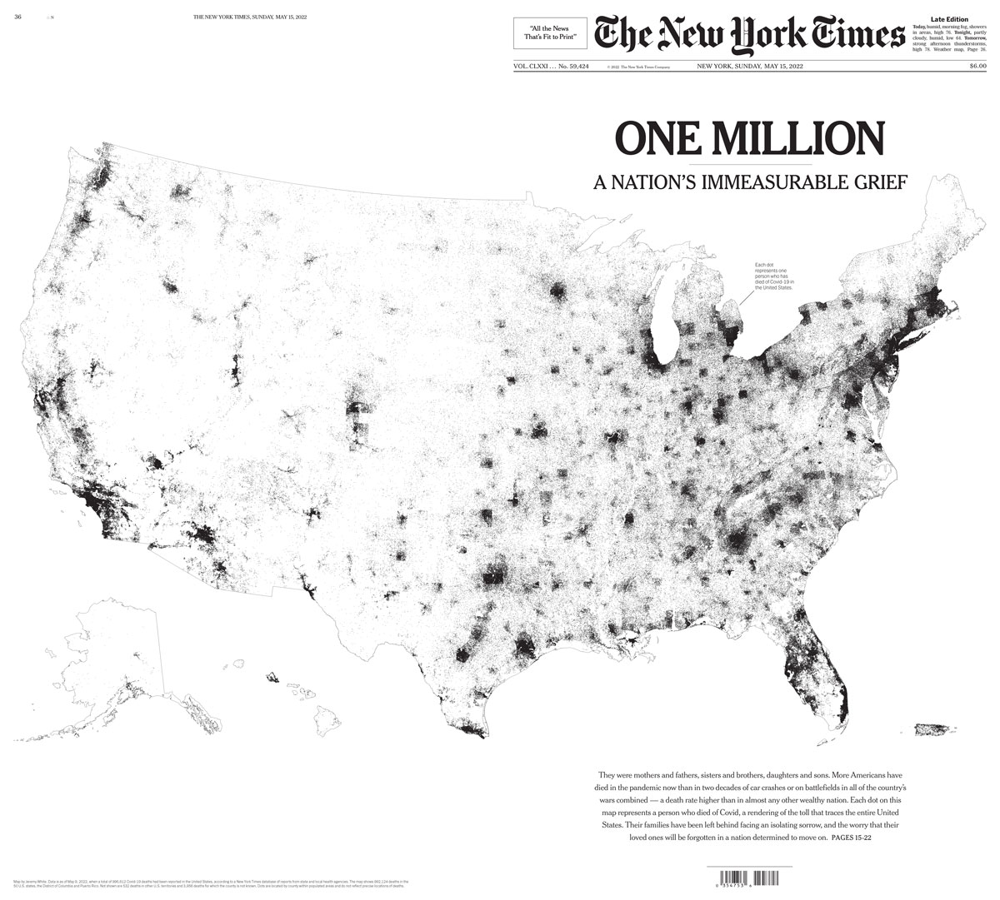
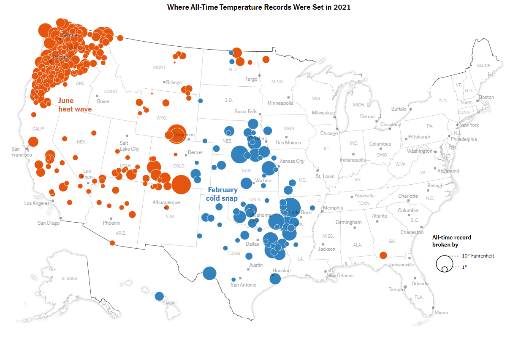
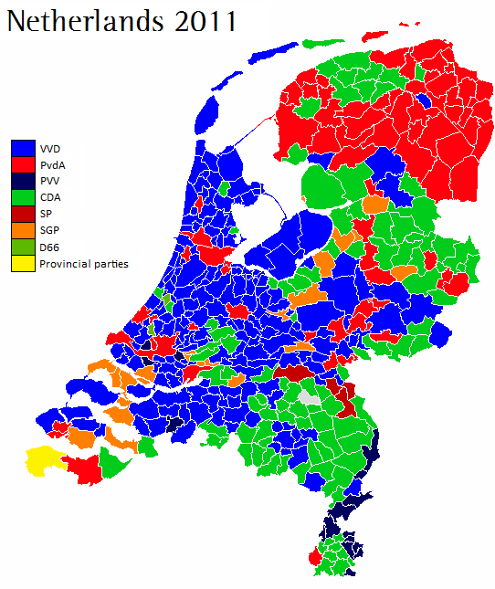
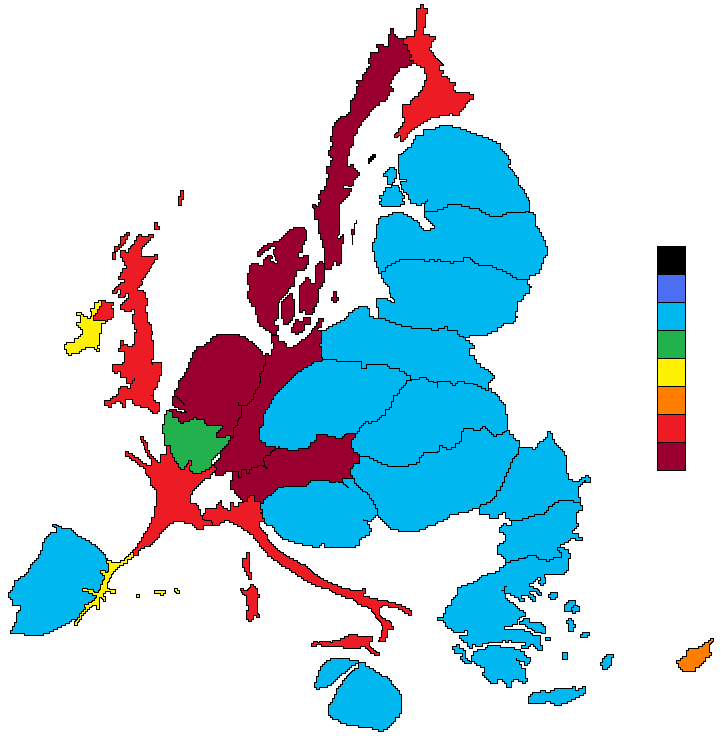
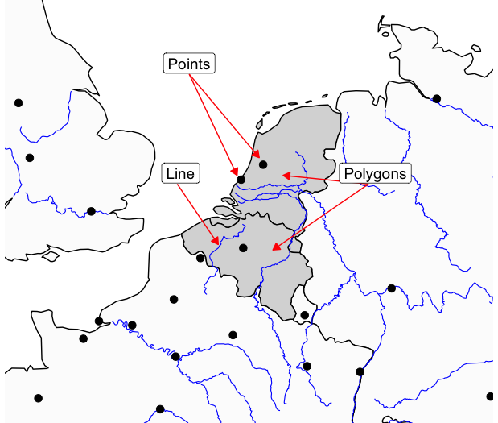
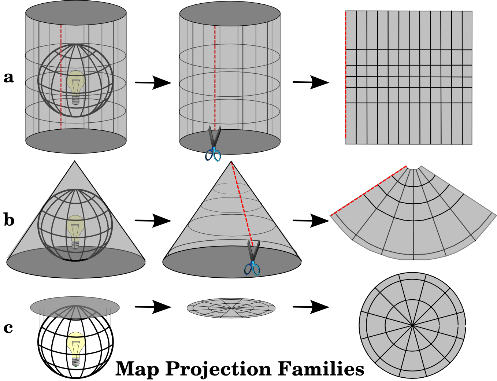
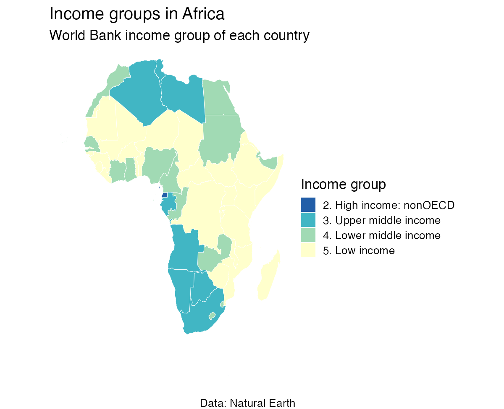

## Today

```{webr-r}
#| context: setup

library(dplyr)
library(ggplot2)
library(sf)
library(rnaturalearth)
options(width = 80, pillar.print_min = 5, pillar.print_max = 5)
theme_set(theme_grey(base_size = 16))

worldmap <- ne_countries(scale = 'medium', returnclass = 'sf')
```

1.  Maps as data visualisation
2.  Your first map + practice
3.  Zooming in + practice
4.  Projections + practice
5.  Normalising with `mutate()` + practice
6.  Make this map
7.  Report 2
8.  Your turn

::: notes
Open the deck a few minutes before class: the setup loads sf and downloads the Natural Earth map, which is the slowest setup of the course in the browser. The answers to each Try it yourself are in these notes. Rough timing for two hours: maps as data visualisation 15 min, first map 20 + practice 8, zooming 10 + practice 6, projections 15 + practice 5, normalising 5 + practice 10, make this map 15, Report 2 10, then your turn. Each practice slide has more tasks than most will finish: stop when about half the room has done the first two. If time runs short, the CRS slide can go: Thursday next week's points-map chapter needs it, but it's explained there again.
:::

# Maps as data visualisation {.section-break}

Chapter 57

## A map is a chart

::: columns
::: {.column width="55%"}
You already know almost everything:

-   the same tool: **ggplot2**
-   the same idea: map data to **aesthetics**
-   new: **position** is a real place on the earth
-   new: a kind of data that knows about **geography**
:::

::: {.column width="45%"}
**Three classes**

1.  **Today:** your first map, projections
2.  **Tue 1 Dec:** choropleths: join your own data to a map
3.  **Thu 3 Dec:** points maps, from coordinates
:::
:::

::: predict
**Before you make a map, ask:** does location actually matter for this question? If not, a bar chart is often clearer
:::

::: notes
The book's running example over the three classes is the UNESCO World Heritage List (about 1,200 sites). Today uses only the Natural Earth world map. Ask: who has a Report 1 dataset with a place column? That's a candidate for Report 2.
:::

## Raster maps

::: columns
::: {.column width="45%"}
{height="420px" fig-alt="An elevation map in which each pixel is shaded according to the height of the land."}
:::

::: {.column width="55%"}
A **grid of pixels**, like a photo. Each pixel has a colour, and the colour means something: here, the height of the land

-   a scanned historical map
-   a satellite image
-   an elevation map

::: predict
The computer doesn't know where 'the Netherlands' is: only that some pixels are green
:::
:::
:::

::: notes
We only use vector maps on the course. A scanned seventeenth-century map is raster: to use it as data someone has to trace it (georeferencing, vectorising), which is mentioned only in passing.
:::

## Vector maps

::: columns
::: {.column width="50%"}
{height="560px" fig-alt="A map of the Low Countries: countries drawn as filled shapes with brown borders, the Rhine and Maas as blue lines, and Amsterdam, Rotterdam, Utrecht, Leiden, Antwerp, Brussels and Cologne as red points."}
:::

::: {.column width="50%"}
::: {style="font-size: 0.72em;"}
Every shape is stored as **coordinates**: longitude, latitude

| | | stored as |
|----|----|----|
| [●]{style="color:#c0392b"} Amsterdam | **point** | one pair: `4.90 52.37` |
| [━]{style="color:#2f7fc1"} Rhine | **line** | pairs joined in order: `8.23 48.97, 8.26 48.99, 8.28 49.01, ...` |
| [■]{style="color:#d9a85b"} Netherlands | **polygon** | a line that closes: 12 shapes (mainland and islands), 262 pairs |

: {tbl-colwidths="[30,18,52]"}
:::

::: predict
Each shape is a **row**, so we can attach data to it: population, votes, number of museums
:::
:::
:::

::: notes
The map is drawn from Natural Earth data with ggplot2: countries and rivers from Natural Earth, city coordinates typed in by hand. The coordinates in the table are real: the first three points of Natural Earth's Rhine (near Karlsruhe), and the Netherlands at the 'medium' scale we use today. This is the key point of the whole section: a vector map knows that this shape is the Netherlands, which is what makes it a data visualisation. Today we use polygons (countries); Thursday next week, points.
:::

## Points maps

::: columns
::: {.column width="45%"}
{height="400px" fig-alt="A map of the United States made of millions of tiny black dots, one for each Covid death, densest in the big cities."}

::: small
One dot per Covid death in the US
:::
:::

::: {.column width="55%"}
{height="400px" fig-alt="A map of the United States with red and blue circles of different sizes, showing where heat and cold records were broken."}

::: small
*New York Times*: temperature records broken. Colour = heat or cold, size = by how much
:::
:::
:::

::: predict
**Discuss:** what does the left-hand map show, apart from Covid deaths?
:::

::: notes
It shows where people live. A points map of almost anything counted by person is a population map in disguise (the xkcd 'heatmap' comic is in the chapter). The NYT one maps two more aesthetics onto each point: colour (category) and size (amount), exactly as a scatter plot would.
:::

## Choropleth maps

::: columns
::: {.column width="45%"}
{height="480px" fig-alt="A map of Dutch municipalities, each coloured by the party with the most votes. Much of the map is dark blue, the colour of the VVD."}
:::

::: {.column width="55%"}
Regions coloured by data: here, the party with the most votes in each municipality, 2011 provincial elections

::: predict
**Predict:** about half the map is VVD blue. What share of the votes did the VVD get?
:::
:::
:::

::: notes
About one fifth. The map gives every square kilometre the same weight, but votes are cast by people: the VVD did well in large, thinly populated rural municipalities. The rule: the same amount of ink should stand for the same amount of data, and choropleths often break it.
:::

## The trouble with choropleths

::: columns
::: {.column width="50%"}
**Normalise the data**

-   not *sites*, but sites **per million people**, or **per km²**
-   otherwise big countries look like 'more' of everything
-   what you divide by is a choice too (Tuesday)
:::

::: {.column width="50%"}
**Distort the map**

{height="330px" fig-alt="A cartogram of the European Union in which countries are stretched or shrunk according to their contribution to the EU budget."}

::: small
A cartogram: EU countries resized by budget contribution per person, 2007-13
:::
:::
:::

::: notes
Normalising is the one they'll actually do, on Tuesday, with mutate(). Cartograms are for recognising, not making, on this course.
:::

## Every map is a choice

::: {style="font-size: 0.85em;"}
-   Which **places** are included, and which left off?
-   Which **borders**, from which year? Many are **contested**
-   Which **projection**? (later today)
-   Which **data**, normalised by what?
:::

::: predict
Remember Tuesday's refugee maps: **arrows** or **circles**? The same data, a different argument
:::

::: notes
Maps feel more objective than charts because they look like a picture of the world. Natural Earth, which we use today, has a documented policy of drawing the borders that are in control on the ground ('de facto'), which is itself a position on contested places such as Kashmir or Western Sahara. Name one example and move on; it comes back in Report 2's limitations section. A smaller example from today's data: the Falkland Islands get their own row, with the UK's income group.
:::

# Your first map {.section-break}

Chapter 58

## Getting a map

```{webr-r}
worldmap <- ne_countries(scale = 'medium', returnclass = 'sf')

worldmap |>
  select(name, continent, pop_est)
```

::: small
**sf**: lets R work with geographic data · **rnaturalearth**: ready-made maps from [Natural Earth](https://www.naturalearthdata.com/)
:::

::: predict
**Look:** we only selected three columns. How many are there?
:::

::: notes
Four: geometry is still there. In an sf object the geometry 'sticks' to every row whatever you do to it. Each row is a feature (here, a country); 242 rows, because it includes territories (Greenland, the Falklands, Jersey) and one row for Antarctica. The 'Geodetic CRS: WGS 84' line comes back in the projections part. scale can be 'small' or 'medium'; 'large' needs an extra package.
:::

## It's just a dataframe, with shapes

::: columns
::: {.column width="50%"}
{fig-alt="Examples of point, line and polygon geometries."}
:::

::: {.column width="50%"}
-   one row = one **feature**
-   ordinary columns: `name`, `continent`, `pop_est`, `income_grp` ...
-   `geometry`: the coordinates that draw the shape
-   point, line, polygon, or **multipolygon** (a mainland and islands)
:::
:::

::: notes
So all of dplyr works: filter(), mutate(), arrange(), and on Tuesday left_join(). That's the whole trick of this part of the course.
:::

## `geom_sf()`

```{webr-r}
ggplot() +
  geom_sf(data = worldmap)
```

::: predict
**Why** is there no `aes(x = ..., y = ...)`?
:::

::: notes
geom_sf() reads the positions from the geometry column. That's exam-style question 3 at the end of the chapter. The axes are longitude and latitude in degrees.
:::

## dplyr works on maps

```{webr-r}
worldmap <- worldmap |>
  filter(continent != 'Antarctica')

ggplot() +
  geom_sf(data = worldmap)
```

::: notes
Note that we overwrite worldmap here, so every later slide is without Antarctica. If anyone is running the cells out of order and gets Antarctica back, that's why.
:::

## Africa {.try-it}

Make a map of only the countries of Africa

```{webr-r}
worldmap |>
  filter(___) |>
  ggplot() +
  geom_sf()
```

::: notes
filter(continent == 'Africa'): 54 countries. Two equals signs, and quotation marks: the same mistakes as in week 2. Note the pipe into ggplot() puts the data in ggplot(), so geom_sf() doesn't need data =: both ways work, but the book mostly uses geom_sf(data = ...) because maps often have several layers from different data.
:::

## Filling by data

```{webr-r}
ggplot() +
  geom_sf(data = worldmap, aes(fill = continent))
```

::: predict
**Predict:** what changes if `fill = pop_est`?
:::

::: notes
A numeric column gives a continuous (blue gradient) scale instead of a categorical one. Change it live. China, India and the US stand out (1.40bn, 1.37bn, 0.33bn): a map of big countries with lots of people, which is the problem we come back to on Tuesday.
:::

## Inside or outside `aes()`?

Same rule as every chart. For polygons: **`fill`** is the inside, **`colour`** is the border

```{webr-r}
#| fig-height: 3.3
ggplot() +
  geom_sf(data = worldmap, aes(fill = pop_est), colour = 'white', linewidth = 0.1) +
  scale_fill_viridis_c() +
  labs(title = "Population of the world's countries", fill = 'Population') +
  theme_void()
```

::: notes
theme_void() removes the grey background, grid lines and the latitude/longitude labels: usually not needed on a map. scale_fill_viridis_c() is the colour-blind safe sequential scale from Tuesday. The legend shows 1.0e+09 etc.; the chapter's version adds labels = scales::label_number(scale = 1e-6, suffix = 'm') to give 1,000m, left out here to keep the slide short. If someone puts colour = 'white' inside aes(), they get a legend saying "white" and pinkish borders: the week 3 mistake.
:::

## Income groups {.try-it}

Fill by `income_grp`, with thin grey borders, a title, a better legend title and `theme_void()`

```{webr-r}
ggplot() +
  geom_sf(data = worldmap, aes(fill = income_grp))
```

::: notes
geom_sf(data = worldmap, aes(fill = income_grp), colour = 'grey50', linewidth = 0.1) + labs(title = 'Income groups of the world', fill = 'Income group', caption = 'Data: Natural Earth / World Bank') + theme_void(). Five groups, numbered 1-5 so they sort in order. Ask: is this categorical or ordered? It's ordered, so a sequential palette (scale_fill_viridis_d() or scale_fill_brewer(palette = 'YlGnBu')) suits it better than the default rainbow. A few small territories are '2. High income: nonOECD' with odd data; don't get pulled into it.
:::

## Practice: your first map {.your-turn}

**Chapter 60, Practice exercises: exercises 1-3**

::: {style="font-size: 0.85em;"}
1.  Filter to Asia and map it
2.  Fill by continent, with white borders
3.  A title and `theme_void()`
:::

::: small
They run in the browser and check your answer. Open the chapter in the course book; the map data takes a few seconds to load the first time
:::

::: notes
About 8 minutes. The exercises are checked against the model code (grade_this_code), so the feedback can be strict about the exact form: if someone has a working map that doesn't pass, compare with the hint. Then Find the bugs as a whole class.
:::

## Find the bugs {.try-it}

This should be a map of Europe with white borders and no background. Find **three** bugs

```{webr-r}
#| fig-height: 3.6
ggplot() +
  geom_sf(data = worldmap, aes(fill = continent, colour = 'white')) +
  coord_sf(xlim = c(34, 72), ylim = c(-25, 45))
  theme_void()
```

::: notes
(1) colour = 'white' is inside aes(): a legend called 'colour' appears with one entry, 'white', and the borders are ggplot's default pink-red. Move it outside. (2) xlim and ylim are swapped: this is 34-72 E and 25 S to 45 N, so East Africa and the Arabian peninsula. Europe is xlim = c(-25, 45), ylim = c(34, 72). (3) No + before theme_void(): the map draws without it, and theme_void() runs on its own line and prints a long list of theme settings (or nothing visible in webR). The same three kinds of bug as the exam's Part A: aesthetics in the wrong place, wrong values, broken pipe/plus.
:::

# Zooming in {.section-break}

## Filter Europe? {.try-it}

```{webr-r}
europe <- worldmap |>
  filter(continent == 'Europe')
```

::: predict
**Predict** first: what will `ggplot() + geom_sf(data = europe)` look like? Then run it
:::

```{webr-r}
ggplot() +
  geom_sf(data = europe)
```

::: notes
Not a map of Europe: France includes French Guiana (and in this data, also Réunion and other overseas parts), and Russia stretches to the Pacific, so the map runs from -180 to 180 degrees longitude. Filtering chooses the data, not the view.
:::

## `coord_sf()`: choose the view

```{webr-r}
ggplot() +
  geom_sf(data = worldmap) +
  geom_sf(data = europe, fill = 'steelblue') +
  coord_sf(xlim = c(-25, 45), ylim = c(34, 72))
```

::: small
`xlim`: **longitude**, west to east · `ylim`: **latitude**, south to north · west of Greenwich and south of the equator are negative · right-click in Google Maps for coordinates (latitude first!)
:::

::: notes
Two layers: the world in grey, then Europe in blue on top. Layers draw in order, so the top one comes last. Neighbouring countries at the edges help readers find their way. Zooming doesn't change the data: a colour scale is still based on all the countries, including the ones off-screen; filter first if that matters.
:::

## Scandinavia {.try-it}

Change the limits to zoom in on Scandinavia

```{webr-r}
ggplot() +
  geom_sf(data = worldmap) +
  coord_sf(xlim = c(-25, 45), ylim = c(34, 72))
```

::: notes
Something like xlim = c(4, 32), ylim = c(54, 72). Ask whether to include Iceland (-25 to -13) and Finland: 'Scandinavia' is itself a choice about borders. Notice how stretched it looks: that's the projection, which is next.
:::

## Filter or zoom? {.try-it}

What's the difference between these two maps?

``` r
worldmap |> filter(continent == 'Asia') |> ggplot() + geom_sf()

worldmap |> ggplot() + geom_sf() + coord_sf(xlim = c(25, 150), ylim = c(-10, 60))
```

::: notes
The first draws only countries with continent 'Asia', and the map stretches to fit all of them (Russia is in Europe in this data, so it's not there). The second draws all countries but only shows 25-150 E and 10 S to 60 N, so parts of Europe, Africa and Russia are visible at the edges. This is exactly a Part A/B exam question.
:::

## Practice: zooming {.your-turn}

**Chapter 60, Practice exercises: exercises 4-5**

::: {style="font-size: 0.85em;"}
4.  Zoom in on the Mediterranean with `coord_sf()`
5.  Highlight the Netherlands: the world in grey, the Netherlands in orange on top
:::

::: small
They run in the browser and check your answer. Open the chapter in the course book; the map data takes a few seconds to load the first time
:::

::: notes
About 6 minutes. Exercise 5 is the two-layer pattern from the coord_sf() slide: both fills are fixed colours, so outside aes(), and the top layer comes last. For anyone who finishes early: fill the world by pop_est and zoom to Europe. Why is it all one colour? (The scale still runs up to China; filter to Europe first.)
:::

# Projections {.section-break}

Chapter 59

## Flattening an orange

Every projection distorts **area**, **shape** or **distance**. Choosing one means choosing what to distort

{fig-align="center" height="380px" fig-alt="Diagram showing a globe projected onto a cylinder, a cone, and a flat plane, each then cut and flattened into a map."}

::: notes
Our maps so far: longitude straight onto x, latitude onto y (the 'plate carrée'), which stretches everything away from the equator. That's why Scandinavia looked wide.
:::

## Mercator

```{webr-r}
ggplot() +
  geom_sf(data = worldmap) +
  coord_sf(crs = '+proj=merc')
```

::: predict
**Predict:** how many Greenlands fit into Africa?
:::

::: notes
About 14 (13.9, from the areas in this dataset: Greenland 2.15 million km², Africa about 30 million). Greenland is slightly smaller than the Democratic Republic of the Congo alone (2.33 million km²). Mercator preserves shape and compass direction, so a straight line is a constant bearing, which is why it was made for navigation (1569). Google Maps uses it because shapes look right when you zoom into a street. For a data map, it makes Europe and North America look bigger, and so more important, than they are.
:::

## Equal area

```{webr-r}
ggplot() +
  geom_sf(data = worldmap) +
  coord_sf(crs = '+proj=eqearth')
```

::: small
**Equal-area** (Equal Earth, Mollweide): sizes right, shapes bent. Use for **choropleths** · **Compromise** (Robinson, Winkel Tripel): nothing exact, nothing too wrong. Good for general world maps
:::

::: notes
Compare Greenland and Africa with the last slide. In a choropleth the reader judges partly by how much area is coloured, so the projection shouldn't add or remove area. Equal Earth was designed in 2018 as a good-looking equal-area alternative. Robinson: '+proj=robin'.
:::

## Pick a projection {.try-it}

Fill by continent, then try `'+proj=moll'` (Mollweide) and `'+proj=wintri'` (Winkel Tripel). Which do you prefer?

```{webr-r}
ggplot() +
  geom_sf(data = worldmap, aes(fill = continent)) +
  coord_sf(crs = ___)
```

::: notes
coord_sf(crs = '+proj=moll'). Mollweide is an oval, equal-area; Winkel Tripel is a compromise, National Geographic's world map since 1998. The crs text needs quotation marks. Extra: what would you choose for a choropleth of museums per person? Equal-area.
:::

## Smaller areas: EPSG codes

```{webr-r}
ggplot() +
  geom_sf(data = worldmap) +
  coord_sf(crs = 3035,
           xlim = c(-15, 50), ylim = c(35, 72),
           default_crs = 4326)
```

::: small
**3035**: Eurostat's equal-area projection for Europe · **28992**: the Netherlands ('RD New') · search '[country] EPSG'. A projected map is measured in **metres**, so `default_crs = 4326` says the limits are still longitude and latitude
:::

::: notes
Compare with the Europe map earlier: Scandinavia is no longer stretched, and the grid lines curve. If the edges get cut off, widen the limits a little: a box of longitude and latitude doesn't fit a curved grid neatly. Forgetting default_crs = 4326 gives an almost empty map, because the limits are read as a few metres around a point.
:::

## Coordinate reference systems

::: columns
::: {.column width="50%"}
**Geographic CRS**

-   longitude and latitude, in **degrees**
-   **WGS 84**, EPSG **4326**: GPS, and Natural Earth
:::

::: {.column width="50%"}
**Projected CRS**

-   a flat map, in **metres**
-   e.g. **3035**, **28992**
:::
:::

```{webr-r}
st_crs(worldmap)$input
```

::: notes
Most of the time ggplot handles it: all geom_sf() layers are converted to the CRS in coord_sf(), or that of the first layer. It matters when you make your own sf object from coordinates, which is Thursday's chapter (st_as_sf(..., crs = 4326)). st_transform() converts permanently; for drawing, coord_sf(crs = ...) does the same job. The full st_crs() output is long; $input just prints the name.
:::

## Practice: projections {.your-turn}

**Chapter 60, Practice exercises: exercises 6-7**

::: {style="font-size: 0.85em;"}
6.  The world in Equal Earth
7.  Europe in EPSG 3035, with `default_crs = 4326`
:::

::: small
They run in the browser and check your answer. Open the chapter in the course book; the map data takes a few seconds to load the first time
:::

::: notes
About 5 minutes. The common mistakes: quotation marks around the EPSG number (crs = '3035' fails differently from crs = 3035), and forgetting default_crs, which gives an almost empty map.
:::

# Normalising with `mutate()` {.section-break}

Bigger countries look like 'more' of everything

## People per square kilometre

An sf object is a dataframe, so `mutate()` works. Area first: measured on an **equal-area** projection

```{webr-r}
worldmap <- worldmap |>
  mutate(area_km2 = as.numeric(st_area(st_transform(worldmap, '+proj=eqearth'))) / 1000000,
         density = pop_est / area_km2)

worldmap |>
  select(name, pop_est, area_km2, density) |>
  arrange(desc(density))
```

::: predict
**Predict:** the top of the list is tiny places. What will a map filled by `density` look like?
:::

::: notes
st_area() and st_transform() are not in the book: tell them it's 'how to measure the area of each shape', and that it's done on an equal-area projection for the reason we just saw. In the exercises area_km2 is already provided. Top: Macao (about 28,000 per km²), Singapore (12,000), Maldives, Hong Kong, Monaco. The Netherlands 465, China 149, Canada under 4. A map filled by density is almost all one colour, because those tiny places stretch the scale: the same problem as zooming in on Europe with the world's population scale. Exercise 11 fixes it with if_else(area_km2 >= 10000, density, NA); next class (choropleths) does the same with sites per million, and bins the scale.
:::

## Practice: normalising {.your-turn}

**Chapter 60, Practice exercises: exercises 8-12**

::: {style="font-size: 0.85em;"}
8.  Population in millions
9.  People per km²
10. Map the density. What goes wrong?
11. **Stretch:** set the tiny places to `NA` with `if_else()`
12. **Stretch:** each country's share of its continent: `group_by()` + `mutate()`
:::

::: small
They run in the browser and check your answer. Open the chapter in the course book; the map data takes a few seconds to load the first time
:::

::: notes
About 10 minutes. These are checked by result, not code, so any correct mutate() passes. Exercise 12: Brazil is 49% of South America's population, Nigeria 15% of Africa's; each continent adds to 100, so a map of it compares within continents, not across. Anyone who finishes goes straight on to Make this map.
:::

# Make this map {.section-break}

Everything from today, in one map

## Make this map {.your-turn}

::: columns
::: {.column width="52%"}
{height="520px" fig-alt="A choropleth map of Africa in the Equal Earth projection, each country filled by its World Bank income group from dark blue (high income) to pale yellow (low income), with thin white borders, no background or axes, the title 'Income groups in Africa' and a caption 'Data: Natural Earth'."}
:::

::: {.column width="48%"}
```{webr-r}
#| fig-height: 4
# your code here

```

::: {style="font-size: 0.65em;"}
**Hints:** which rows? which column is the fill? borders? which projection? palette: `scale_fill_brewer(palette = 'YlGnBu', direction = -1)`
:::
:::
:::

::: notes
The answer (also in _scripts/make-week5-thu-target-map.R): africa <- worldmap |> filter(continent == 'Africa'); ggplot() + geom_sf(data = africa, aes(fill = income_grp), colour = 'white', linewidth = 0.2) + scale_fill_brewer(palette = 'YlGnBu', direction = -1) + coord_sf(crs = '+proj=eqearth') + labs(title = 'Income groups in Africa', subtitle = 'World Bank income group of each country', fill = 'Income group', caption = 'Data: Natural Earth') + theme_void(). direction = -1 reverses the palette so that richer is darker. 15 minutes, then ask someone to talk through their code. Things to ask the room: why equal-area here (it's a choropleth); is income_grp ordered or categorical (ordered, so a sequential palette); the one dark blue country is Equatorial Guinea (high income because of oil, with most of its people poor), so what does a country-level average hide?
:::

# Report 2 {.section-break}

Due Monday 14 December

## Report 2: a map

::: {style="font-size: 0.85em;"}
-   **1,200-1,500 words**, with **at least two maps**, plus other charts if you wish · **25%** of the grade
-   The **same dataset as Report 1**, or a new one: it needs a **place** column, or coordinates
-   As in Report 1: your question, where the data came from and how it was made, what you did to it, what the maps show, and the **limitations**
-   New for maps: **why a map?** · **which projection**, and why · **normalised** by what? · **whose borders**?
-   Submit the .Rmd **and** the knitted html, plus the data, as a **.zip** on Brightspace. It must knit from start to finish
:::

::: notes
From the Assessment section on the book's front page. Tuesday (choropleths) needs data with country or region names that can be joined to a map; Thursday (points maps) needs coordinates, or places that can be geocoded. Their Report 1 data might already have one: Nobel (birth country and city), Shakespeare and Company (member addresses, with coordinates), the Spotify data (no: a good example of a dataset for which a map makes no sense). The Data sources page has more, including Mapping Inequality. The reproducibility point from Tuesday: Report 2 is marked on whether it knits.
:::

## Pitch your map

In one or two sentences:

> I want to map **[what]**, by **[country / region / point]**, to find out **[question]**.

::: {style="font-size: 0.85em;"}
-   Does location actually matter for the question?
-   Does your data have **names** of places (a choropleth) or **coordinates** (a points map)?
-   Will a map of it just be a **population map**? What would you divide by?
:::

::: notes
If there's time, go round the room quickly, as with the Report 1 pitch. Otherwise ask them to write the sentence down and bring it on Tuesday, when they'll try joining their own data to a map. Listen for: no place column at all; place names that won't match a map (historical names, cities in a country-level map); counts that need normalising.
:::

# Your turn {.section-break}

## Your turn {.your-turn}

In the course book:

-   **Chapters 58-60**: Your first map, Map projections, and the practice exercises you haven't finished
-   **The exercise** at the end of chapter 58: South America, filled by income group, zoomed in, black borders, three colours with `scale_fill_manual()`, labels and `theme_void()`

::: predict
**Stuck?** `filter(continent == 'South America')` · `coord_sf(xlim = c(west, east), ylim = c(south, north))` · `colour =` outside `aes()` for borders · `scale_fill_manual(values = c(...))` needs as many colours as groups
:::

::: notes
South America has three income groups in this data: nine countries upper middle, three lower middle (Bolivia, Guyana, Paraguay), and one 'High income: OECD', which is the Falkland Islands, a British territory with the UK's income group. Hence three colours, and a good border question to ask about. Zoom: about xlim = c(-82, -34), ylim = c(-56, 13). Without zooming the map stretches west to -109, because of Chile's Pacific islands: the filter-vs-zoom point again.
:::

## Before Tuesday

**Home exercise 8** (chapter 61): GDP per person, an equal-area projection, and total vs per person. Ungraded, but the best practice for Report 2

**Report 2**: write your one-sentence pitch, and check your data has places in it

**Read** chapter 62, Choropleth maps, before class

**Practice exam**: keep going
