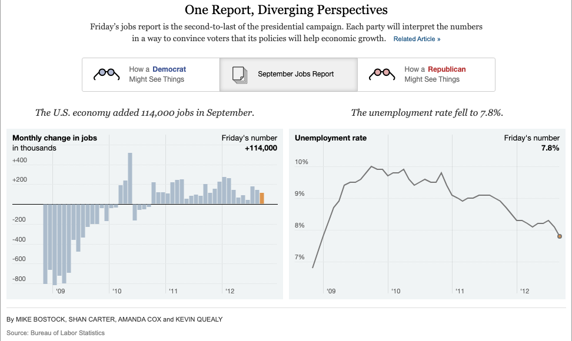
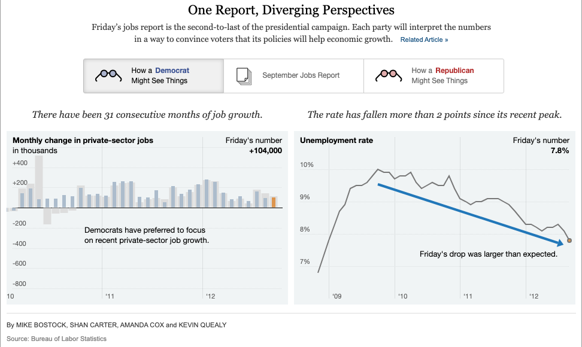
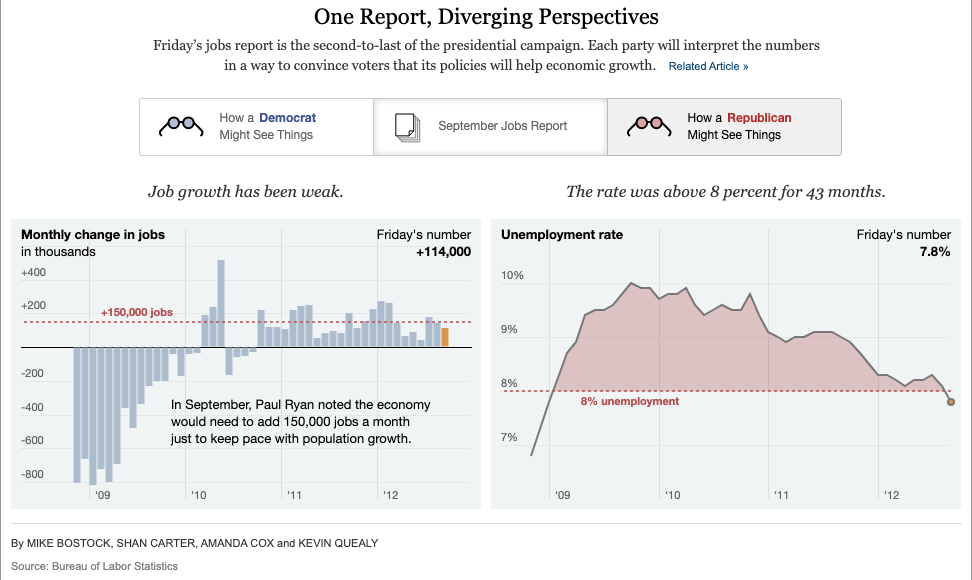
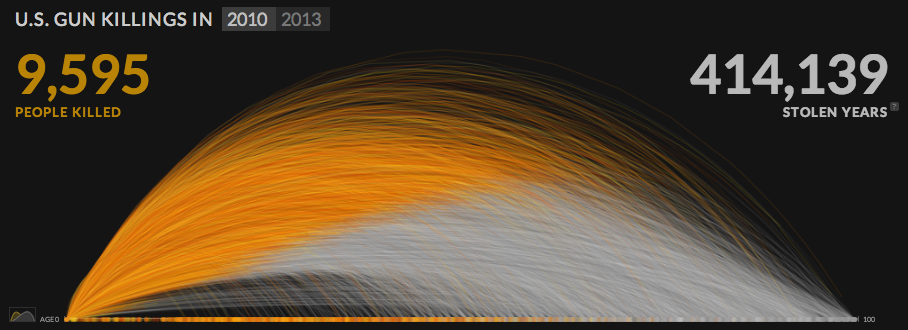
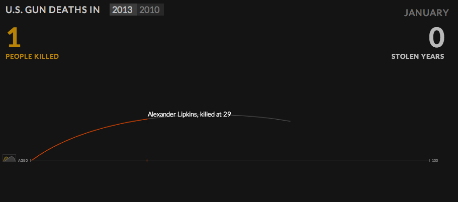
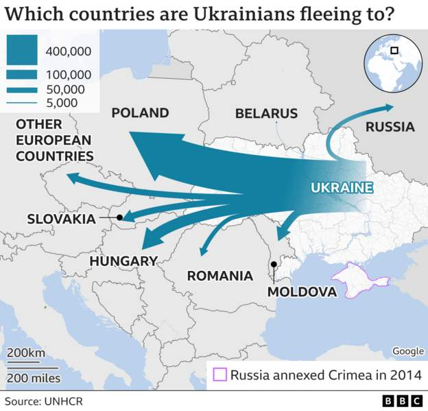
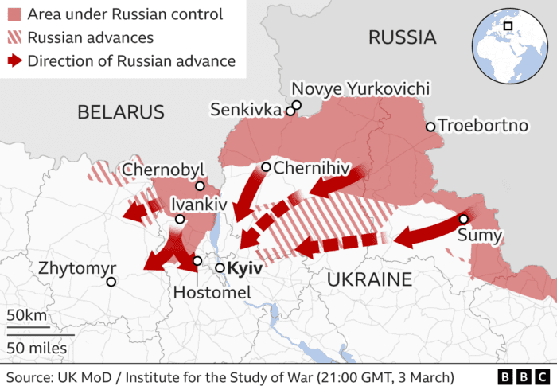
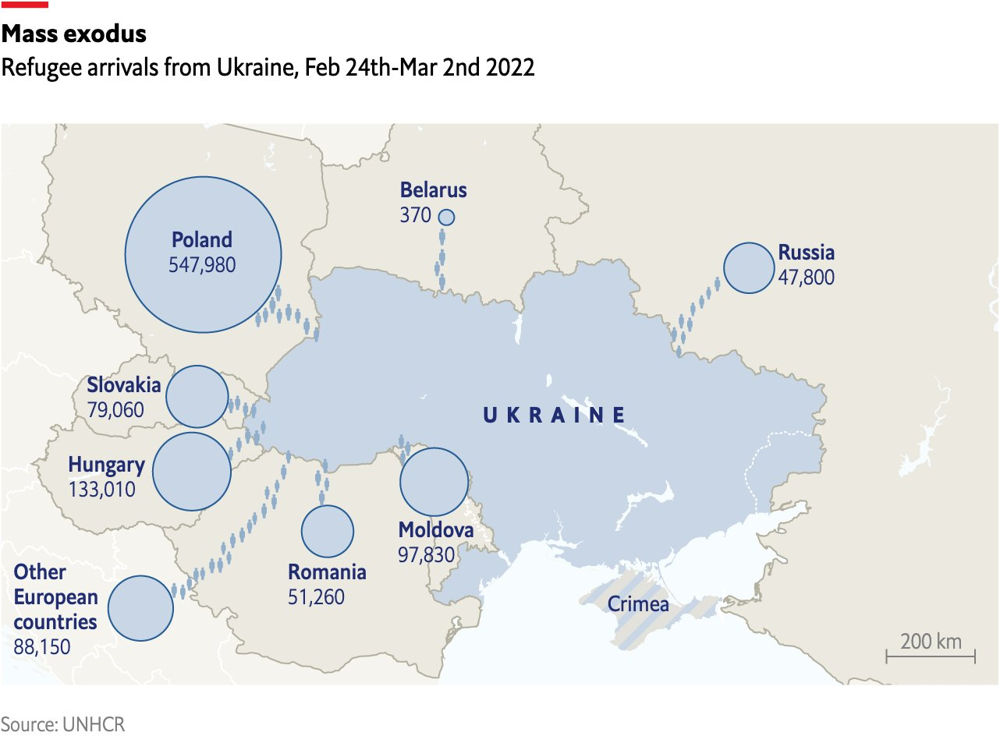

## Today

```{webr-r}
#| context: setup

library(dplyr)
library(readr)
library(ggplot2)
library(palmerpenguins)
options(width = 80, pillar.print_min = 8, pillar.print_max = 8)
theme_set(theme_grey(base_size = 16))

url <- "https://raw.githubusercontent.com/yann-ryan/infovis-course/master/titanic_df_full.csv"
download.file(url, "titanic_df.csv")
titanic_df <- read_csv("titanic_df.csv", show_col_types = FALSE)

paintings <- tibble(
  title = c("The Anatomy Lesson", "The Night Watch", "The Goldfinch",
            "The Milkmaid", "View of Delft", "Girl with a Pearl Earring",
            "The Jewish Bride"),
  artist = c("Rembrandt", "Rembrandt", "Fabritius", "Vermeer", "Vermeer",
             "Vermeer", "Rembrandt"),
  year = c(1632, 1642, 1654, 1658, 1661, 1665, 1665),
  museum = c("Mauritshuis", "Rijksmuseum", "Mauritshuis", "Rijksmuseum",
             "Mauritshuis", "Mauritshuis", "Rijksmuseum"),
  width_cm = c(217, 454, 23, 41, 118, 39, 167)
)

artists <- tibble(
  artist = c("Rembrandt", "Vermeer"),
  born = c(1606, 1632)
)
```

1.  Data and charts are not neutral
2.  Missing values
3.  FAIR data and reproducibility
4.  Accessibility
5.  Critique round 3
6.  Exam briefing
7.  TidyTuesday challenge

::: notes
Open the deck a minute before class: the setup downloads the Titanic data and loads ggplot2 and palmerpenguins, which is slow in the browser. Answers to each Try it yourself are in these notes. Rough timing for two hours: ethics and missing values 25 min, FAIR 5, accessibility 20, critique round 3 15, exam briefing 25, TidyTuesday challenge the remaining time (it can be finished at home). If time runs short, shorten the TidyTuesday part, not the exam briefing.
:::

# Data and charts are not neutral {.section-break}

Chapter 52: Ethics and data visualisation

## Data is not neutral

All data was collected by someone, for some purpose. Ask:

-   **Who** collected this data, and **why**?
-   What did they choose to record, and what did they **leave out**?
-   Who is in the data, and who is **missing**?

::: predict
**Discuss:** think of the dataset you used for Report 1. Can you answer all three?
:::

::: notes
The chapter's examples: Paine's table of the cost of a navy in Common Sense (1776), made to persuade; states counting populations to tax, conscript and decide who belongs. Many humanities datasets were collected by states, companies or colonial administrations for their own purposes. Ask two or three students about their Report 1 data: the Nobel data is made by the Nobel Foundation; Shakespeare and Company is a lending library's own records, transcribed by a research project.
:::

## Every chart is an argument

Choices you've already made in R:

::: {style="font-size: 0.85em;"}
-   **What to include:** `filter()` to one country, one period, one category
-   **Scales:** does the y axis start at zero?
-   **Titles and annotations:** a headline title tells the reader what to see; an arrow tells them where to look
:::

::: notes
Drucker: visualisations are taken as "what is", and we forget someone made them. Provenance rhetoric: a source line and a clean minimal design both lend authority, earned or not. Next two slides: one jobs report, three ways.
:::

## One report, three charts

{fig-align="center" height="560px" fig-alt="New York Times graphic from October 2012, neutral view: a bar chart of monthly change in jobs since 2008 and a line chart of the unemployment rate, falling to 7.8 percent."}

::: small
Mike Bostock, Shan Carter, Amanda Cox and Kevin Quealy, ["One Report, Diverging Perspectives"](https://archive.nytimes.com/www.nytimes.com/interactive/2012/10/05/business/economy/one-report-diverging-perspectives.html), *New York Times*, 5 October 2012
:::

::: notes
The September 2012 jobs report, a month before the presidential election. This is the neutral view: 114,000 jobs added, unemployment 7.8%. Click the Democrat and Republican buttons on the live page if the room has a connection; the next two slides show them.
:::

## How a Democrat might see it

{fig-align="center" height="600px" fig-alt="The Democrat view: private-sector jobs only, starting in 2010, captioned 'There have been 31 consecutive months of job growth', with a blue arrow showing unemployment falling since its peak."}

## How a Republican might see it

{fig-align="center" height="520px" fig-alt="The Republican view: a dotted line at 150,000 jobs that most months fall below, captioned 'Job growth has been weak', and the unemployment area shaded red above an 8 percent line, 'above 8 percent for 43 months'."}

::: predict
**Discuss:** the data is identical. What changed?
:::

::: notes
Democrat: only private-sector jobs, and the x axis starts in 2010, so the big losses of 2008-09 are gone; an arrow from the peak shows the fall. Republican: a reference line at 150,000 jobs (what's needed to keep up with population growth), so most bars look like failures; the area above 8% is shaded red. Changed: the period shown (filter), which series, reference lines, annotations, the captions. Each is a choice they've made themselves in ggplot this month: filter(), annotate(), geom_hline(), labs(). This doesn't mean avoiding a message: make the choices deliberately, and check the data supports the story.
:::

## Situated knowledge

::: {style="font-size: 0.85em;"}
-   **The 'god trick'** (Haraway): claiming to see everything from nowhere in particular
-   **Positionality** (Alcoff): we all come to knowledge from a position: gender, class, ethnicity, education, nationality...
-   **Strong objectivity** (Harding): being open about your perspective, and including those usually left out, makes research *more* objective
:::

::: predict
For your reports: say where the data came from, what you did to it, and what it can't tell you
:::

::: notes
All summarised from D'Ignazio and Klein, Data Feminism. Strong objectivity is not "anything goes"; it's transparency.
:::

## Emotion: *U.S. Gun Deaths*

::: columns
::: {.column width="62%"}
{fig-alt="Periscopic's visualisation of US gun killings in 2010: 9,595 people killed, 414,139 stolen years. Each person is an arc, orange up to the age they were killed and grey for the years they might have lived, thousands of arcs together."}
:::

::: {.column width="38%"}
{fig-alt="The animation's first arc for 2013: one named person killed at 29, the arc turning grey for the rest of an expected lifetime."}

::: small
The animation starts with one person at a time
:::
:::
:::

::: small
Periscopic, *U.S. Gun Deaths* (2013). Screenshots from Alberto Cairo, ["Periscopic's U.S. Gun Deaths"](https://www.peachpit.com/articles/article.aspx?p=2036558), Peachpit, 2013
:::

::: notes
Each arc is one person: orange from birth to the age they were killed, grey from there to the age they might have lived to. The total on the right is not deaths but "stolen years". The animation starts with one arc at a time, each with a name, before building up the total. The data is FBI Uniform Crime Report data, the same as a table of statistics. Ask: is this more honest than a bar chart, or less? The "might have lived" part is an estimate (Periscopic modelled it), and Cairo's article discusses how it shows that uncertainty. The site itself is no longer online.
:::

# Missing values {.section-break}

## An ethical decision that looks technical

In 2019 a paper in *Nature* argued that complex societies came *before* 'moralising gods'. Where the database had **no information**, the analysis treated it as **no gods**. Retracted in 2021.

```{webr-r}
titanic_df |>
  group_by(pclass) |>
  summarise(average_age = mean(age, na.rm = TRUE))
```

::: predict
**Predict:** if every missing age is replaced with 0, which class's average will drop the most?
:::

::: notes
In other words, NA was treated as zero. Averages leaving NAs out: 39.2, 29.5, 24.8. Let them guess before the next slide.
:::

## Making the mistake on purpose

```{webr-r}
titanic_df |>
  mutate(age = if_else(is.na(age), 0, age)) |>
  group_by(pclass) |>
  summarise(average_age = mean(age))
```

```{webr-r}
titanic_df |>
  group_by(pclass) |>
  summarise(total = n(), missing_age = sum(is.na(age))) |>
  mutate(percent_missing = round(missing_age / total * 100))
```

::: notes
Third class drops by over seven years (24.8 to 17.5); first by about five (39.2 to 34.4), second by under two (29.5 to 27.8). Because 29% of third-class ages are missing (208 of 709), against 12% in first and 6% in second. The data isn't missing at random: the records know least about the poorest passengers, so the error falls on one group. The chapter's histogram of ages with NA as 0 shows a spike of "babies" at zero: a chart makes this mistake easy to spot, if you look.
:::

## Whose data is missing? {.try-it}

The `cabin` column is also often missing. Who is missing a cabin number?

```{webr-r}
titanic_df |>
  group_by(pclass) |>
  summarise(total = n(), no_cabin = ___)
```

::: predict
What would happen to a chart of "passengers by deck" if you dropped the `NA`s?
:::

::: notes
no_cabin = sum(is.na(cabin)). First class 67 of 323 (21%), second 254 of 277 (92%), third 693 of 709 (98%). A chart by deck that drops the NAs would be almost entirely first-class passengers, and would look like a chart of the whole ship. Ask what this says about who made the records: cabin numbers survive mostly from first-class lists. Checklist from the chapter: check NAs first (sum(is.na(col))), never replace NA with zero unless "no data" really means none, ask whose data is missing, and say in the report how much was missing and what you did.
:::

## Arrows or circles?

::: columns
::: {.column width="33%"}
{height="330px" fig-alt="BBC map, early March 2022, 'Which countries are Ukrainians fleeing to?': thick teal arrows sweep out of Ukraine into Poland, Hungary, Slovakia, Romania, Moldova and Russia."}

::: small
BBC, refugees, March 2022
:::
:::

::: {.column width="33%"}
{height="330px" fig-alt="BBC map, 3 March 2022: red arrows showing the direction of the Russian advance on Kyiv."}

::: small
BBC, Russian advance, 3 March 2022
:::
:::

::: {.column width="33%"}
{height="330px" fig-alt="The Economist map 'Mass exodus', refugee arrivals from Ukraine 24 February to 2 March 2022: a circle in each neighbouring country sized by arrivals (Poland 547,980) with small person icons crossing each border."}

::: small
*The Economist*, refugees, March 2022
:::
:::
:::

::: small
All three collected by James Cheshire, ["More than arrows"](https://jcheshire.com/resources/more-than-arrows/) (2022), which has more alternatives
:::

::: notes
Same week, same news organisation: the first two maps use the same visual language for refugees and for an invading army. Arrows suggest force and threat at the destination. Cheshire's point (and The Correspondent's in 2020): news maps of migration with big arrows make readers more negative about migrants. The Economist shows arrivals as circles sized by number of people, with small person icons crossing the borders: the same UNHCR data. The BBC later changed its refugee map to circles after criticism. A good example for Thursday too: maps as arguments.
:::

## People and sensitive topics

::: {style="font-size: 0.85em;"}
-   **What do your shapes suggest?** Arrows for people look like arrows for armies
-   **Each data point is a person:** no sensationalist titles, jokey colours or decoration
-   **Show individuals** where you can
-   **Protect privacy:** could your chart identify a living person?
:::

::: predict
Data has also been used to challenge power: Du Bois's charts for the 1900 Paris Exposition; the Detroit Geographic Expedition (1971), who collected the data no one official had; ProPublica's investigation of a reoffending algorithm (2016)
:::

::: notes
And used to reinforce injustice: the 1930s redlining maps (Mapping Inequality is on the data page). Du Bois is one of the critique sheets, so his group can say more in a moment. Correll's checklist at the end of the chapter: make the invisible visible, show uncertainty, remember the people in the data, protect privacy, question power. It's the same list the critique round uses.
:::

# FAIR data and reproducibility {.section-break}

Chapter 53

## FAIR

::: columns
::: {.column width="50%"}
-   **F**indable: described, with keywords, easy to find
-   **A**ccessible: publicly available where possible
-   **I**nteroperable: standard formats (e.g. csv)
-   **R**eusable: documented well enough for someone else to use
:::

::: {.column width="50%"}
**Reproducibility, for your reports**

-   Include the data in the .zip
-   The .Rmd should knit from start to finish
-   Comment anything unclear
-   Include any extra files you made (e.g. for cleaning)
:::
:::

::: notes
Mostly they are the end users of FAIR data, but they can keep their own work FAIR by documenting what they did to it. Report 2 is marked on this: I (or anyone) should be able to open the folder and knit it. renv exists for versions; outside the scope of the course. The TidyTuesday challenge at the end asks them to judge a dataset against FAIR.
:::

# Accessibility {.section-break}

Chapter 54

## Who can't read your chart?

::: {style="font-size: 0.85em;"}
-   **Colour vision deficiency:** red-green affects about 8% of men and 0.5% of women
-   **Low vision:** contrast, text size
-   **Screen readers:** alt text
:::

| Scale | For | CVD-safe choice |
|----|----|----|
| Sequential | ordered numbers | `scale_colour_viridis_c()`, or a two-colour gradient |
| Diverging | numbers with a midpoint | avoid red-green: e.g. blue-orange |
| Qualitative | categories | ColorBrewer `Dark2`, `Set2`, `Paired` |

: {.striped}

::: notes
Sequential scales are affected least because they vary in lightness. The default ggplot blue gradient is hard for low vision: viridis is better. The chapter's map example is the 2020 US election, with red-blue diverging, which is fine for red-green CVD but the chapter asks how to improve it.
:::

## Colour scales {.try-it}

Make both charts colour-blind safe

```{webr-r}
ggplot(penguins, aes(x = bill_length_mm, y = flipper_length_mm,
                     colour = body_mass_g)) +
  geom_point(size = 3)
```

```{webr-r}
ggplot(penguins, aes(x = bill_length_mm, y = flipper_length_mm,
                     colour = species)) +
  geom_point(size = 3)
```

::: notes
First: + scale_colour_viridis_c(), or scale_colour_gradient(low = "lightyellow", high = "darkblue"). Second: + scale_colour_brewer(palette = "Dark2"). Better still for the second: don't rely on colour alone, add shape = species in aes(), or label the groups directly. The warnings about removed rows are the two penguins with missing measurements.
:::

## Contrast and alt text

::: columns
::: {.column width="45%"}
**Contrast** against white:

-   pure blue 8.6 : 1
-   pure red 4 : 1
-   pure green 1.4 : 1

Large text, sans serif, dark text, coloured text only when needed
:::

::: {.column width="55%"}
**Alt text**: chart type, the data, and what it shows

```{{r}}
#| fig.alt: "Scatter plot of bill length
#|   against flipper length for 342 penguins.
#|   Gentoo penguins have the longest
#|   flippers."
```

or `{r, fig.alt = "..."}`
:::
:::

::: notes
The template from the chapter: chart type, type of data, reason for including it; the source goes in the surrounding text, not the alt text. In R Markdown both forms work: the chunk header {r, fig.alt = "..."} is the one the chapter's screenshot shows. Ask for a one-sentence alt text for the species chart, then go into the critique round, which asks each group to write one for their sheet.
:::

# Critique round 3 {.section-break}

Accessibility and ethics: same groups, same sheets

## Critique round 3 {.your-turn}

::: {style="font-size: 0.8em;"}
**Accessibility**

1.  Which colours would be hard to tell apart with red-green CVD? Does meaning depend on colour alone?
2.  Enough contrast? Is the text big enough?
3.  Write a one- or two-sentence **alt text** for it

**Ethics**

4.  Who made it, when, for whom, and why? Is it trying to persuade, openly or not?
5.  Where does the data come from? Who or what is counted, and who is missing?
6.  What role does emotion play? · 7. Whose position does it represent, and yours?
8.  Pick one item from the ethics checklist: how well does it do?
:::

::: notes
The full questions are on the Critique gallery page. 10-12 minutes in groups, then one alt text from each group read out. Nightingale: red/blue/black wedges, the legend relies on colour, made to persuade the government (and openly so). Minard: colour is only two colours (advance/retreat), mostly safe; whose deaths are counted (soldiers of one army). Du Bois: made to challenge, openly; much of the data comes from official sources, collected by governments that enforced segregation. Snow: black bars on a map, no colour problem; the data was collected by Snow himself, to argue for water-borne cholera. Round 4, on Thursday, is maps as arguments, and a verdict.
:::

# Exam briefing {.section-break}

Tuesday 5 January 2027

## When, where, what

::: {style="font-size: 0.85em;"}
-   **Tuesday 5 January 2027, 13:00-15:00**, Universitair Sportcentrum, Hall 2
-   **Resit:** Tuesday 26 January 2027, 15:00-17:00, Lipsius 1.27
-   **Two hours**, worth **40%** of your final grade
-   **No R.** You read and reason about code; you don't run it
-   **A function reference sheet** is provided: you don't need to memorise function names or arguments
-   Everything is in the book: **Preparing for the Exam**, at the bottom of the menu, with a full practice exam
-   Check **MyTimetable** for changes
:::

::: notes
Things to confirm and add if they're settled: whether the exam is on paper or digital; whether students need to register for it; the university's rules on student ID and arriving late. The reports and checkpoints have no resit, only the exam. The reference sheet is the table in the exam prep chapter: it lists what each function does, not when to use it.
:::

## The four parts

| Part | What you do | Weight | Covers | Time |
|----|----|----|----|----|
| A | **Read the code**: predict the output, choose the right code, find the bug | 30% | Weeks 1-2 | ~35 min |
| B | **Code and charts**: what chart does this make; what would you change? | 20% | Weeks 3-4 | ~20 min |
| C | **Critique a visualisation**: problems, and how to fix them | 25% | Weeks 3-6 | ~30 min |
| D | **Plan an analysis**: a new dataset and a research question | 25% | All | ~30 min |

: {tbl-colwidths="[7,55,10,13,15]" .striped}

::: small
A and B have one right answer · C and D are open: there are many good answers · the times are a suggestion, roughly in proportion to the marks
:::

::: notes
The times add up to 115 minutes, leaving five to check. The most common way to lose marks is to spend too long on Part A and rush D, which is worth almost as much. Today's chapters are in Part C (accessibility, ethics) and Part D (missing data, whose data).
:::

## Example data

```{webr-r}
paintings
```

```{webr-r}
artists
```

::: notes
Seven Dutch seventeenth-century paintings. Years are the usual (sometimes approximate) dates, widths rounded to the nearest centimetre. Fabritius is deliberately missing from artists. The exam prints tables like these, small enough to follow every row by hand. The examples are new; the practice exam in the book uses different data, so they can still do it under time pressure at home.
:::

## Part A: read the code {.try-it}

Without running it: write out the table this produces

```{webr-r}
paintings |>
  group_by(museum) |>
  summarise(n = n(), widest = max(width_cm))
```

::: predict
And: which keeps only Vermeer's paintings after 1660? **a** `filter(artist == "Vermeer", year > 1660)` · **b** `filter(artist == "Vermeer" | year > 1660)` · **c** `filter(artist = "Vermeer", year > 1660)` · **d** `filter(artist == Vermeer, year > 1660)`
:::

::: notes
Two rows, three columns: Mauritshuis n = 4, widest 217; Rijksmuseum n = 3, widest 454. Alphabetical order. The method: write down what each line does to the table. Filter: a, two rows (View of Delft, Girl with a Pearl Earring). b: | means or, four rows, adding The Milkmaid (1658) and The Jewish Bride (a Rembrandt). c: an error, and dplyr says "This usually means that you've used `=` instead of `==`". d: "object 'Vermeer' not found", no quotation marks. A good answer to "what goes wrong" names the result. Students can paste each into the cell to check.
:::

## Part A: joins {.try-it}

How many rows? What happens to The Goldfinch?

```{webr-r}
paintings |>
  inner_join(artists, by = "artist") |>
  mutate(age = year - born)
```

::: predict
And with `left_join()` instead?
:::

::: notes
inner_join keeps only rows with a match in both: Fabritius isn't in artists, so The Goldfinch disappears, 6 rows. With left_join, all 7 rows stay, and The Goldfinch gets NA for born and age. Same lesson as the Titanic ages today: NA spreads through every calculation.
:::

## Part B: code and charts {.try-it}

Describe the chart this makes, before running it

```{webr-r}
ggplot(paintings, aes(x = artist)) +
  geom_bar()
```

::: predict
What would you change to (1) colour the bars by museum, and (2) make every bar the same height, showing the *share* in each museum?
:::

::: notes
Three bars, one per artist, height = number of rows: Fabritius 1, Rembrandt 3, Vermeer 3. geom_bar() counts rows itself. (1) aes(x = artist, fill = museum): fill, not colour, for bars; inside aes() because it comes from a column. (2) geom_bar(position = "fill"): each bar stacked to 1, so the y axis is now a proportion and should be relabelled.
:::

## Part C: critique a visualisation {.try-it}

```{webr-r}
ggplot(paintings, aes(x = title, y = width_cm, fill = title)) +
  geom_col() +
  coord_cartesian(ylim = c(20, 460), expand = FALSE)
```

::: predict
Find **four** problems. For each: **what** it is, **why** it matters, **how** to fix it
:::

::: notes
(1) The y axis starts at 20: bars are read by length, so the differences are exaggerated (The Goldfinch almost disappears). Remove coord_cartesian(). (2) The fill repeats the x axis: seven colours carrying no information, a redundant legend, and several hues that are hard to tell apart with CVD (today's chapter). Remove fill, or highlight one painting. (3) The titles overlap: put them on the y axis and order by width. (4) Column names as labels, no title, no source: labs(). The point of the what/why/how structure: "the colours are bad" earns very little; "the colours repeat the x axis and carry no information, and some can't be told apart by colour-blind readers, so remove them" earns the marks.
:::

## Part D: plan an analysis

A dataset of **letters** in a seventeenth-century correspondence network, one row per letter: `sender` · `recipient` · `sender_place` · `recipient_place` · `date` · `language`

**Question:** how did the geography of the network change between 1600 and 1700?

::: {style="font-size: 0.7em;"}
::: columns
::: {.column width="50%"}
**Steps**

1.  `mutate()` a year and a decade from `date`
2.  `count()` letters by `sender_place` and decade
3.  `left_join()` a table of places with coordinates; check for `NA`s
4.  `st_as_sf()`, then a **points map**, sized by letters, `facet_wrap()` by period
:::

::: {.column width="50%"}
**Problems** (explain two or more)

-   **Survival:** whose letters were kept? Is this the network, or the archive?
-   **Missing dates** can't go in a decade
-   **Place names** spelled many ways (*Den Haag*, *'s-Gravenhage*)
-   **Raw counts:** compare shares, not totals
:::
:::
:::

::: notes
Reveal the question first and give groups three minutes before talking through the answer (the answer columns are on the same slide; cover them or talk to the question first). The mapping steps come on Thursday and next week, which is why it's in the exam: Part D covers the whole course. What makes it strong: each step names a function and says why; the chart fits the question (where and when); the problems are specific to this data, with a consequence. Code doesn't have to be correct in Part D. Two problems explained properly beat ten one-word ones.
:::

## How to prepare

::: {style="font-size: 0.85em;"}
1.  **Do the practice exam** in the book (Preparing for the Exam): two hours, with the reference sheet, *before* reading the model answers
2.  **Check your understanding** boxes at the ends of chapters: the style of Parts A and B. Predict first, then run
3.  **Learning objectives:** the exam prep chapter has a checklist of what you should be able to do
4.  **Home exercises**, including the ungraded ones
5.  **Critique** the charts you see in the news, using the critique gallery questions
:::

::: notes
In Parts A and B there's one correct answer: show the working (the intermediate table) anyway. In C and D, marks for clear reasoning in the course's vocabulary; naming the function is enough, the code doesn't have to be perfect. Add whether a wrong final answer in A gets partial credit for correct working, if that's decided.
:::

# TidyTuesday challenge {.section-break}

Chapter 55

## TidyTuesday challenge {.your-turn}

In RStudio, a new R Markdown file. Pick a dataset (chapter 55 has three to start with: British literary prizes, Rolling Stone albums, refugees), then:

::: {style="font-size: 0.85em;"}
-   Explore it, and make **one** chart that answers a question
-   Make it **accessible**: a CVD-safe palette, readable theme, a caption and `fig.alt`
-   Answer: where does the data come from? How **FAIR** is it? What **ethical** questions does it raise? Whose data is **missing**?
:::

::: predict
**Stuck?** `sum(is.na(col))` inside `summarise()` to find missing values · `scale_colour_viridis_c()` / `scale_fill_brewer(palette = "Dark2")` · alt text: chart type, data, what it shows
:::

::: notes
Pick quickly: choosing the dataset is where the time goes. The refugees data is the one to raise the sensitive-topics points with (arrows, people as numbers). Not submitted; it can be finished at home.
:::

## Before Thursday

**Read** chapter 57: Maps as data visualisation

**Home exercise 7** (chapter 56): make a Nobel chart more accessible

**Practice exam:** start it, under time pressure

**Thursday 26 Nov:** Digital Mapping 1. Critique round 4, and Report 2 introduced
